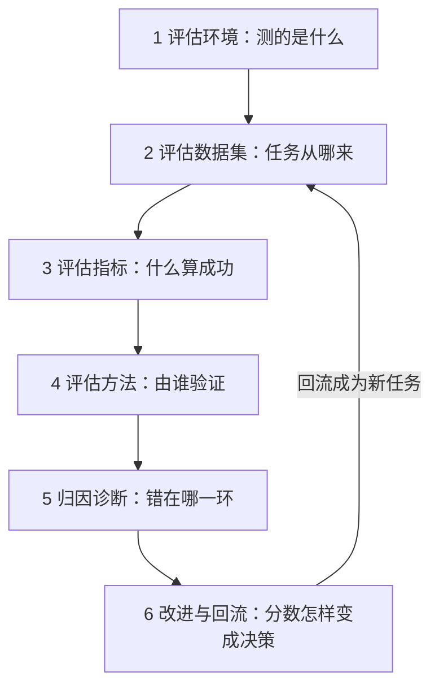
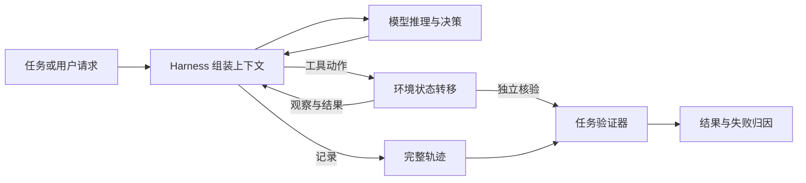
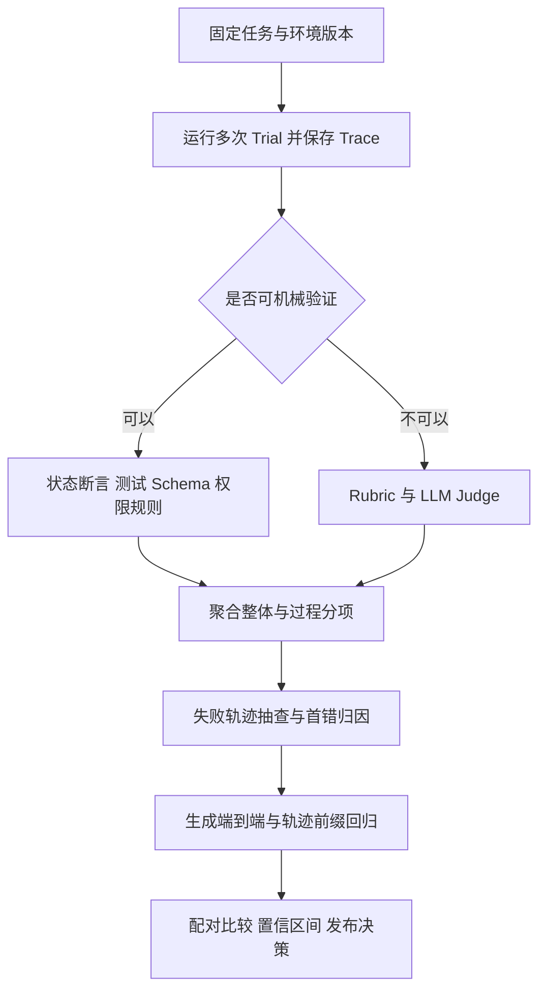

# Agent 评估体系设计与实践

Agent 能不能把事办成，不能只看它最后说了什么。客服 Agent 可以准确地说“退款已完成”，但订单状态并未改变；Coding Agent 可以报告“修复已验证”，却可能没有运行测试；RAG Agent 可以给出流畅答案，但引用内容并不支持结论。

评估是一条闭环，本文按这条环逐环展开：第 6 节改出来的东西，会以新任务的形式回到第 2 节再测一遍。

每一环都要交出一份能被下一环使用的产物，缺口通常就出在“某环没有产物”上。

| 环节     | 要回答的问题  | 产物                 |
| ------ | ------- | ------------------ |
| 1 评估环境 | 测的是什么   | 可重置、可验证的被测对象定义     |
| 2 数据集  | 任务从何而来  | 带契约和验证器的任务集        |
| 3 指标   | 什么算成功   | 可计算的口径，含可靠性与成本     |
| 4 评估方法 | 由谁验证    | grader、Judge 与评分结果 |
| 5 归因诊断 | 错在哪一环   | 部件分布、首错与回归用例       |
| 6 改进回流 | 分数如何变决策 | 发布决定，以及回流的新任务      |

第 7 节用一篇已上线的智能客服技术报告，把这六环在真实系统里对一遍。

## 1 评估环境：被测对象不是模型，是模型、Harness 与环境

Agent 系统至少分三层：模型按可见信息推理决策；Harness 组装上下文、暴露工具、编排与鉴权并记录轨迹；环境保存状态、执行动作并返回观察。一次运行不是一次文本生成，而是多轮交互造成的状态变化。

因此公开基准上的分数只是参考，实测到的是“模型、Harness、工具接口、环境与评分程序”的组合。换更强模型后分数不变，可据此怀疑瓶颈在工具描述、状态管理或观察信息；关掉某个记忆或路由组件后分数下降，才算证明它对当前任务分布有贡献。两种做法都要固定其余变量。

| 方法   | 固定什么           | 改变什么            | 回答的问题            |
| ---- | -------------- | --------------- | ---------------- |
| 模型替换 | Harness、环境、评测集 | 只换模型            | 瓶颈在模型还是在 Harness |
| 组件消融 | 模型、环境、评测集      | 关闭某个 Harness 部件 | 该部件贡献多少          |

环境本身也需要建模：要有可重置的初始状态、可观察的状态变化，以及能被验证器独立读出的终态。ARE 论文把评估环境实现为有状态 App、事件、通知与场景，其基准 Gaia2 支持状态重置、事件记录与异步变化，下图是它的环境结构。

*图 1  ARE 的 App、环境事件、通知与 Agent 交互结构。来源：Froger et al., [ARE: Scaling Up Agent Environments and Evaluations](https://arxiv.org/abs/2509.17158)。*

*对照：《AI Agents in Depth》第七章（李博杰）从评估环境解剖界定被测对象；Code as Agent Harness（arXiv:2605.18747）讨论 Harness 与环境的代码接口；本节交互图与方法表为本文整理。*

## 2 评估数据集：任务从哪来

### 2.1 一条任务先要有可复现的契约

一条可重复的 Agent 评估至少固定五项内容。

| 要素 | 要回答的问题 |
| --- | --- |
| 任务 | Agent 要解决什么 |
| 初始环境 | 从什么状态开始 |
| 可用动作 | 谁能做什么 |
| 执行协议 | 如何推进与何时结束 |
| 成功条件 | 哪些证据算成功 |

Anthropic 在[Agent Evals 指南](https://www.anthropic.com/engineering/demystifying-evals-for-ai-agents)中区分 task、trial、grader、transcript、outcome 与 evaluation harness。关键是 outcome 与 transcript 的区别：outcome 是运行结束后环境的实际结果，transcript 是完整交互记录；Agent 声称完成只是 transcript 的一部分，不等于 outcome 已达成。

*对照：五要素来自 Anthropic 官方指南的 task / trial / grader / transcript / outcome 划分，《AI Agents in Depth》第七章的任务契约与之同构，表格为本文整理。*

### 2.2 数据来源与环境决定分数代表什么

任务数据集依赖环境状态、工具接口、用户模拟、评分器与执行协议：人机交互型要有受任务事实约束的用户模拟器，工具型要有明确的权限与状态依赖，网页、桌面、代码 Agent 分别需要可重置网页、虚拟机或隔离容器。

数据集有三个来源，各有用途，不能把排行榜直接当产品成功率。

| 来源 | 用途 | 注意 |
| --- | --- | --- |
| 公开基准 | 粗筛模型、借鉴评测设计 | 分布与业务不一致，不直接用于产品决策 |
| 自建业务集 | 模型选型、Harness 设计决策 | 覆盖真实任务分布，需持续维护 |
| 生产轨迹回流 | 回归集主体 | 成本最高、准确性最高，需脱敏复核 |

设计要点四条：验证深度要核查机器可独立复核的事实而非 Agent 自述；难度分层要覆盖简单、多步与复杂组合并具备诊断价值；防泄漏要多源组合、参数化模板与 canary 标识；质量维护要发布前淘汰低质题、发布后持续修复环境、描述与验证问题。

| 任务环境 | 代表 Benchmark | 主要检验点 |
| --- | --- | --- |
| 对话与工具交互 | [τ-bench](https://arxiv.org/abs/2406.12045)、[τ²-Bench](https://arxiv.org/abs/2506.07982)、[ToolSandbox](https://arxiv.org/abs/2408.04682) | 多轮沟通、状态修改、政策遵循、协作 |
| 网页操作 | [WebArena](https://arxiv.org/abs/2307.13854)、[VisualWebArena](https://aclanthology.org/2024.acl-long.50/) | 浏览器观察、页面操作、跨步骤工作流、视觉定位 |
| 桌面与移动 | [OSWorld](https://arxiv.org/abs/2404.07972)、[AndroidWorld](https://arxiv.org/abs/2405.14573) | 多应用状态、GUI 操作、环境恢复、状态验证 |
| 软件与终端 | [SWE-bench](https://arxiv.org/abs/2310.06770)、[SWE-bench Verified](https://openai.com/index/introducing-swe-bench-verified/)、[Terminal-Bench](https://arxiv.org/abs/2601.11868) | 代码修改、测试是否真通过、命令行长任务 |
| 通用助手与动态环境 | [GAIA](https://arxiv.org/abs/2311.12983)、[Gaia2 / ARE](https://arxiv.org/abs/2509.17158) | 搜索、歧义、时间约束、动态事件、噪声 |

Benchmark 本身也要被验证。[Agentic Benchmark Checklist](https://arxiv.org/abs/2507.02825)把问题分为 task validity、outcome validity 与 reporting：任务要能测到声称的能力，评分要能区分真正成功与投机通过，报告要披露限制与统计不确定性。使用时至少检查空操作基线、oracle 解、状态重置、测试隔离、任务歧义与评分边界。

*对照：Benchmark 的选择与审计标准来自 Agentic Benchmark Checklist 与 Anthropic 官方指南；动态环境参考 ARE 论文与其基准 Gaia2；三来源表与设计要点为本文整理。*
## 3 评估指标：什么算成功，成本也算在里面

只报一个成功率无法定位问题，指标至少分四层，每层都要有明确口径。

| 层次 | 指标 | 定义或公式 | 适用 |
| --- | --- | --- | --- |
| 结果层 | 任务成功率 | 终态断言通过的任务数 / 总任务数 | 一切任务 |
| 结果层 | Pass@k | 同一任务 k 次独立采样至少一次成功，`1-(1-p)^k` | 能力上限、开放探索 |
| 结果层 | Pass^k | 同一任务 k 次全部成功，`p^k` | 客服、退款、支付等要稳定交付 |
| 结果层 | Best@k | k 次中的最好得分，用于连续得分任务 | 有分级得分的任务 |
| 结果层 | 部分完成率 | 已完成子目标数 / 总子目标数 | 多组件长任务 |
| 过程层 | 工具选择准确率 | 选对工具的次数 / 需要工具的步数 | 有工具的任务 |
| 过程层 | 参数合法率 | 通过 Schema 与类型校验的调用数 / 总调用数 | 函数调用 |
| 过程层 | 工具调用成功率 | 返回有效结果的调用数 / 总调用数 | 依赖外部服务 |
| 过程层 | 关键动作覆盖率 | 已完成的关键动作 / 必需关键动作 | 多步任务 |
| 过程层 | 禁止动作违反率 | 触发禁止动作的任务数 / 总任务数 | 合规与安全 |
| 过程层 | 无效步骤数 | 未推进目标的步数 / 总步数 | 效率诊断 |
| 过程层 | 首错位置分布 | 首个偏离目标行为的步号分布 | 失败归因 |
| 过程层 | 重规划触发正确率 | 应在环境反馈后重规划的步中正确重规划的比例 | 动态环境 |
| 沟通层 | 信息告知准确率 | 与环境状态一致的告知条目 / 应告知条目 | 人机交互型 |
| 沟通层 | 澄清正确率 | 该追问时追问且问对信息点的比例 | 需求模糊任务 |
| 沟通层 | 安全否决触发数 | 幻觉、越权、PII 泄漏等一票否决项触发次数 | 高风险场景 |
| 运营层 | TTFT / p95 时延 | 首 token 时间 / 95 分位总时延 | 体验与容量 |
| 运营层 | 每任务成本 | 输入输出 token 与工具费用合计 | 成本控制 |
| 运营层 | 成本-性能比 | 单位成功率所耗成本 | 选型与预算 |

Pass@k 与 Pass^k 的差别必须讲清。设单次成功率 `p=0.6`、`k=5`，则 Pass@5 `=1-0.4^5≈99.0%`，看起来几乎总能成功一次；Pass^5 `=0.6^5≈7.8%`，说明连续五次不出错仍然很难。[τ-bench](https://arxiv.org/abs/2406.12045) 的实验也显示，即便单次表现尚可，`pass^8` 仍可能低于 `25%`。前者衡量探索时的能力上限，后者才接近支付、退款这类要求稳定交付的场景；报告要写清 k 次尝试是同一任务独立采样，还是流水线上连续任务，对有副作用的操作应在沙盒或可回滚环境中采样。

过程与结果也要分开定义。结果回答“目标有没有达成”，例如退款是否落库、网络是否恢复；过程回答“必要约束有没有满足”，例如是否核验身份、是否选对账户、是否如实告知。两者不能平均成一个数：状态正确但未核身是关键失败；状态已变但错误告知用户则另记沟通失败。聚合方式（硬门槛、分项得分、复合成功率）取决于任务风险，报告里必须同时给出整体成功率与分项；阈值要来自业务风险与基线验证，不能从某个 benchmark 抄一个通用数字。

**成本属于运营层指标，难的是核算口径**。上表已列出每任务成本与成本-性能比，但成本会反过来改变选型，核算时至少要分三层。

| 成本层 | 构成 | 容易被忽视的放大因素 |
| --- | --- | --- |
| 模型推理 | 输入 / 输出 / 缓存 token 费用 | 多轮会把历史反复作为输入计费；思考 token 同样计费 |
| 工具调用 | 外部 API 费用、沙盒资源、返回内容注入上下文的 token | 一次搜索结果可能占数千 token，并在后续每轮重复计入 |
| 基础设施 | 向量库、消息队列、关系库、日志与追踪存储 | 观测与存储的长期开销 |

《AI Agents in Depth》（李博杰）给了一组值得当作模板的实测：一个固定的八轮客服退款任务，用 gpt-4o-mini，分别开关两种上下文优化。下表是**该书的实测数据，不是论文结果**。

| 方案 | 输入 token | 缓存 token | 总成本 | 相对基线 |
| --- | --- | --- | --- | --- |
| 无缓存、无压缩 | 20,700 | 0 | $0.003776 | — |
| 仅稳定前缀 | 20,386 | 13,568 | $0.002707 | -28.3% |
| 仅压缩历史 | 16,177 | 0 | $0.003115 | -17.5% |
| 稳定前缀 + 压缩 | 16,035 | 6,144 | $0.002643 | -30.0% |

两项优化不能简单相加：只开前缀省 28.3%，只压历史省 17.5%，同时开只省 30.0%，因为压缩历史同时缩短了可命中缓存的前缀。上下文优化必须在完整任务里一起实测。该书转述的 RE-Bench 结果同样说明：短预算下的领先不能直接外推到长时间运行，选型要在接近真实任务时长的多个预算点上比较（此条也是书的转述，不是论文原文）。

*对照：《AI Agents in Depth》第七章给出结果层与过程层划分、Pass^k 口径以及“成本分析”一节的实测数据；τ-bench 论文给出 `pass^8` 实测；RE-Bench 结论由该书转述。表格的分子分母写法为本文整理，引用时应回到各自原定义。*

## 4 评估方法：由谁验证

自动评估不是“让一个更强模型打分”。稳妥的顺序是：先用确定性检查解决可验证的部分，再把主观判断拆成明确 Rubric，最后用人工校准过的 Judge 处理无法机械判定的部分，并报告不确定性。

### 4.1 先用确定性验证器做硬检查

优先验证数据库状态、文件差异、测试结果、工具 Schema、权限策略与安全不变量，对应终态断言通过率、测试通过率、Schema 校验通过率与权限违规数。代码任务除新测试通过外还要看原有测试是否回归，测试脚本与 Agent 生成文件要隔离，避免 Agent 改了验证器却得高分；事务类任务的验证器必须查真实状态，而不是从最终答复推断交易已发生。

确定性 grader 也有边界：字符串完全匹配会误判语义正确而格式不同的答案；子串匹配会忽略否定词，或被“罗列所有可能答案”钻空子；状态匹配可能漏掉未授权副作用。所以验证器也是要测试的软件，要给它写负例、边界用例与对抗用例。

### 4.2 Rubric 和 LLM Judge 只接管适合它们的部分

开放式表达、解释是否清楚、复杂回答是否覆盖必需信息，通常没有唯一字符串答案。做法是先把评价拆成独立维度，每个维度给出判断标准、通过与失败例子、边界案例与一票否决条件；高风险项不能被其他优点平均掉。

Judge 应看到评分所需的任务、证据与 Rubric，而不是只看最终回答。对事实性问题先抽取可核验的事实主张，再分别比对工具输出、政策文件或参考证据；判分用结构化输出并要求指出证据位置；证据不足时允许返回“不确定”，而不是强迫它猜。

Judge 本身也要评估，核心是与人工标注的一致性。[MT-Bench 与 Chatbot Arena 研究](https://arxiv.org/abs/2306.05685)讨论了位置偏差、冗长偏差、自我偏好与推理能力限制。一致性可用 Cohen 的 κ 或 Fleiss 的 κ 度量并扣除随机一致；pairwise 评判应交换候选顺序并记录翻转率，翻转率过高说明结论不可靠。多模型裁判可作为审计手段，但不自动消除偏差。

### 4.3 报告需要不确定性和复现信息

样本小或任务相关时，不能只比较两个百分数。n 个用例上测得成功率 p，标准误可粗略估计为 `SE(p)≈√(p(1-p)/n)`：100 个用例、70% 成功率时，95% 置信区间约为 `70%±9` 个百分点，此时“新模型 73% 对旧模型 70%”不足以支持切换。

同一批任务比较两个配置应优先做配对分析：逐题记录谁胜出，用 McNemar 检验或配对 bootstrap 判断差异，而不是把两个独立成功率相减。Agent 每次运行也可能不同，每配置最好用多个随机种子并报告均值与波动范围；并行验证多个假设时要考虑多重比较。每个结果都要绑定模型版本、提示词、工具定义、数据集、环境镜像、随机种子与 grader 版本，复现清单还应覆盖数据集版本、运行脚本、硬件与人工抽检比例。OpenAI 的[Agent Evals 文档](https://developers.openai.com/api/docs/guides/agent-evals)也把 trace grading 用于定位多步工作流的问题。

*对照：确定性 verifier 优先、Rubric 与 Judge 的分工参照《AI Agents in Depth》第七章；task / outcome validity 参照 Agentic Benchmark Checklist；Judge 偏差与一致性参照 MT-Bench 与 Chatbot Arena 研究；trace grading 参照 OpenAI 的 Agent Evals 文档。*
## 5 归因诊断：错在哪一环

整体成功率只能说明好不好，说不出差在哪一层。部件指标用于诊断与归因，不替代端到端结果；反过来，所有部件都达标也不等于整机成功，因为组合会引入新的状态依赖、信息丢失与错误传播。

下表是部件指标总表，可直接查口径，分子分母都要来自可复核的轨迹或环境状态。

| 部件 | 指标 | 口径或公式 |
| --- | --- | --- |
| 记忆 | 事实回忆准确率 | 正确回忆的事实数 / 应回忆事实数 |
| 记忆 | 多会话消歧准确率 | 正确关联到目标会话或实体的次数 / 消歧类问题数 |
| 记忆 | 更新时间正确率 | 采用最新事实而非过期事实的回答数 / 涉及更新问题数 |
| 记忆 | 该拒答时拒答率 | 无可靠证据时正确拒答数 / 无证据类问题数 |
| RAG 检索 | Recall@K | 前 K 候选中命中全部相关证据的问题数 / 问题数 |
| RAG 检索 | MRR | 首个相关证据排名倒数的均值 |
| RAG 检索 | NDCG@K | 带相关度分级的排序质量 |
| RAG 检索 | 上下文精确率 / 召回率 | 召回片段中相关片段比例 / 相关片段被召回比例 |
| RAG 生成 | 忠实度 | 被证据支持的结论数 / 结论总数 |
| RAG 生成 | 答案相关性 | 回应问题的答案数 / 答案数，或 Judge 分 |
| RAG 生成 | 引用覆盖率 | 有可核对引用的关键结论数 / 关键结论数 |
| RAG 生成 | 拒答正确率 | 证据不足时正确拒答数 / 证据不足问题数 |
| 工具 | 工具选择准确率 | 选对工具的步数 / 需要工具的步数 |
| 工具 | 参数合法率 | 通过 Schema 校验的调用数 / 总调用数 |
| 工具 | 调用成功率 | 返回有效结果的调用数 / 总调用数 |
| 工具 | 结果理解正确率 | 正确解读工具返回的步数 / 有返回的步数 |
| 规划 | 约束满足率 | 满足的硬约束数 / 硬约束总数 |
| 规划 | 必需动作覆盖率 | 已完成必需动作数 / 必需动作数 |
| 规划 | 无效步骤数 | 未推进目标的步数 / 总步数 |
| 规划 | 重规划触发正确率 | 应重规划且正确重规划的步数 / 应重规划步数 |
| 编排 | 交接正确率 | 条件满足且交对目标的次数 / 交接次数 |
| 编排 | 角色边界违反率 | 越界操作次数 / 总操作次数 |
| 编排 | 共享状态一致性 | 各 Agent 读到的状态与真实状态一致的步数 / 检查步数 |
| 编排 | 重复劳动率 | 重复执行的等价子任务数 / 子任务数 |
| 编排 | 边际成本 | 多 Agent 成本减单 Agent 基线成本，再除以增益 |

各部件对应的公开资料与常见误读如下。

| 部件 | 可用资料 | 要避免的误读 |
| --- | --- | --- |
| 记忆 | [LoCoMo](https://arxiv.org/abs/2402.17753)、[LongMemEval](https://arxiv.org/abs/2410.10813) | 只测简单回忆会漏掉跨会话关联与冲突更新 |
| RAG | [RAGAS](https://arxiv.org/abs/2309.15217)、[ARES](https://arxiv.org/abs/2311.09476)、[RGB](https://arxiv.org/abs/2309.01431)、[RAGTruth](https://arxiv.org/abs/2401.00396) | 不能把检索失败与生成幻觉混成一个总分 |
| 工具 | [BFCL](https://gorilla.cs.berkeley.edu/leaderboard.html)、[ToolSandbox](https://arxiv.org/abs/2408.04682)、[ToolLLM](https://arxiv.org/abs/2307.16789)、[StableToolBench](https://arxiv.org/abs/2403.07714) | 单轮 Schema 正确不等于多轮状态更新正确 |
| 规划 | [PlanBench](https://arxiv.org/abs/2206.10498)、[TravelPlanner](https://arxiv.org/abs/2402.01622)、[GAIA](https://arxiv.org/abs/2311.12983) | 计划看着合理不等于行动后状态成立 |
| 编排 | [AgentBench](https://arxiv.org/abs/2308.03688) 及业务自建集 | 只统计 Agent 数量没有意义，要比较收益与成本 |

### 5.1 记忆与 RAG 沿数据链路拆测

记忆不只是“向量库能不能搜到”。要分开看四件事：该写的有没有写、旧信息有没有更新、当前问题有没有召回正确事实、事实关系有没有理解正确，对应事实回忆准确率、多会话消歧准确率、更新时间正确率与拒答率。LongMemEval 覆盖长期交互记忆的多类能力，LoCoMo 提供长对话记忆任务；自建集还应加入事实更新、时间顺序、相似人物消歧与“无可靠证据时应拒答”。

RAG 要区分检索端与生成端。检索端看 Recall@K、MRR、NDCG@K 与上下文精确率/召回率，回答“该找的证据有没有找出来”；生成端看忠实度、答案相关性、引用覆盖率与拒答正确率，回答“结论有没有证据支持、没证据时会不会编”。合成一个总分会掩盖最常见的失败模式：检索到了但没用上，或没检索到却照样作答。RAGAS 提供无参考的自动指标，ARES 用轻量评估器加少量人工标注估计质量，RAGTruth 提供细粒度幻觉标注；任何自动分数都应抽样人工核验。BLEU、ROUGE 这类文本重叠指标只适合特定的文本重叠任务，不宜作为 RAG 答案正确性的总指标。

### 5.2 工具与规划需要有状态任务

工具链要沿一次调用记录六件事：是否需要工具、选了什么工具、参数是否通过 Schema、工具是否执行、返回值是否改变环境、结果是否被正确解释。BFCL 关注函数调用结构与工具使用；ToolSandbox 加入有状态执行、工具间隐式依赖与用户模拟；StableToolBench 针对动态 API 的可复现问题采用缓存或模拟思路；[Stanford CME295 Lecture 8 的 Agent evaluation 段落](https://www.youtube.com/watch?v=8fNP4N46RRo&t=3615s)同样把工具型 Agent 拆成多个决策环节来评。

规划不能只让 Judge 给“合理”分。任务存在可判定约束时，应在执行后检查预算、时间、地点与偏好是否同时满足，必需动作是否全覆盖，无效步骤与重试有几次，环境反馈后是否重规划，目标未达成时是否如实报告。PlanBench 与 TravelPlanner 提供带约束的规划任务，GAIA 覆盖分层的通用助手场景。一种常见的整理方式是把 Agent 评估概括为推理、工具、交互三维，或列成任务成功率、轨迹质量、工具调用准确性与效率成本：这些清单可以当检查表用，但每个维度都要落到上表那样可算的口径。

### 5.3 从总分下钻到首个错误

任务失败后要回放完整轨迹，定位第一个使任务偏离目标的行为，并区分根因与后果：账户 ID 取错是根因，后续在错误账户上查询、重试与解释都是连锁表现。归因记录应含任务名、首错步号、错误类别、责任方、证据、置信度与可恢复性；错误类别先按需求理解、检索、规划、工具选择、参数、工具执行、状态跟踪、政策违规、结果表达、超时与环境故障分桶，再对自动标签抽样校正，避免把“服务端超时”统计成“模型不会规划”。

归因结果转成两种回归用例。

| 用例类型 | 起点 | 检查指标 | 作用 |
| --- | --- | --- | --- |
| 端到端回归 | 初始状态 | 任务成功率、关键动作覆盖率、禁止动作违反率 | 守住完整工作流不退化 |
| 轨迹前缀回归 | 冻结首错之前的上下文与工具返回 | 当前决策是否落在可接受动作集、是否触发禁止动作 | 低成本隔离单个决策边界 |

轨迹前缀用例的答案应定义为可接受动作集合而不是唯一动作，允许“先读仓库规则”“先询问用户”“拒绝危险操作”等合理分支。

部件评估输出的是每类问题的分布与证据，而不是给 Harness 一个脱离任务的总分。有了这些分布，才能决定哪些交给程序、哪些交给模型评审。

*对照：记忆参照 LoCoMo、LongMemEval；RAG 参照 RAGAS、ARES、RGB、RAGTruth；工具参照 BFCL、ToolSandbox、ToolLLM、StableToolBench；规划参照 PlanBench、TravelPlanner、GAIA；编排参照 AgentBench 与《AI Agents in Depth》第七章。部件指标总表与两类回归用例为本文按这些资料整理的口径。*

## 6 改进与回流：分数如何变成决策

评估回答“在定义好的任务与条件下表现如何”，可靠性回答“遇到超时、工具故障、流量变化与高风险动作时能否持续交付”。两者相关但不等同：重试可能抬高成功率同时增加成本与重复副作用，降级可能提高可用性却降低能力，转人工能避免高风险失败但改变自动解决率与等待时间。所以指标要分开归属：业务稳定性用 Pass^k 表达，服务稳定性用可用性、错误率与恢复时间表达，两者都要单独记录策略开关状态，不能把重试、降级或人工兜底的收益都归给模型。

### 6.1 失败控制要有明确边界

工具调用要设超时与重试上限，对可重试错误采用带随机抖动的退避，持续失败时熔断或切换有界降级路径。写操作需要幂等键、状态确认与审计记录；退款、改套餐、发信等动作按风险设置预览、二次确认或人工审批。降级不能悄悄编造工具结果，转人工时要携带已核实事实与未完成事项。[Amazon Builders' Library](https://aws.amazon.com/builders-library/timeouts-retries-and-backoff-with-jitter/)指出，重试对有副作用的操作并非天然安全，必须控制范围并保证幂等。

对应可观测指标为超时率、重试次数分布、熔断触发次数、降级率、转人工率、幂等冲突数与回滚次数。这些口径可直接转成混沌测试场景：工具 5xx、空响应、重复回调、错误状态码、限流、部分写入与超时后结果未知。

### 6.2 监控要让一次运行可回放

一次用户任务应有统一 trace，子 span 记录模型调用、检索、工具执行、重试、审批与转交；至少记录模型与提示词版本、输入输出 token、工具延迟与结果、错误类别、环境变化、成本与 grader 标注，并避免把密钥与未脱敏 PII 写进追踪。[OpenTelemetry GenAI 语义约定](https://github.com/open-telemetry/semantic-conventions-genai)提供 GenAI span、指标与事件的标准化方向，可把埋点与后端分析解耦。

生产 SLI/SLO 要同时覆盖业务结果与服务质量，例如任务完成率、政策违规率、工具可用性、p95 时延、单位任务成本与人工接管率。Google SRE 的 [SLO 实践](https://sre.google/workbook/implementing-slos/)与[错误预算策略](https://sre.google/workbook/error-budget-policy/)可作发布治理参考，但阈值要由业务风险与历史基线制定，不存在所有 Agent 通用的正确 SLO。

### 6.3 评测结果需要进入发布决策

新模型、Prompt、记忆策略、检索配置与工具变更都应绑定离线回归；离线通过后可先 shadow 或小流量灰度，再依据预先定义的质量、成本与安全门槛扩量或回滚。A/B 测试比的是真实用户分布上的业务效果，离线 benchmark 胜在稳定复现与诊断，两者不能互相替代。判断某组件是否值得保留可做消融，判断版本是否更好应做配对对比并报告不确定性；报告至少要同时给出成功质量、可靠性、成本与延迟。要区分机制指标与目标指标：计划长度是你改的东西，会话总成本才是你要的结果。

### 6.4 闭环回到数据集

最后一环常被跳过：把线上失败变成资产。触发信号包括用户纠正、点踩、重复追问、转人工、政策拦截与状态核验失败；它们先脱敏复核，再补上初始状态、可见证据、独立验证器、首错位置与系统版本，成为回流任务。回流任务既补充数据集，也反过来检验验证器是否可靠——一个把失败判成成功的验证器会在这一环暴露。修完之后从第 2 节再走一遍：先跑局部用例，再跑完整任务与故障注入用例，最后灰度观察真实用户指标。

*对照：超时、有限重试、退避与幂等参照 Amazon Builders' Library；SLI/SLO 与错误预算参照 Google SRE Workbook；埋点语义参照 OpenTelemetry GenAI 语义约定；可靠性指标口径与《AI Agents in Depth》第七章一致。*
## 7 案例解读：智能客服系统的评估体系（美团智能交互技术报告）

本章不做事先设计，只解读一篇已上线的工业技术报告：Meituan, [*Higher Satisfaction, Lower Cost: A Technical Report on How LLMs Revolutionize Meituan's Intelligent Interaction Systems*](https://arxiv.org/abs/2510.13291)。报告把该系统称作 WOWService，已在美团 App 部署。它要解决的问题与本文同源——开放域多轮对话没有统一的标准答案，缺少标准化基准，量化评估与持续优化都无从下手。

本节只覆盖报告的**评估部分**（Evaluation Section，4.1–4.3）与支撑评估的数据回流；模型训练（持续预训练、SFT、偏好学习、推理增强）与业务改造不在本节范围，需要时直接读原报告。

### 7.1 评估平台：先把流程统一起来

报告给出的不是一个评测集，而是一个统一平台：集成语料管理、版本控制与过程监控，同时支持人工与自动的端到端评估流程；用它周期性评测 SOTA 模型与 Agent，结果发布到动态排行榜上指导算法迭代。

平台由两部分组成。

- **评估集构建**，分三阶段：① 数据分布设计，按真实场景设计并定期刷新以跟进业务变化；② 数据采样，按难度、长度等关键维度分层随机采样，其余维度按正态或均匀分布；③ 指标设计，采用 GSB、MOS、Perfect Rate 等既有口径。
- **评估执行**，分两类：① 人工评估，盲评协议下每个 case 由 2 至 3 名不知道模型身份的评估员独立打分；② 模型评估，用专用模型自动打分并生成理由，结果与人工标注交叉验证，分歧由专家裁决，目标是**人机一致率超过 95%**。

*图 2  智能交互系统的评估平台架构（报告 Figure 12）。来源：Meituan, [arXiv:2510.13291](https://arxiv.org/abs/2510.13291) Figure 12。*

*对照：平台的两块构成分别对应本文 2.2 节的数据集设计与 4.2 节的 Judge 校准；“盲评 + 模型打分 + 专家裁决”正是 4.2 节要求的人工一致性检验，报告直接把它写成了可考核指标。*

### 7.2 单轮回复的自动评分：四档分与四阶段流水线

报告的理由很直白：人工评估成本高且不一致。它的自动评估给单轮回复打四档分——**-1 为红线行为**（如违反规则），**0 / 1 / 2 分别对应不满意、满意、优秀**。实现是一条四阶段流水线。

1. **上下文聚合与输入准备**：装配结构化输入，包括历史对话、模型回复、带 CoT 的标准答案与评分 Rubric。
2. **专用 Agent 并行打分**：把评分拆成三个并行二分类——“-1 分裁决者”判红线，“2 分裁决者”判优秀，“0 分裁决者”判无效；三者都不命中则给 1 分。
3. **高效决策路由**：汇总并行结果，无冲突的直接定档，有冲突的上送下一阶段。
4. **专家级冲突裁决**：由推理能力更强的 Expert Adjudicator 处理歧义 case 并给出终判。

*对照：这一结构对应本文 4.1 与 4.2 的分工——能被结构化判断的部分交给专用判定器，主观歧义才上更强的裁决模型。可借鉴的是把一次主观评分拆成三个可判定的二分类，再用一层路由把“无分歧的多数”快速处理掉，用结构换一致性。*

需要标注一处口径冲突：报告 4.1 定义的是 **-1/0/1/2 四档**，而 4.2 描述打分范围是 **-1 至 3**，并把“得 3 分”作为 Perfect Rate 的分子。同一篇报告的两个小节用了两套档位，引用具体数字时必须注明取自哪一小节。

### 7.3 基座模型评估：把模型能力与端到端表现分开

基座模型评估刻意与业务系统、外部工具、知识库解耦，只测模型的内在能力（问题理解、沟通、解决），用于业务决策与算法优化，而不是生产环境中的端到端表现（报告 Figure 13，[原图](https://arxiv.org/html/2510.13291v2/4_base_model_eval.svg)）。为此报告构建了 Intelligent Interaction Systems Benchmark，能力分类来自真实场景。

数据集与口径：数据主要来自线上流量的清洗处理，辅以人工构造；按难度、长度等维度分层采样，其余维度随机（正态或均匀）；每条用例含输入 prompt、元数据标签（如关键考核点）与用于比对的 ground truth；**每条用例的最终分取三次独立运行的平均**。三个对外指标如下。

| 指标 | 口径 | 回答什么 |
| --- | --- | --- |
| Overall Score | 评估集全部用例得分之和（单条范围 -1 至 3） | 总体水平 |
| Availability Rate | 得 2 或 3 分的用例占比 | 能不能给出可用答案 |
| Perfect Rate | 得 3 分的用例占比 | 能不能给出高质量的答案 |

结果（报告 Table 12）：第一梯队是 Doubao-Seed-1.6（339.33 / 45.24% / 14.40%）、GPT-oss-120B（321.44 / 38.44% / 22.22%）与 LongCat（305.11 / 34.22% / 15.33%），榜尾的 Qwen3-32B 只有 162.67。值得注意 GPT-oss-120B 的 Overall Score 低于 Doubao-Seed-1.6，Perfect Rate 反而更高——两个口径在选型上会给出不同答案，这正说明单一总分不足以支撑决策。

*对照：本节对应本文第 3 节的结果层指标、2.2 节的数据集设计与 6.3 节“结论要绑定测量条件”。报告是“能力评估与端到端评估分开报告”的工业实现；上表数字直接取自报告 Table 12，未做换算，报告也未说明评测时间。*

### 7.4 端到端 Agent 评估：双视角与关键检查点

报告先给了一个前提判断：线上 Agent 是 LLM 与外部工具、知识库组合成的固定工作流，靠熔断等保护机制维持稳定；固定路径让定义良好的任务一致性很高，同时降低了对模型自主规划与探索能力的要求。因此端到端评估必须双视角：既看整体任务完成效率，又深入内部轨迹，对执行逻辑与关键决策做细粒度评估（报告 Figure 14，[原图](https://arxiv.org/html/2510.13291v2/4_agent_eval.svg)）。

框架上有三点值得记：覆盖核心服务链但不含 UI；被评 Agent 是模块化多 Agent 结构，由 Lead Agent 分解任务、协调 Sub-agent、整合结果，擅长复杂、可并行、长上下文的任务；最难的工程点不是评分器，而是造出一个包含数据库、用户模拟器、API 与业务规则的真实沙盒。

评估内容也不止“最终有没有解决”：还要看 Agent 在 **Key Checkpoints** 上的表现是否符合预期，并整体考虑成本、效率、安全，以及与上下游工单系统的衔接。

*对照：这与本文第 1 节的被测对象（模型 + Harness + 环境）逐项对应——报告把“环境”具体成带数据库与用户模拟器的沙盒，把“过程”具体成 Key Checkpoints，把“由谁验证”落在沙盒中可独立核验的检查点上；轨迹级细粒度评估对应 5.3 节的首错归因与第 5 节的部件诊断。*

### 7.5 评估驱动迭代：数据回流与上线效果

报告的评估不是一次性验收，而是把数据回路做进架构：用模型自采样的交互数据做自动迭代（报告 Figure 3 数据回路、Figure 4 SRT 框架）。下图是报告的数据回路架构。

*图 3  数据回路架构（报告 Figure 3；报告 [Figure 4 原图](https://arxiv.org/html/2510.13291v2/2_2_4_srt_framework.png) 是 SRT 框架）。来源：Meituan, [arXiv:2510.13291](https://arxiv.org/abs/2510.13291)。*

上线效果（报告摘要）：USM 1 **-27.53%**、USM 2 **+25.51%**，其中 USM 1 越低越好。主动协作策略的消融（报告 Table 11）为：基线 USM 1 18.2 / USM 2 48.0，加入主动协作后 12.5 / 58.8，报告给出的变化为 -5.6 / +10.8。

*对照：这条“评估 → 迭代 → 再上线”的回路对应本文 6.3 节的发布决策与 4.3 节的复现信息。报告用一次消融回答了“这个能力是否值得保留”，正是第 5 节的部件诊断与 6.3 节要求的东西；但它对外只给相对变化，没有绝对值分布、样本量与置信区间，引用时不宜与其他报告的数字直接比较。*

## 结语

评估是一条闭环，每一环都要有产物：环境能重置、任务有契约、指标有口径、验证有 grader、失败有归因、发布有门槛，最后还得把线上失败做成新任务回流。少了任何一环，分数都只是一张快照。

## 附录 A 延伸资料

### A.1 评估体系与环境

- Anthropic, [Demystifying evals for AI agents](https://www.anthropic.com/engineering/demystifying-evals-for-ai-agents)
- 李博杰, [AI Agents in Depth 第七章 Agent 的评估](https://bojieli.github.io/ai-agent-book/book/chapter7/)
- Zhu et al., [Establishing Best Practices for Building Rigorous Agentic Benchmarks](https://arxiv.org/abs/2507.02825)
- Froger et al., [ARE: Scaling Up Agent Environments and Evaluations](https://arxiv.org/abs/2509.17158)
- Ning et al., [Code as Agent Harness](https://arxiv.org/abs/2605.18747)
- YouTube, [Agentic Evaluations Workshop](https://www.youtube.com/watch?v=UxMZfbWI3LY)
- YouTube, [Stanford CME295 Lecture 8 — LLM Evaluation](https://www.youtube.com/watch?v=8fNP4N46RRo)，1:00:15 起为 Agent evaluation

### A.2 代表性 Benchmark 与评估方法

- Yao et al., [τ-bench](https://arxiv.org/abs/2406.12045)
- Barres et al., [τ²-Bench](https://arxiv.org/abs/2506.07982)
- Lu et al., [ToolSandbox](https://arxiv.org/abs/2408.04682)
- Wu et al., [LongMemEval](https://arxiv.org/abs/2410.10813)
- Saad-Falcon et al., [ARES](https://arxiv.org/abs/2311.09476)
- Zheng et al., [Judging LLM-as-a-Judge with MT-Bench and Chatbot Arena](https://arxiv.org/abs/2306.05685)
- Meituan, [LongCat-Flash Technical Report](https://arxiv.org/abs/2509.01322)
- Meituan, [Higher Satisfaction, Lower Cost: A Technical Report on How LLMs Revolutionize Meituan's Intelligent Interaction Systems](https://arxiv.org/abs/2510.13291)（报告内称该智能交互系统为 WOWService），第 7 节案例来源

### A.3 成本与预算

- 李博杰, [AI Agents in Depth](https://bojieli.github.io/ai-agent-book/book/chapter7/)第七章“成本分析”：gpt-4o-mini 八轮任务的上下文优化实测对照（见第 3 节成本表格），以及“仿真环境”一节的预算-能力曲线与 RE-Bench 说明
