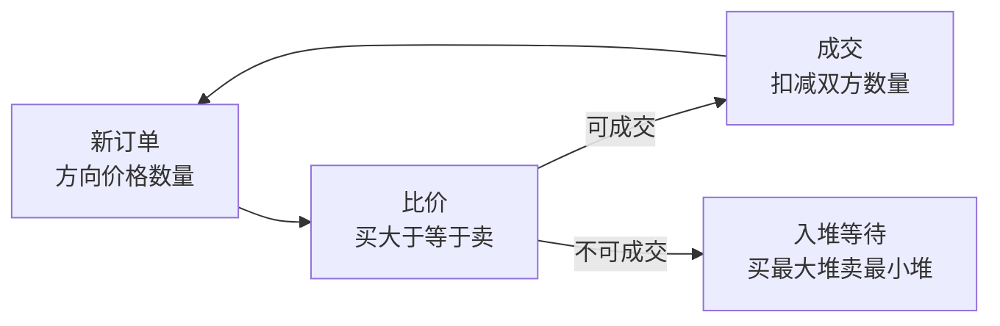

# 算法笔记

**摘要：** 数据结构手撕（LRU/组合结构）+ 高频七题（链表/滑窗/DP/搜索/树/堆/单调栈，各一题，偏大模型厂商常考口径）+ 撮合引擎综合案例。与语言篇分工：语法细节回各语言篇，本篇只留"结构与思路"。

**怎么读：** §1 热手（数据结构）→ §2 七题（每题思路 + 核心代码 + 变体）→ §3 清单（按题型补）→ §4 撮合引擎。代码均为 Python，可直接跑。

## 1. 数据结构手撕

**一句话：三题覆盖"哈希+有序""组合结构"——手撕考的是不变量，不是背诵。**

### 1.1 LRU 缓存（常问）

- 不变量：HashMap（key→node）+ 双向链表（访问序）；Get/Put 都移到表头；满则删表尾。
- Python 3.7+ dict 自带顺序，可直接当有序字典用：

```python
class LRUCache:
    def __init__(self, capacity: int):
        self.capacity = capacity
        self.cache = {}

    def get(self, key: int) -> int:
        if key not in self.cache:
            return -1
        val = self.cache.pop(key)
        self.cache[key] = val
        return val

    def put(self, key: int, value: int) -> None:
        if key in self.cache:
            self.cache.pop(key)
        self.cache[key] = value
        if len(self.cache) > self.capacity:
            oldest_key = next(iter(self.cache))
            self.cache.pop(oldest_key)
```

- 进阶：线程安全版单锁最简单，高并发分段（见《系统设计笔记》§6.3）。

### 1.2 组合结构两题

- **双端队列全 O(1)：** 循环数组 + 头尾指针，随机 index 也是 O(1)；满时倍增搬迁（摊还 O(1)）。
- **集合插入 O(1) + 范围查：** 哈希（存在性）+ 有序结构（TreeSet/跳表，范围迭代），各取所长。

## 2. 高频七题

**一句话：链表练指针，滑窗练区间，DP 练状态，搜索练遍历，树练递归，堆练 TopK，单调栈练"下一个更大"——七个套路互相不替代。**

### 2.1 反转链表（LeetCode 206，常问）

- 思路：三指针边走边改向，`prev` 即新头；递归版同理（先反转后面再接）。
- 变体：K 个一组翻转（25）、两两交换（24）、环检测（141，快慢指针）。

```python
def reverse_list(head):
    prev, cur = None, head
    while cur:
        nxt = cur.next
        cur.next = prev
        prev, cur = cur, nxt
    return prev
```

### 2.2 最长不重复子串（LeetCode 3，常问）

- 思路：滑窗 + 哈希记上次位置；右端扩张，左端跳到重复字符之后；窗口长即答案。
- 变体：最小覆盖子串（76，加计数器）、至多 K 个不同字符（340，窗口内种类数）。

```python
def length_of_longest_substring(s: str) -> int:
    last, start, ans = {}, 0, 0
    for i, ch in enumerate(s):
        if ch in last and last[ch] >= start:
            start = last[ch] + 1
        last[ch] = i
        ans = max(ans, i - start + 1)
    return ans
```

### 2.3 零钱兑换（LeetCode 322，常问）

- 思路：完全背包一维 DP，`dp[i]` = 凑 i 的最少硬币；转移 `dp[i] = min(dp[i-c] + 1)`；无解返回 -1。
- 变体：爬楼梯（70，斐波那契型）、打家劫舍（198，相邻约束）、编辑距离（72，二维 DP）、最长递增子序列（300，耐心排序 O(n log n)）。

```python
def coin_change(coins, amount: int) -> int:
    INF = amount + 1
    dp = [INF] * (amount + 1)
    dp[0] = 0
    for i in range(1, amount + 1):
        for c in coins:
            if c <= i:
                dp[i] = min(dp[i], dp[i - c] + 1)
    return dp[amount] if dp[amount] != INF else -1
```

### 2.4 岛屿数量（LeetCode 200，常问）

- 思路：扫到 `'1'` 计数加一，DFS 淹没整岛（置 `'0'`）；BFS 用队列同理，栈深怕爆用 BFS。
- 变体：腐烂橘子（994，多源 BFS 计分钟）、被包围区域（130，反向淹没边界）、单词搜索（79，回溯 + 恢复现场）。

```python
def num_islands(grid) -> int:
    if not grid:
        return 0
    m, n, ans = len(grid), len(grid[0]), 0

    def dfs(x, y):
        if not (0 <= x < m and 0 <= y < n) or grid[x][y] != '1':
            return
        grid[x][y] = '0'
        dfs(x + 1, y)
        dfs(x - 1, y)
        dfs(x, y + 1)
        dfs(x, y - 1)

    for i in range(m):
        for j in range(n):
            if grid[i][j] == '1':
                ans += 1
                dfs(i, j)
    return ans
```

### 2.5 最近公共祖先（LeetCode 236，常问）

- 思路：后序递归——命中 p/q 直接返回；左右各有所获则当前即答案；否则把有的一侧往上传。
- 变体：二叉搜索树版（235，利用有序性一次下探）、路径总和 III（437，前缀和 + 回溯）、最大路径和（124，全局变量收答案）。

```python
def lowest_common_ancestor(root, p, q):
    if not root or root is p or root is q:
        return root
    left = lowest_common_ancestor(root.left, p, q)
    right = lowest_common_ancestor(root.right, p, q)
    if left and right:
        return root
    return left or right
```

### 2.6 前 K 个高频元素（LeetCode 347，常问）

- 思路：计数 + 最小堆（或 `nlargest`）；O(n) 写法用桶排序（频次做下标）。
- 变体：数组第 K 大（215，快排 partition）、数据流中位数（295，双堆）、TopK 高频词（692，加字典序）。

```python
import heapq
from collections import Counter

def top_k_frequent(nums, k):
    cnt = Counter(nums)
    return heapq.nlargest(k, cnt.keys(), key=cnt.get)
```

### 2.7 每日温度（LeetCode 739，常问）

- 思路：单调递减栈存下标；当前高于栈顶即"答案揭晓"，弹出结算；剩下的默认 0。
- 变体：接雨水（42，双指针/单调栈两解）、柱状图最大矩形（84，同套路）、下一个更大元素（496）。

```python
def daily_temperatures(t):
    ans = [0] * len(t)
    st = []  # 存下标，对应温度单调递减
    for i, x in enumerate(t):
        while st and t[st[-1]] < x:
            j = st.pop()
            ans[j] = i - j
        st.append(i)
    return ans
```

## 3. 算法清单

**一句话：七题之外按题型补——字符串、全排列、树进阶、概率 DP、工程题各有代表。**

- **字符串：** 全排列（46，回溯）、最长公共子序列（1143，二维 DP）、最长回文子串（5，中心扩展/马拉车）。
- **数组：** 最大子数组和 Kadane、旋转数组查找（33，二分变体）、最长连续序列（128，哈希）、出现超 N/k 次（摩尔投票）。
- **树进阶：** 层序遍历（102，BFS 分层）、对称（101，镜像递归）、路径总和输出路径（记父指针回溯）。
- **概率 DP：** 棋盘走 k 步仍在（688，DP 记分布）；最后一人坐对概率 1/2（对称性一句话）。
- **工程题：** 大文件找重复行（hash 分桶 + 外排序/位图）。
- **AI 手撕方向（大模型厂商新增）：** 注意力/解码/采样现场实现、CUDA 基础核函数——超出本篇范围，单列方向，参考 AgentGuide 的 AI 手撕分类。

## 4. 撮合引擎案例

**一句话：买单卖单各一个堆，按价格配对成交——堆 + 价格优先 + 数量扣减，三行即核心。**



```python
import heapq

class Order:
    def __init__(self, order_id, side, price, quantity):
        self.order_id, self.side, self.price, self.quantity = order_id, side, price, quantity

    def __lt__(self, other):
        # heapq 是最小堆：买单价格高优先（反向比），卖单价格低优先
        return self.price > other.price if self.side == 'buy' else self.price < other.price

class MatchingEngine:
    def __init__(self):
        self.bids, self.asks = [], []

    def place_order(self, order):
        book, counter = (self.asks, self.bids) if order.side == 'buy' else (self.bids, self.asks)
        while book and order.quantity > 0 and self._can_match(order, book[0]):
            top = book[0]
            qty = min(order.quantity, top.quantity)
            order.quantity -= qty
            top.quantity -= qty
            if top.quantity == 0:
                heapq.heappop(book)
        if order.quantity > 0:
            heapq.heappush(counter, order)

    @staticmethod
    def _can_match(order, top):
        return top.price <= order.price if order.side == 'buy' else top.price >= order.price
```

- **要点：** 买单最大堆、卖单最小堆（Python heapq 反向比较实现）；成交价取挂单方价格；余量入堆；生产级再加：价格时间优先、数量隐藏（冰山）、风控校验、自成交防范。

## 附：与他篇的边界

- 装饰器、单例、测试写法 → 《Java/Python笔记》§5–§6。
- LRU 并发版、线程池 → 《系统设计笔记》§6.3、《Java/Python笔记》§2。
- 高频榜单看 CodeTop（codetop.cc）；AI 手撕分类见 AgentGuide（github.com/adongwanai/AgentGuide）。
