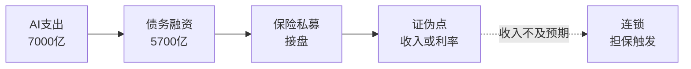

# AI债务周期：当算力变成融资标的

> **用途：** 行业分析第四篇，挂靠《股市笔记》§1.5（政策传导）与《交易流派》信用流动性逻辑。不提供个股推荐，不构成投资建议。
> **证据标准：** 每个数字须有**日期 + 口径 + 来源**；凡标"**待核**"未经逐条回溯原文，引用前须复核。空方观点（Burry/Ares）与多方反驳并列，不预设立场。

## 运行层：从现金买单到借钱买单

- **规模：** 摩根士丹利预计2026年AI相关债务发行约5700亿美元（5月底已2360亿，为去年同期四倍，Odaily 2026-08-17转引）；五大超大规模运营商今年已发债约2200亿美元（新浪2026-10-09）；Hyperscaler支出今年约7000亿、2027年或破1万亿美元；摩根大通预计到2030年AI相关累计发债4.1万亿美元（智通财经2026-09-28转引）。
- **现金流转负：** Alphabet Q2 capex 449亿、自由现金流-59亿（史上首次）；Amazon过去12月自由现金流+182亿→-76亿，2026年capex约2200亿；Meta Q2自由现金流85.5亿→7.84亿；Oracle FY2026 capex 556.6亿、自由现金流-236.9亿，评级BBB-（Odaily 2026-08-17转引）。
- **期限错配：** 钱今天花（土地/电力/GPU），收入未来多年收；Alphabet发100年期债券、250亿投资级债，Amazon两笔约540亿+250亿，Meta 250亿（Odaily 2026-08-17转引）。
- **争夺池子：** 美国2026财年赤字1.993万亿美元（CBO口径，新浪2026-10-09）；AI与政府同抢长期资本，10年期美债约5.17%、30年约5.73%（2002年来最高，ZGEO/新浪2026-10-09）；低评级AI借款收益率近11%（Volta案例），880亿美元低评级AI借款已入市（高盛口径）。

## 定价层：从需求交易到资本回报率交易

- **叙事切换：** 市场从"需求交易"进入"资本回报率交易"（Odaily 2026-08-17）：问题从"能建多少算力"变成"算力能否自我偿付"（本金+利息+电力运维+折旧）。
- **折旧争议：** Burry称超大规模厂商把芯片寿命拉到4–6年、2026–2028或少计约1760亿美元折旧，Oracle 2028年盈利或高估27%（智通财经2026-09-28转引其帖文）；英伟达七页备忘录反驳称4–6年合理；美光称存储需求到2028年超供给（反驳需求夸大论）。
- **残值：** H100三年残值降51%（Ares图表，Burry转引，待核）；旧GPU租金是"贬值快于偿还"的先行指标；CoreWeave近全价续签旧芯片是反例。
- **期限错配：** 2026年购置硬件在债务到期时或落后两代，租金下滑即覆盖不了本息——这是期限错配的数学本质。

## 结构层：融资网络与接盘方

- **网络：** Ares 2026秋季另类信贷通讯：过去12个月26笔约5730亿美元，横跨公司债/建设贷款/租赁/GPU抵押/担保；Meta/Oracle/微软/亚马逊/谷歌/英伟达/OpenAI/Anthropic同网不同身份（借款人/租户/供应商/担保人），前提全是"AI支出持续增长"（智通财经2026-09-28转引）。
- **接盘：** 美国与百慕大保险浮存金超10万亿美元（Burry口径，待核）；Ares口径美国保险投资资产9万亿美元；Meta埃尔帕索140亿美元园区火险上限仅4.5亿（~3%），风险从保单转向租约担保条款。
- **新结构：** SPV表外租赁（甲骨文模式）、私募信贷（Apollo/Blackstone/PIMCO枢纽）、博通为OpenAI超500亿美元融资牵头+担保（VT Markets 2026-10-08转引）；供应商变担保方：订单锁定 vs 双重冲击（失单+代偿）。
- **租赁锁定：** 五家未来租赁付款约1.16万亿美元（微软3291亿/Meta 2790亿/Oracle 2600亿，Odaily 2026-08-17转引）——需求在是收入基础，需求掉头是固定成本。
- **传导：** Ares警告的2000年"供应商融资"类比：支出节奏一变，担保在担保人最弱时触发。

## 证伪层

- **多方证伪（泡沫不破）：** 2028年规模化盈利窗口兑现（ZGEO）、收入覆盖债务、推理与应用变现加速、存储需求到2028年超供给（美光）。
- **空方证伪（泡沫破）：** 利率继续上行（Dalio临界点：利率起效之时）、收入不及预期致董事会挪资本、旧GPU租金下行、CDS走阔、博通/OpenAI交易担保比例超预期。
- **Dalio框架：** 债务+利率+集中度=经典泡沫三件套；10–15条非相关回报流、大失序时期（福布斯CEO大会2026-10-07，21财经/澎湃转引）；政府与科技同发债的"心肌梗死"（达利欧，Julia La Roche访谈转引）。
- **跟踪项：** AI债务发行月度、10年/30年美债、旧GPU租金、相关CDS、博通12月财报担保披露、头部capex指引。

**传导链：** AI支出 → 债务融资 → 保险私募接盘 → 证伪（收入兑现或利率上行）。断点：收入不及预期、利率跳升、旧租金下行。方法见[《思维工具》](/posts/econ-tools)§1。

## 参考

- Odaily AI融资周期（2026-08-17）：https://www.odaily.news/zh-CN/post/5212537
- 智通财经Burry/Ares（2026-09-28）：https://www.zhitongcaijing.com/content/detail/1501589.html
- 新浪资本争夺战（2026-10-09）：https://k.sina.cn/article_5952915705_162d248f906703q7ku.html
- ZGEO压力测试（2026-10-09）：https://zgeo.net/news/ai-capex-high-interest-debt-geo
- 21财经Dalio警告（2026-10-09）：https://www.21jingji.com/article/20261009/herald/6e01d4b56f7c9bbd12f4fd31fac58555.html
- 澎湃AI泡沫（2026-10-08）：https://m.thepaper.cn/newsDetail_forward_34212160
- VT Markets信贷额度（2026-10-08）：https://www.vtmarkets.com/cn-asia/opinion/the-ai-boom-just-opened-a-credit-line/
- BusinessTimes Dalio原文（2026-10-07）：https://www.businesstimes.com.sg/zh-hans/companies-markets/ai-bubble-may-burst-soon-amid-financing-concentration-rising-rates-ray-dalio
