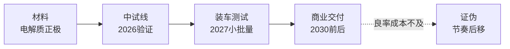

# 固态电池与储能：验证年

> **用途：** 行业分析第三篇，挂靠《股市笔记》§4（0-7步分析法）与《交易流派》趋势动量逻辑。不提供个股推荐，不构成投资建议。
> **证据标准：** 每个数字须有**日期 + 口径 + 来源**；凡标"**待核**"未经逐条回溯原文，引用前须复核。核心纪律：产线投产≠量产，装车测试≠商业交付。

## 运行层：2026拼验证，2027拼装车

- **节奏：** 2026年是半固态量产元年、全固态中试与小批量装车验证阶段，2027年或小批量生产，2030年前小幅量产、 далее规模商业化（TMTpost/财联社/微博财联社综述，2026年内，转引）。
- **事件：** 深圳坪山硫化物全固态中试线投产（配e平台/DMO装车测试）；重庆璧山首期20GWh量产线预计2026Q3（知乎专栏转述，待核）；三星SDI或2027年启动全固态量产（财联社转引，待核）；人民日报2026-06-22：2026或是装车验证关键节点、中试线密集落地。
- **路线：** 硫化物为主流；产业链配套（正极/电解质/集流体/封装/设备）逐步完善，成本仍是变量（TMTpost，转引）。

## 定价层：谁为溢价买单

- **付费方：** 高端车、eVTOL、人形等对能量密度敏感、价格不敏感的场景先行；储能看度电成本，固态短期难进。
- **对照：** 液态锂电仍在降本，固态的窗口 = 能量密度溢价 − 成本劣势；窗口打开速度取决于良率爬坡，不取决于发布会。
- **设备先行指标：** 干法/等静压（前道，交付久）先招标，中道叠片/绝缘跟进，最后模组Pack（9FZT，转引）——设备订单是验证进度的先行观测。

## 结构层：产业链位置

- **上游：** 材料与设备（正极/负极/电解质/集流体/封装 + 干法/等静压/叠片设备）；亚太份额超50%（GEN市场报告转引，待核）。
- **中游：** 电芯设计生产；宁德"天恒"等储能侧产品先行（东财PDF转引）。
- **格局：** 中国凭完整锂电链 + 政策 + 新能源车需求占先；日韩（三星SDI/丰田系）押全固态量产节点。两条路线赛跑，不对技术路线下结论。

## 证伪层

- **节奏证伪：** 装车量、良率、成本下降三者任一不及预期，节奏后移（产线投产≠量产是第一纪律，eet-china）。
- **需求证伪：** 液态降本超预期压缩溢价窗口；下游（车端/低空/人形）放量不及预期。
- **跟踪项：** 中试线投产数、装车测试公告、设备招标额、头部排产指引。

## 参考

- 人民日报固态电池观察（2026-06-22）：http://paper.people.com.cn/zgnyb/pc/content/202606/22/content_30164812.html
- TMTpost量产元年：https://www.tmtpost.com/7920519.html
- 财联社量产哨声：https://www.cls.cn/detail/2207128
- 进度辨析（投产≠量产）：https://www.eet-china.com/mp/a511320.html
- 产业链图谱：https://m.thepaper.cn/baijiahao_32338269
- 行业洞察（招标顺序）：https://www.9fzt.com/9fztgw_1_middle_A/80d0d593b75c779ee66c93b341f0640d.html
