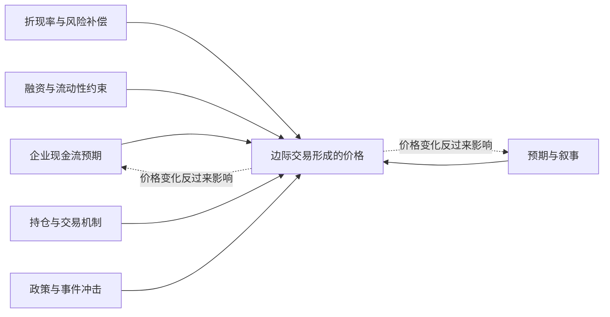
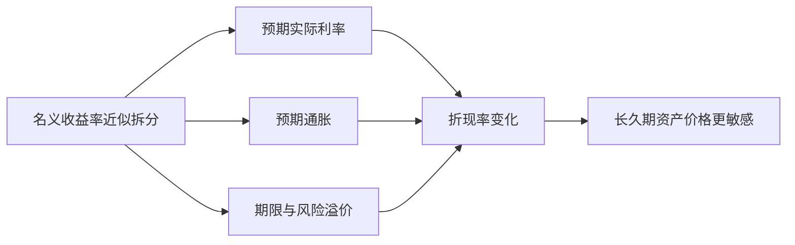
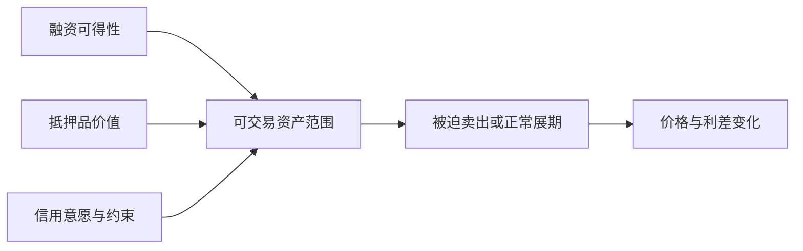
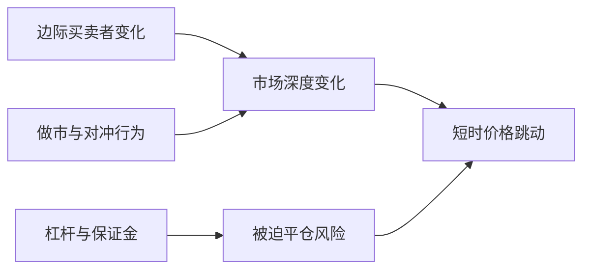
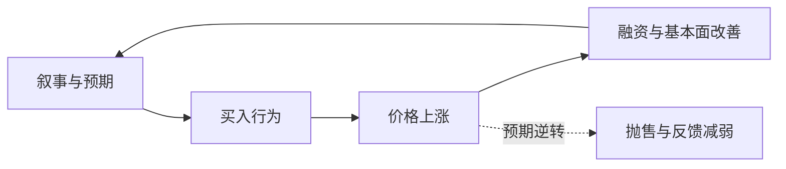
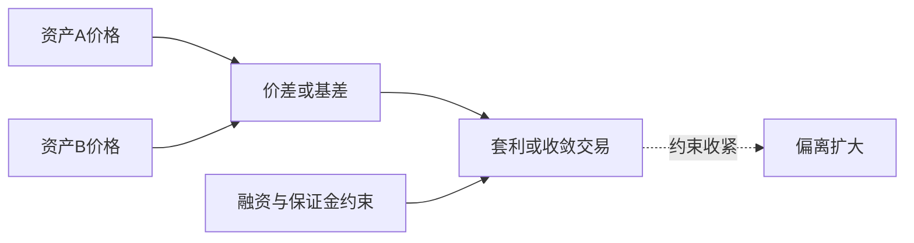
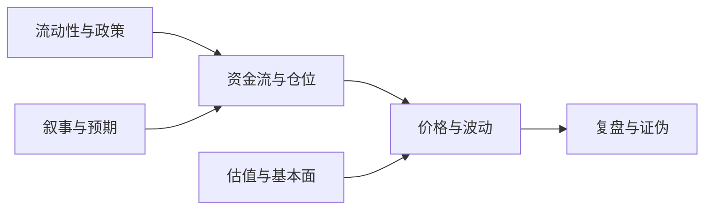

# 市场的多种逻辑：价格为什么这样走

> **定位：** 本文与 [《股市笔记》](/posts/econ-principles) 的 §3（结构与执行）/§5（案例）并行阅读，是 16 个历史案例的分逻辑讲解。案例以美债/美股为主，**中国市场对应案例见 中国市场案例包**。
> 本文用历史案例解释八种市场逻辑，不提供当前市场预测或投资建议。每个案例先交代日期和口径，再谈机制；凡无可靠来源的数字不写入正文。

## 阅读说明

- 读者：已了解股票、债券和基本财务术语的自学者。
- 用法：先读导读和全景图，再按需读单章；综合案例放在第9章。
- 证据规则：案例正文逐条标注来源与日期；文末按逻辑分组列出来源及支撑范围。
- 利润池追问（每章通用）：需求从哪来？供给如何响应？哪个环节最稀缺？利润流向谁？股价是否已反映？——行业增长不等于环节受益，更不等于个股值得买。

## 导读：价格由边际交易形成

**图1｜八种逻辑的全景位置。** 概念示意：各因素处在不同层次，可同时作用；箭头不代表已证明的因果强度。

## 1. 现金流与基本面

**定义与时间尺度：** 企业未来盈利和现金流如何影响价值；通常以季度财报和多年经营周期观察。

**传导机制：** 需求、价格、成本、竞争和资本开支改变现金流预期，再改变估值。

**可观察证据：** 营收、利润、经营现金流、指引修正；均注明发布日期和报表口径。

### 案例1A｜思科2001财年第三季度（截至2001-04-28）

- 市场与标的：纳斯达克上市公司思科（CSCO），美元口径。
- 关键机制：电信设备资本开支骤停，订单消失叠加库存减记，季度由盈转亏。
- 原始观察数据及口径：思科官方财报新闻稿披露该季净亏损26.9亿美元（每股-0.37美元），上年同期为净利润6.41亿美元；亏损含大额过剩库存减记（公司口径，2001年5月发布）。
- 至少一种替代解释：同期纳斯达克整体杀估值，股价下跌不全由当季亏损解释，倍数压缩亦有贡献。
- 失效边界：单公司、单产品周期事件；库存减记多为一次性，不能外推为持续现金流。
- 来源与发布日期：[思科2001年第三财季财报新闻稿](https://newsroom.cisco.com/c/r/newsroom/en/us/a/y2001/m05/cisco-systems-reports-third-quarter-earnings.html)，2001年5月发布。

### 案例1B｜英伟达2024财年（截至2024-01-28）

- 市场与标的：纳斯达克上市公司英伟达（NVDA），美元口径。
- 关键机制：AI计算需求爆发，数据中心收入转化为经营现金流，估值锚随盈利上修。
- 原始观察数据及口径：FY2024年报（10-K）披露全年营收609亿美元，同比+126%；其中数据中心营收475亿美元，同比+217%；净利润297.6亿美元（公司法定披露口径）。
- 至少一种替代解释：股价涨幅同时包含估值倍数扩张，不能全归因于当期现金流兑现。
- 失效边界：收入集中于少数云巨头资本开支；出口管制、资本开支周期逆转会打破外推。
- 来源与发布日期：[英伟达FY2024年报10-K（PDF）](https://s201.q4cdn.com/141608511/files/doc_financials/2024/q4/1cbe8fe7-e08a-46e3-8dcc-b429fc06c1a4.pdf)，2024年2月发布；[全年业绩新闻稿](https://investor.nvidia.com/news/press-release-details/2024/NVIDIA-Announces-Financial-Results-for-Fourth-Quarter-and-Fiscal-2024/)，2024年2月21日。

**与折现率逻辑的区别：** 本章解释现金流数量变化，不解释利率或风险补偿变化；同一涨跌往往两层叠加，见第2章。

## 2. 折现率与风险溢价

**定义与时间尺度：** 无风险利率、期限/信用/股权风险补偿变化如何改变折现率；观察窗口从议息会议到数年久期传导。

**传导机制：** 政策利率与通胀预期推高名义和实际收益率，久期越长的资产价格对折现率越敏感。

**可观察证据：** 联邦基金目标区间、FRED `DGS10`（10年名义）、`DFII10`（10年实际）；结论注明观察日期。

**图2｜折现率影响资产价格的路径。** 概念示意；具体收益率以 FRED 序列和观察日期为准。

### 案例2A｜纳斯达克100指数2022年（2022-01-01至2022-12-31）

- 市场与标的：美股纳斯达克100价格指数（NDX），美元、价格回报口径（不含股息）。
- 关键机制：美联储将联邦基金目标区间从0–0.25%上调至4.25–4.50%，长久期成长股折现率上行，指数全年跌约33%。
- 原始观察数据及口径：美联储2022年3月决议启动加息（目标区间0.25–0.50%），12月决议上调至4.25–4.50%；纳斯达克100指数2022年价格回报约-33%（指数口径，成份为纳斯达克上市最大100家非金融公司，见纳斯达克指数方法文件）。
- 至少一种替代解释：2022年企业盈利预期亦下修，分子走弱与分母走高同时作用，不能把跌幅全归因于利率。
- 失效边界：折现率解释估值中枢，不解释触底时点（指数10月见底时加息尚未结束）；盈利韧性强的公司分化明显。
- 来源与发布日期：[美联储2022年3月决议](https://www.federalreserve.gov/newsevents/pressreleases/monetary20220316a1.htm)，2022-03-16；[美联储2022年12月决议](https://www.federalreserve.gov/newsevents/pressreleases/monetary20221214a.htm)，2022-12-14；[纳斯达克100指数方法文件（PDF）](https://indexes.nasdaq.com/docs/Methodology_NDX.pdf)。

### 案例2B｜美国长久期国债2022年（2022-01-01至2022-12-31）

- 市场与标的：美国国债现货收益率（FRED日度序列），美元、名义口径。
- 关键机制：通胀超预期叠加快速加息，名义与实际收益率同步大幅上行，久期最长的债券价格跌幅最大。
- 原始观察数据及口径：FRED `DGS10`（10年名义）年末值从约1.5%升至约3.9%；`DFII10`（10年实际）从约-1.0%升至约+1.6%（FRED日度序列，年末值，约数）。
- 至少一种替代解释：缩表（QT）与期限溢价回升、通胀风险溢价亦推高长端，不能只归因于政策利率路径。
- 失效边界：收益率解释债券价格，不预测反转时点（2023年收益率维持高位）；实际收益率口径含流动性溢价，非纯预期。
- 来源与发布日期：[FRED官网序列检索](https://fred.stlouisfed.org/)，`DGS10`、`DFII10`，观察窗口2022全年；[美联储2022年6月货币政策报告](https://www.federalreserve.gov/monetarypolicy/2022-06-mpr-part2.htm)，2022-06-17。

**与现金流逻辑的区别：** 本章解释“未来现金流打几折”，不解释企业能赚多少；2022年是两层同向叠加的典型。

## 3. 流动性与信用

**定义与时间尺度：** 融资可得性、抵押品价值和信用意愿如何约束交易；观察窗口从隔夜融资到数月信用收缩。

**传导机制：** 融资枯竭迫使展期失败或被迫抛售，信用利差走阔；央行流动性工具通过替代私人融资修复传导，但不直接修复偿付能力。

**可观察证据：** 商业票据发行量与利率、回购市场、央行工具公告日期与使用量；注明工具名称、宣布日和合格资产范围。

**图3｜流动性与信用影响市场的路径。** 概念示意；不代表央行资产负债表规模直接等于股价。

### 案例3A｜美国商业票据冻结与CPFF（2008-09-01至2008-10-27）

- 市场与标的：美国商业票据市场（短期无担保与资产支持票据），美元口径。
- 关键机制：雷曼倒闭后投资者拒绝展期，票据存量萎缩、长端利率飙升；美联储宣布商业票据融资工具（CPFF）提供流动性后备，2008年10月27日开始购买。
- 原始观察数据及口径：美联储2008年10月7日公告创设CPFF，通过特殊目的公司购买3个月期高评级票据；工具2010年2月1日关闭，贷款全额偿还（美联储官方设施说明口径）。
- 至少一种替代解释：银行体系偿付能力担忧同样冻结放贷，票据市场恢复不等于信贷全面恢复；财政注资（TARP）亦在同时推进。
- 失效边界：流动性工具解决展期问题，不解决资不抵债；经济仍进入深度衰退，股市数月后才见底。
- 来源与发布日期：[美联储CPFF创设公告](https://www.federalreserve.gov/newsevents/pressreleases/monetary20081007c.htm)，2008-10-07；[美联储CPFF设施说明](https://www.federalreserve.gov/newsevents/reform_cpff.htm)，含起止日期与偿还记录。

### 案例3B｜2020年3月美元融资与美债市场压力（2020-02-26至2020-03-31）

- 市场与标的：美国国债现货市场与美元融资市场，美元口径。
- 关键机制：疫情不确定性下现金需求激增，经纪商资产负债表受限，买卖价差与价格冲击升至金融危机以来最高；美联储3月15日宣布至少增持5000亿美元国债、3月23日转开放式购买后流动性修复。
- 原始观察数据及口径：纽约联储研究记录10年期收益率2月26日1.34%跌至3月9日0.55%历史低点，3月18日反弹至1.20%；3月19日起两周日均购买国债约720亿美元；3月31日推出FIMA回购工具减少外国央行抛售动机（纽约联储Liberty Street口径）。
- 至少一种替代解释：财政刺激预期与避险情绪反转亦推动收益率回升，不能把3月下旬修复全归因于购买量。
- 失效边界：购买恢复的是市场功能，不是经济本身；2021–2022年通胀回归后收益率大幅上行，证明流动性逻辑有时效。
- 来源与发布日期：[纽约联储《疫情期间的国债流动性与美联储》](https://libertystreeteconomics.newyorkfed.org/2020/05/treasury-market-liquidity-and-the-federal-reserve-during-the-covid-19-pandemic/)，2020-05-29；[美联储2020年3月15日决议](https://www.federalreserve.gov/newsevents/pressreleases/monetary20200315a.htm)，2020-03-15。

**与其他逻辑的区别：** 本章解释“能不能融到钱、能不能展期”，不解释企业值多少钱；流动性修复常先于基本面修复。

## 4. 资金流、持仓与微观结构

**定义与时间尺度：** 边际买卖者、杠杆持仓、订单簿深度和做市/对冲行为如何放大短时价格；观察窗口从分钟到数周逼仓。

**传导机制：** 拥挤持仓遇保证金或赎回，被迫平仓冲击有限深度的订单簿；做市商顺势对冲进一步放大波动。

**可观察证据：** 持仓集中度、空头占流通比、成交量、买卖价差、券商保证金与交易限制公告；注明市场、日期和统计口径。

**图4｜资金流与微观结构放大的路径。** 概念示意；资金流解释成交方向，不直接证明价值高低。

### 案例4A｜美债现货-期货基差交易平仓（2020-03-09至2020-03-18）

- 市场与标的：美国国债现货与期货基差（相对价值交易），美元口径。
- 关键机制：杠杆投资者持有现货多头、期货空头对冲利率风险；期货上涨触发保证金，被迫平仓现货，叠加经纪商库存已满，形成保证金螺旋。
- 原始观察数据及口径：纽约联储记录3月9日至18日10年期收益率从0.55%反弹65个基点至1.20%，波动率3月13日见顶，买卖价差与价格冲击为2007–09年危机以来最高（纽约联储市场流动性指标口径）。
- 至少一种替代解释：外国官方与现金持有人的直接抛售亦施压现货，不能把收益率反弹全归因于基差平仓。
- 失效边界：基差交易是特定杠杆策略，解释的是国债段的错位，不解释同期股市下跌；去杠杆结束后错位收敛。
- 来源与发布日期：[纽约联储《疫情期间的国债流动性与美联储》](https://libertystreeteconomics.newyorkfed.org/2020/05/treasury-market-liquidity-and-the-federal-reserve-during-the-covid-19-pandemic/)，2020-05-29。

### 案例4B｜游戏驿站逼空（2021-01-11至2021-01-29）

- 市场与标的：美股游戏驿站（GME），美元、价格口径。
- 关键机制：极高空头占比叠加散户集中买入与期权对冲，订单流单向挤压；1月底部分券商限制交易，流动性机制本身改变走势。
- 原始观察数据及口径：SEC员工报告记录GME 1月27日收347.51美元，较1月11日收盘涨超1600%；1月13–29日日均成交约1亿股，较2020年均值增超1400%；1月空头占流通比达122.97%（SEC员工报告CAT与市场数据口径，2021年10月发布）。
- 至少一种替代解释：1月11日激进投资者进入董事会的公司新闻启动了最初上涨，基本面叙事与逼空机制并存。
- 失效边界：超100%空头占比与社交媒体协同极罕见，不可作为通用模板；交易限制说明微观结构会在极端时被改写，事后复盘不等于事前可交易。
- 来源与发布日期：[SEC员工报告《2021年初股票与期权市场结构状况》](https://www.sec.gov/files/staff-report-equity-options-market-struction-conditions-early-2021.pdf)，2021年10月发布；[SEC新闻稿2021-212](https://www.sec.gov/newsroom/press-releases/2021-212)，2021-10-18。

**与其他逻辑的区别：** 本章解释“谁被迫买卖、盘口接不接得住”，不回答公司值多少钱；逼空结束不代表价值回归，只代表拥挤解除。

## 5. 行为、叙事与反身性

**定义与时间尺度：** 信念、叙事与价格之间的反馈；价格上涨强化叙事，叙事吸引买入，基本面（融资、投资）随之变化；观察窗口从数月狂热到多年长波。

**传导机制：** 叙事降低怀疑→资金流入→价格上涨→财富效应与融资便利→基本面短期“证实”叙事→更多资金流入；逆转时同一链条反向运行。

**可观察证据：** 估值分位数、新开户与成交、媒体叙事强度、融资条件变化；严格区分事前可观测事实与事后故事。

**图5｜叙事与反身性反馈环。** 概念示意；事后故事不等于事前可预测。

### 案例5A｜纳斯达克互联网泡沫（1998-01-01至2002-10-09）

- 市场与标的：美股纳斯达克综合指数（价格指数口径），美元。
- 关键机制：“新经济”叙事下亏损科技公司以用户和流量定价，IPO与散户资金自我强化；2000年3月见顶后盈利证伪，反馈逆转。
- 原始观察数据及口径：纳斯达克综合指数2000年3月10日盘中触及约5048点，2002年10月跌至约1114点，跌幅约78%（价格指数口径）；席勒《非理性繁荣》同期以CAPE框架警示估值偏离（耶鲁在线数据库口径，1871年起美股数据）。
- 至少一种替代解释：加息周期（2000年联邦基金利率上调至6.5%）与企业资本开支见顶亦压制估值，不全是叙事破灭。
- 失效边界：叙事解释涨跌方向与幅度，不预测顶点与底部位置；“这次不一样”每次细节不同，类比需比机制而非比涨幅。
- 来源与发布日期：[席勒耶鲁在线数据库](http://www.econ.yale.edu/~shiller/data.htm)，支撑CAPE与长期估值数据；[《非理性繁荣》官网](http://irrationalexuberance.com/)，2000年首版，支撑叙事框架的同期记录。

### 案例5B｜美国房价“只涨不跌”叙事（2006-01-01至2009-12-31）

- 市场与标的：美国全国房价（S&P/Case-Shiller全国房价指数），美元、名义口径。
- 关键机制：全国房价长期上涨形成“房地产不跌”信念，次级贷款与证券化放大购买力，房价与信贷互推；2006年见顶后违约上升，抵押品贬值反过来收紧信贷。
- 原始观察数据及口径：S&P/Case-Shiller全国房价指数2006年见顶后持续下跌至2009年初（FRED序列`CSUSHPISA`可复核区间与单位）；席勒在《次贷解决方案》（The Subprime Solution，2008）等同期著作中记录房价预期的自我强化（作者同期分析口径）。
- 至少一种替代解释：贷款标准恶化与利率重置是违约的直接触发器，预期逆转是放大器而非唯一原因。
- 失效边界：房价是低频、异质、杠杆化资产，叙事反馈慢但深；不能把房价逻辑直接套用到高频股票交易。
- 来源与发布日期：[FRED官网](https://fred.stlouisfed.org/)，序列`CSUSHPISA`，支撑房价指数区间；[席勒耶鲁在线数据库](http://www.econ.yale.edu/~shiller/data.htm)，支撑长期房价与利率数据。

**与其他逻辑的区别：** 本章解释信念与价格的互相塑造，不解释现金流本身；基本面证伪才是反馈逆转的硬约束。

## 6. 趋势与动量

**定义与时间尺度：** 过去收益延续的现象与跟随策略；截面动量看相对强弱，时间序列动量看自身趋势；持有期通常数月到一年。

**传导机制：** 基本面渐进释放、投资者反应不足与羊群、止损与追踪资金按规则加仓，使趋势延续；震荡与反转期快速回吐。

**可观察证据：** Jegadeesh-Titman（1993）截面动量原始样本1965–1989年、6个月形成与持有期；Moskowitz-Ooi-Pedersen（2012）时间序列动量覆盖多类资产；策略指数注明费用后与样本外表现。

**图6｜趋势与动量的作用与风险。** 概念示意；历史样本结果不保证未来有效。

### 案例6A｜2009年动量崩溃（2009-03-01至2009-05-31）

- 市场与标的：美股截面动量组合（做多过去赢家、做空过去输家），美元、学术组合口径。
- 关键机制：市场触底反弹时过去输家（多为高贝塔、受困公司）弹性最大，空头端暴涨吞噬组合，属典型的动量崩溃。
- 原始观察数据及口径：Daniel与Moskowitz（2016，《Journal of Financial Economics》“Momentum Crashes”）记录2009年3–5月为动量策略历史最差阶段之一，崩溃集中发生在市场剧烈反转期（学术样本口径，非实盘基金业绩）。
- 至少一种替代解释：美联储与财政救助改变风险偏好，反转由政策驱动，动量崩溃是结果而非原因。
- 失效边界：学术组合无交易成本、无容量约束；实盘动量基金的回撤形态与幅度不同，不能直接等同。
- 来源与发布日期：Daniel & Moskowitz 2016 “Momentum Crashes”，《Journal of Financial Economics》；Jegadeesh & Titman 1993 “Returns to Buying Winners and Selling Losers”，《Journal of Finance》，支撑动量原始定义与样本。

### 案例6B｜2022年趋势跟踪CTA（2022-01-01至2022-12-31）

- 市场与标的：全球管理期货趋势策略（SG Trend Index成份：规模最大的趋势CTA集合），美元、费后净回报口径。
- 关键机制：股债商多资产出现持续单边趋势（加息、美元、商品），趋势信号同向加仓，策略与股指呈跷跷板，成为分散工具。
- 原始观察数据及口径：SG Trend Index 2022年全年回报约+27.3%，创纪录年度表现；SG CTA Index约+20.1%（兴业银行指数口径，年度重构、等权/规模口径见方法文件；第三方年度盘点转载）。
- 至少一种替代解释：2022年趋势机会来自罕见的宏观离散程度（通胀+加息），不能证明趋势策略在震荡市有效。
- 失效边界：单年高光后策略常迎均值回归与资金涌入；指数代表头部管理人，不代表中小CTA与实盘滑点后收益。
- 来源与发布日期：[SG Trend Index方法文件（PDF）](https://wholesale.banking.societegenerale.com/fileadmin/indices_feeds/SG_Trend_Index_Methodology.pdf)，支撑指数口径；[AlphaWeek 2022年CTA指数盘点](https://www.alpha-week.com/2022-cta-index-performance-review)，2023年初，支撑年度回报数字。

**与其他逻辑的区别：** 本章解释价格延续与策略行为，不解释资产应当值多少；趋势是利用相关性，不是发现价值。

## 7. 相对价值、均值回归与套利

**定义与时间尺度：** 高度相关资产间的价差、基差偏离后收敛的交易；持有期从数日到数月，依赖融资与杠杆维持。

**传导机制：** 价差偏离→套利资金进入→收敛获利；若融资收紧或偏离一方存在信用风险，价差反而扩大，保证金追缴迫使平仓。

**可观察证据：** 新老券利差、基差、配对价差、基金杠杆与对手方集中度；注明正常时期的波动区间与危机时的偏离。

**图7｜相对价值与套利约束。** 概念示意；偏离可以长期持续或不收敛。

### 案例7A｜LTCM收敛交易崩溃（1998-08-17至1998-09-23）

- 市场与标的：全球多市场相对价值组合（新老国债利差、利率互换利差等），美元口径。
- 关键机制：俄罗斯宣布卢布贬值与债务暂停后避险资金涌入高流动性资产，利差不收敛反扩大；LTCM杠杆极高、头寸占部分市场未平仓比重过大，无法减仓。
- 原始观察数据及口径：总统金融市场工作组1999年4月报告记录LTCM 1997年底总资产1290亿美元，为当时最大对冲基金家族数倍；1998年9月14家机构联合注资约36亿美元换取90%股权与经营控制权（官方事后报告口径）。
- 至少一种替代解释：对手方银行自身的风险敞口与惜贷放大了传染，崩溃不只是LTCM一家的问题。
- 失效边界：收敛交易假设历史相关性稳定；环境切换时“无风险套利”变成方向性押注；私人救助避免了清算，不等于策略事后被证明正确。
- 来源与发布日期：[总统金融市场工作组《对冲基金、杠杆与LTCM教训》报告（PDF）](https://home.treasury.gov/system/files/236/hedgfund.pdf)，1999年4月；[美联储历史《LTCM濒临倒闭》](https://www.federalreservehistory.org/essays/ltcm-near-failure)，支撑事件脉络。

### 案例7B｜2007年8月量化股票策略平仓（2007-08-07至2007-08-10）

- 市场与标的：美股多空量化股票组合（基于统计套利与因子敞口），美元口径。
- 关键机制：拥挤的多空组合遭遇一侧基金去杠杆，对手盘同向平仓使历史相关性短暂断裂，账面“中性”组合数日内大亏。
- 原始观察数据及口径：Khandani与Lo（2007/2011，《Journal of Investment Management》“2007年8月量化基金发生了什么”）记录8月7–9日部分高频次策略数日亏损达多年收益量级，并论证为拥挤交易集中平仓（学术复盘口径，非单只基金实盘）。
- 至少一种替代解释：次贷危机发酵期信用收缩是总背景，量化平仓是链条一环而非孤立事件。
- 失效边界：学术复盘用的是模拟组合与公开数据推断，不能点名某基金的真实仓位；均值回归在几天内发生，不代表所有偏离都会快速收敛。
- 来源与发布日期：Khandani & Lo “What Happened to the Quants in August 2007?”, 《Journal of Investment Management》；[总统金融市场工作组LTCM报告（PDF）](https://home.treasury.gov/system/files/236/hedgfund.pdf)，1999年4月，支撑拥挤与杠杆的对照框架。

**与其他逻辑的区别：** 本章解释“相关资产价差为何不收敛”，不解释市场整体方向；套利者的融资约束本身就是风险源。

## 8. 政策、事件与制度变化

**定义与时间尺度：** 规则、汇率制度、监管或公司事件突变改变定价前提；事件窗口从分钟公告到数月执行。

**传导机制：** 公告修正预期→价格跳跃→执行细节再定价→波动与流动性变化；区分“说了什么”“做了什么”“市场如何定价”是三件事。

**可观察证据：** 央行新闻稿发布时间戳、汇率/利率即时报价、交易所交易记录；注明时区、品种与报价来源差异。

**图8｜政策与事件冲击的定价路径。** 概念示意；区分公告、执行和市场定价三个环节。

### 案例8A｜瑞士央行放弃欧元兑瑞郎下限（2015-01-15）

- 市场与标的：外汇现货欧元兑瑞郎（EUR/CHF），欧元/瑞郎口径。
- 关键机制：2011年9月设立的1.20下限因欧元持续走弱、干预规模失控而取消；做空瑞郎的拥挤头寸瞬间反转，流动性蒸发。
- 原始观察数据及口径：瑞士央行2015年1月15日宣布即刻取消1.20下限并同步降息；欧元兑瑞郎当日暴跌，盘中最大跌幅约30%后部分收复（外汇现货报价口径；极端流动性下不同数据商报价存在差异）。
- 至少一种替代解释：欧洲央行即将推QE的预期本就压迫欧元，瑞郎飙升有顺势成分，不全是取消下限的机械结果。
- 失效边界：央行背书的制度本身制造了“无风险”错觉；事件窗口以分钟计，事后任何“早该知道”的说法都是事后诸葛亮。
- 来源与发布日期：[瑞士央行理事2015年1月16日解释讲话（BIS转载）](https://www.bis.org/speeches/20150116-rationale-discontinuing-minimum-exchange-rate-and-lowering-interest-rates)，2015-01-16；[瑞士央行2015年4月货币政策回顾](https://www.snb.ch/en/publications/communication/speeches/2015/ref_20150424_tjn)，2015-04-24。

### 案例8B｜英国脱欧公投（2016-06-23至2016-06-24）

- 市场与标的：英镑兑美元现货与英国股指，外汇与股票口径。
- 关键机制：公投前民调与博彩赔率定价“留欧”，结果逆转预期，英镑与风险资产同步重定价；英格兰银行随后降息+扩QE应对。
- 原始观察数据及口径：计票结果公布后英镑兑美元跌至三十年低点附近（现货外汇口径）；过度精确的盘中低点因做市商报价差异而不宜引用单一数字。
- 至少一种替代解释：全球避险（日元、国债上涨）分担了跌幅，英镑贬值本身亦缓冲了以英镑计价的跨国公司盈利预期。
- 失效边界：事件交易解释跳空，不解释之后数月英镑与英股的修复路径；政治进程的时间表比公投夜更重要。
- 来源与发布日期：[英格兰银行官网货币政策资料](https://www.bankofengland.co.uk/)，支撑2016年8月政策响应；[BIS季度评论2016年9月](https://www.bis.org/publ/qtrpdf/r_qt1609.htm)，支撑事件后市场波动复盘框架。

**与其他逻辑的区别：** 本章解释离散信息如何一次性改写概率，不解释趋势延续；事件后要回到现金流与折现率重新估值。

## 9. 综合案例：多种逻辑如何叠加

**所选行情与日期：** 2020年2月26日至3月31日美国金融市场压力（国债、股票、美元融资同现异动）。

**时间线：**

- 2月26日–3月9日：疫情担忧升温，10年期收益率从1.34%跌至0.55%历史低点（折现率/避险逻辑主导）。
- 3月9–18日：基差交易平仓与保证金螺旋，收益率反弹65个基点至1.20%，买卖价差升至危机以来最高（流动性+资金流逻辑主导）。
- 3月15–23日：美联储降息100基点、宣布至少5000亿美元国债购买并转开放式购买（政策逻辑介入）。
- 3月24–31日：波动与非流动性回落，标普500反弹；3月31日FIMA工具减少外国央行抛售（流动性修复确认）。

**图9｜综合案例的叠加链条。** 概念示意；同一行情的不同部分可能由不同逻辑主导。

**逻辑A能解释什么，不能解释什么：** 折现率逻辑解释2月底至3月初收益率暴跌（避险+降息预期），不能解释3月中旬收益率反向上行。

**逻辑B能解释什么，不能解释什么：** 流动性与资金流逻辑解释3月中旬国债异动（基差平仓、经纪商受限），不能解释疫情对企业盈利的真实伤害。

**逻辑C能解释什么，不能解释什么：** 政策逻辑解释3月下旬功能修复（购买规模与速度），不能保证经济不衰退，也不能解释2021年后通胀回归。

**综合判断与剩余不确定性：** 同一窗口内三种逻辑依次主导；若只用一种逻辑复盘，会把“市场功能恢复”误读为“基本面见底”。剩余不确定：基差平仓与官方抛售各自贡献无法精确拆分。

## 10. 结论：识别逻辑的复核清单

1. 当前价格变化主要来自现金流预期、折现率，还是资金与交易机制？
2. 我的观察窗口是分钟、日、季度还是多年？逻辑与窗口匹配吗？
3. 关键数据来自原始披露还是二手转述？日期、口径、币种是什么？
4. 有没有至少一种替代解释？什么证据会推翻我的解释？
5. 周期、阈值、涨跌幅数字有可复核来源，还是约数与转引？
6. 跨市场比较时，币种、区间、价格/总回报、频率统一了吗？
7. 有没有把相关性说成因果？单一样本能证明策略有效吗？
8. 考虑交易成本、滑点、容量与幸存者偏差了吗？
9. 流动性修复不等于基本面修复，我区分了吗？
10. 事件公告、实际执行、市场定价，我分开看了吗？
11. 这个逻辑上一次失效是什么时候、为什么？
12. 我的结论是学习笔记，还是在暗示买卖？后者一律删除。

历史案例仅用于学习，不构成投资建议。

## 附录A｜案例与数据口径对照

| 案例 | 市场与标的 | 日期区间 | 币种 | 价格或总回报 | 频率 | 来源 |
|---|---|---|---|---|---|---|
| 1A思科 | 美股CSCO | 2001财年Q3（截至2001-04-28） | 美元 | 公司财报口径 | 季度 | 思科官方新闻稿 |
| 1B英伟达 | 美股NVDA | FY2024（截至2024-01-28） | 美元 | 公司财报口径 | 年度 | FY2024 10-K |
| 2A纳指100 | 美股NDX | 2022-01-01至2022-12-31 | 美元 | 价格回报 | 年度 | 纳斯达克方法文件 |
| 2B长债收益 | 美国国债收益率 | 2022全年 | 美元 | 收益率 | 日度 | FRED DGS10/DFII10 |
| 3A票据冻结 | 美国商业票据 | 2008-09-01至2008-10-27 | 美元 | 工具口径 | 事件 | 美联储CPFF公告 |
| 3B美元融资 | 美债与美元融资 | 2020-02-26至2020-03-31 | 美元 | 收益率/购买量 | 日度 | 纽约联储研究 |
| 4A基差平仓 | 美债现货-期货 | 2020-03-09至2020-03-18 | 美元 | 收益率/利差 | 日度 | 纽约联储研究 |
| 4B游戏驿站 | 美股GME | 2021-01-11至2021-01-29 | 美元 | 价格 | 日度 | SEC员工报告 |
| 5A互联网泡沫 | 纳斯达克综指 | 1998-01-01至2002-10-09 | 美元 | 价格指数 | 日度 | 席勒数据库 |
| 5B美国房价 | S&P/Case-Shiller全国指数 | 2006-01-01至2009-12-31 | 美元 | 名义指数 | 月度 | FRED CSUSHPISA |
| 6A动量崩溃 | 美股动量学术组合 | 2009-03-01至2009-05-31 | 美元 | 学术组合口径 | 月度 | Daniel-Moskowitz 2016 |
| 6B趋势CTA | SG Trend Index | 2022-01-01至2022-12-31 | 美元 | 费后净回报 | 年度 | 兴业银行指数 |
| 7A LTCM | 全球相对价值组合 | 1998-08-17至1998-09-23 | 美元 | 官方报告口径 | 事件 | 总统工作组报告 |
| 7B量化平仓 | 美股多空量化组合 | 2007-08-07至2007-08-10 | 美元 | 学术复盘口径 | 日度 | Khandani-Lo |
| 8A瑞郎下限 | 外汇EUR/CHF | 2015-01-15 | 欧元/瑞郎 | 现货报价 | 分钟 | 瑞士央行 |
| 8B脱欧公投 | 英镑/英股 | 2016-06-23至2016-06-24 | 英镑/美元 | 现货/价格 | 日度 | 英格兰银行、BIS |

## 附录B｜术语表

- **边际交易：** 决定最新成交价的那一笔买卖；价格由边际决定，不由平均持仓成本决定。
- **久期：** 债券现金流对收益率变化的敏感度；久期越长，折现率变化对价格影响越大。
- **基差：** 现货与期货（或相关资产）之间的价差；基差交易赌价差收敛。
- **反身性：** 价格与参与者信念、融资条件互相影响的反馈环。
- **动量：** 过去涨的继续涨、过去跌的继续跌的现象；分截面（相对强弱）与时间序列（自身趋势）。
- **均值回归：** 偏离历史关系的价格差向均值靠拢的假设；可能长期不回归。
- **做市：** 持续报出买卖价、赚取价差并承担库存风险的交易行为。
- **熔断：** 交易所价格大幅波动时暂停交易的机制安排。
- **总回报：** 含股息/票息再投资的回报；价格回报不含。
- **价格回报：** 仅价格涨跌的回报，不含分红派息。

## 附录C｜分逻辑来源目录

- 逻辑1来源：[思科2001年第三财季财报新闻稿](https://newsroom.cisco.com/c/r/newsroom/en/us/a/y2001/m05/cisco-systems-reports-third-quarter-earnings.html)，2001年5月，支撑案例1A当季盈亏与库存减记事实；[英伟达FY2024年报10-K（PDF）](https://s201.q4cdn.com/141608511/files/doc_financials/2024/q4/1cbe8fe7-e08a-46e3-8dcc-b429fc06c1a4.pdf)，2024年2月，支撑案例1B营收与数据中心收入事实。
- 逻辑2来源：[美联储2022年3月决议](https://www.federalreserve.gov/newsevents/pressreleases/monetary20220316a1.htm)，2022-03-16，支撑加息起点；[美联储2022年12月决议](https://www.federalreserve.gov/newsevents/pressreleases/monetary20221214a.htm)，2022-12-14，支撑年末目标区间；[纳斯达克100指数方法文件（PDF）](https://indexes.nasdaq.com/docs/Methodology_NDX.pdf)，支撑指数口径；[FRED官网](https://fred.stlouisfed.org/)，`DGS10`/`DFII10`，支撑案例2B收益率事实。
- 逻辑3来源：[美联储CPFF创设公告](https://www.federalreserve.gov/newsevents/pressreleases/monetary20081007c.htm)，2008-10-07，支撑案例3A工具创设事实；[美联储CPFF设施说明](https://www.federalreserve.gov/newsevents/reform_cpff.htm)，支撑起止日期与偿还记录；[纽约联储《疫情期间的国债流动性与美联储》](https://libertystreeteconomics.newyorkfed.org/2020/05/treasury-market-liquidity-and-the-federal-reserve-during-the-covid-19-pandemic/)，2020-05-29，支撑案例3B收益率与购买量事实。
- 逻辑4来源：[纽约联储《疫情期间的国债流动性与美联储》](https://libertystreeteconomics.newyorkfed.org/2020/05/treasury-market-liquidity-and-the-federal-reserve-during-the-covid-19-pandemic/)，2020-05-29，支撑案例4A基差平仓与保证金螺旋机制；[SEC员工报告《2021年初股票与期权市场结构状况》](https://www.sec.gov/files/staff-report-equity-options-market-struction-conditions-early-2021.pdf)，2021年10月，支撑案例4B价格、成交与空头占比事实。
- 逻辑5来源：[席勒耶鲁在线数据库](http://www.econ.yale.edu/~shiller/data.htm)，支撑 CAPE 与长期美股及房价数据；[《非理性繁荣》官网](http://irrationalexuberance.com/)，2000年首版，支撑叙事框架同期记录；[FRED官网](https://fred.stlouisfed.org/)，序列`CSUSHPISA`，支撑案例5B房价指数区间。
- 逻辑6来源：Jegadeesh & Titman 1993《Journal of Finance》，支撑动量原始定义；Daniel & Moskowitz 2016《Journal of Financial Economics》，支撑案例6A动量崩溃事实；[SG Trend Index方法文件（PDF）](https://wholesale.banking.societegenerale.com/fileadmin/indices_feeds/SG_Trend_Index_Methodology.pdf)，支撑指数口径；[AlphaWeek 2022年CTA指数盘点](https://www.alpha-week.com/2022-cta-index-performance-review)，支撑案例6B年度回报。
- 逻辑7来源：[总统金融市场工作组《对冲基金、杠杆与LTCM教训》报告（PDF）](https://home.treasury.gov/system/files/236/hedgfund.pdf)，1999年4月，支撑案例7A资产规模与救助事实；Khandani & Lo《Journal of Investment Management》，支撑案例7B量化平仓复盘。
- 逻辑8来源：[瑞士央行2015年1月16日解释讲话（BIS转载）](https://www.bis.org/speeches/20150116-rationale-discontinuing-minimum-exchange-rate-and-lowering-interest-rates)，2015-01-16，支撑案例8A取消下限事实；[英格兰银行官网](https://www.bankofengland.co.uk/)，支撑案例8B政策响应；[BIS季度评论](https://www.bis.org/publ/qtrpdf/r_qt1609.htm)，支撑事件复盘框架。
- 综合案例来源：[纽约联储《疫情期间的国债流动性与美联储》](https://libertystreeteconomics.newyorkfed.org/2020/05/treasury-market-liquidity-and-the-federal-reserve-during-the-covid-19-pandemic/)，2020-05-29，支撑时间线与购买量；[美联储2020年3月15日决议](https://www.federalreserve.gov/newsevents/pressreleases/monetary20200315a.htm)，2020-03-15，支撑政策介入时点。
