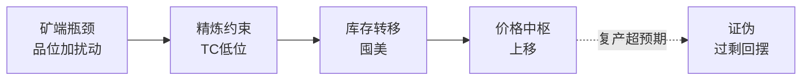

# 铜与贵金属：供给瓶颈与货币属性

> **用途：** 行业分析第二篇，挂靠《股市笔记》§1（周期与信用）与《交易流派》大宗商品逻辑。不提供个股推荐，不构成投资建议。
> **证据标准：** 每个数字须有**日期 + 口径 + 来源**；凡标"**待核**"未经逐条回溯原文，引用前须复核。

## 运行层：矿端锁死供给，新旧需求切换

- **供给：** 2026年全球铜精矿增量约13.5万吨、增速0.58%五年最低；原生精炼铜仅增5.2万吨，再生铜增26.5万吨对冲；精炼铜产量增速约1.11%（新浪四季报2026-09-22，转引期货研报）。老矿品位下滑、新矿7–10年周期、前期capex不足是长期项；智利/秘鲁（水/罢工/审批）、非洲（电力/灾害）是短期项。
- **需求切换：** 传统（地产/家电）拖累放缓；算力（摩根大通：AI数据中心2026年新增约47.5万吨，CME 2026-01-24转引）、储能电网托底；2024年全球数据中心用铜41.7万吨，2030年或至119.7万吨（国盛2026-01-01，转引）。
- **平衡：** 2025年过剩46.9万吨 → 2026年约25万吨 → 2027年约39.5万吨（弱过剩，新浪2026-09-22转引）；国际铜研究组织口径2026年缺口约15万吨（CME 2026-01-24转引）。口径不同结论同向：从宽松走向紧平衡。
- **价格：** LME铜2026-09-10盘中14,875美元/吨历史新高，沪铜9-08收110,620元/吨（新浪2026-09-22）。机构目标：汇丰13180、花旗12000、中邮13000美元/吨（CME 2026-01-24转引，仅记录分歧）。
- **政策变量：** 美国232铜关税：半成品已征50%，精炼铜拟2027年征15%、2028年30%（白宫/商务部公告，新浪2026-09-22转引）；贸易商提前囤美，美国消费占全球7%却囤62%–70%交易所库存（CME 2026-01-24转引），亚洲欧洲更紧。

## 定价层：铜看实体，金看货币

- **铜（工业锚）：** 定价锚定实体供需与产业周期，金融属性弱；COMEX-LME溢价、人民币汇率是本土观测锚（crainternational 2026-05-29）。
- **金（货币锚）：** 央行连续增持（中国央行连12个月，累计41吨，新浪/国信2026-11转引口径）+ ETF流入（2025年内净流入674吨，持有3893吨，东兴2026-12转引）+ 避险溢价；瑞银Teves：上半年或冲5000美元/盎司，下半年随宽松退出动能减弱（证券时报2026-01-21转引）。
- **银（双属性）：** 工业（光伏/电子）+ 金融；金银比仍在70上（国盛2026-01-01，转引），相对低估还是补涨看工业兑现；供需缺口或扩至6000吨级（东兴2026-12-16转引）。
- **铜金比价：** 本质是工业周期与避险的博弈，人民币企稳+利率企稳是底部拐点信号（crainternational 2026-05-29）；系统性风险到来时联动失效。

## 结构层：谁卡脖子

- **矿端：** 7–10年周期 + 品位下滑 + 勘探capex不足，供给弹性长期弱；TC长期低位甚至负值，冶炼靠再生铜与高价传导活着。
- **库存结构：** 美国91.2天历史最高 vs 非美7.4天（9年15%分位，国盛2026-01-01转引）——总量过剩、结构短缺，脆弱平衡。
- **黄金供需：** 矿金低增长 + 央行年购超1000吨三年 + ETF回流，底部中枢上移、弹性看利率（东兴2026-12-16转引）。
- **宏观压制：** 美联储9-16加息至3.75%–4.00%、多数票委预期年内再加一次（新浪2026-09-22）；高利率压远期估值，是涨幅天花板而非趋势反转。

## 证伪层

- **供给证伪：** Grasberg/Panama全面复产、TC回升、再生铜超预期释放。
- **需求证伪：** AI capex/光伏/新能源车不及预期、地产链继续下行。
- **货币证伪：** 降息重启（金银的交易反转）、地缘缓和（避险溢价消退）。
- **跟踪项：** 精矿TC、COMEX-LME溢价、非美库存天数、央行购金月度、232细则落地节奏。

## 参考

- 新浪铜四季报（2026-09-22）：https://finance.sina.com.cn/money/future/2026-09-22/doc-inissuic8928545.shtml
- CME铂金铜双重变奏（2026-01-24）：https://www.cmegroup.com/cn-s/insights/media-partners/7he/2026-01-23.html
- 铜金比价（2026-05-29）：https://crainternational.com.cn/infor/view?id=105235
- 瑞银Teves专访（2026-01-21）：https://www.stcn.com/article/detail/3603006.html
- 国盛有色年度策略（2026-01-01）：https://m.hibor.com.cn/wap_detail.aspx?id=049640cfaf6f531bb8186495361f4a8a
