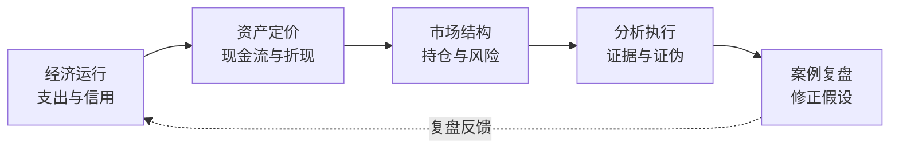
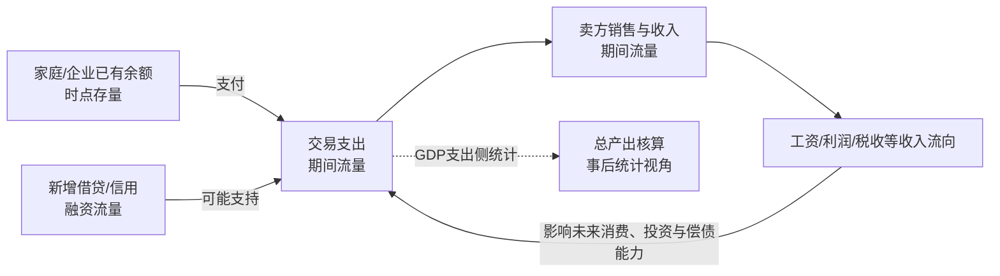
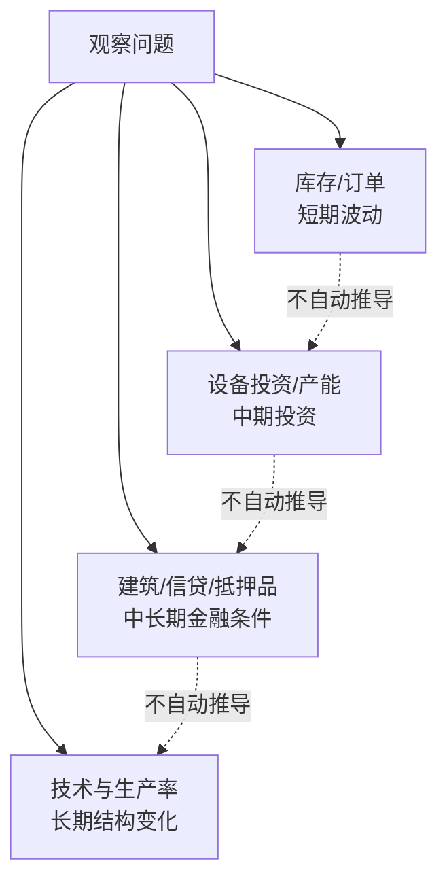
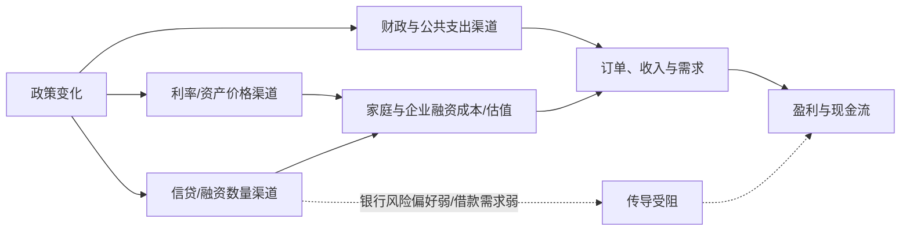
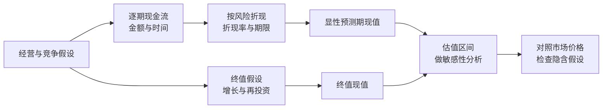
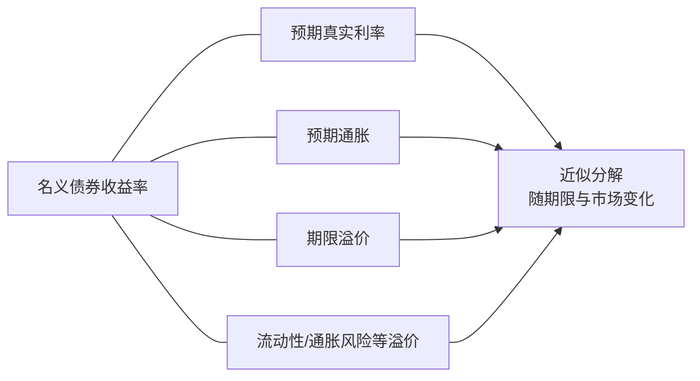
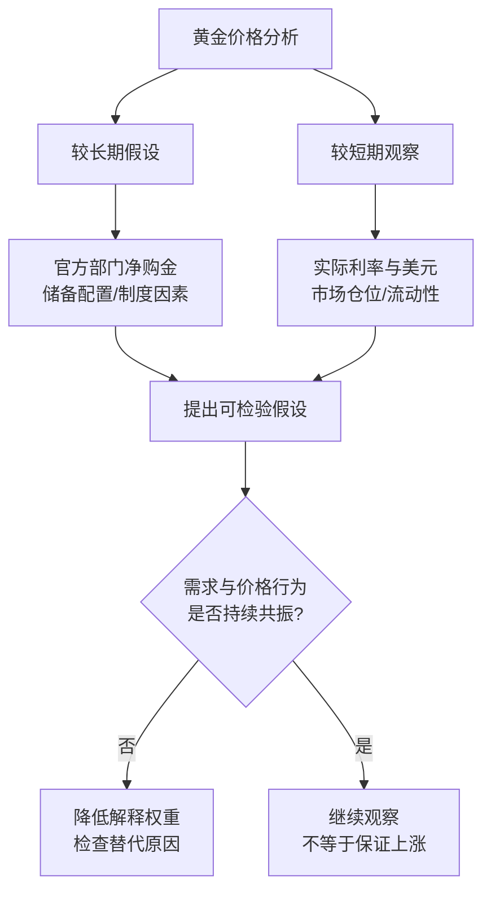
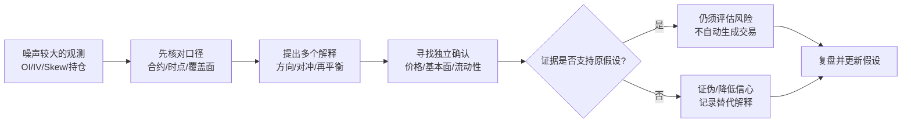
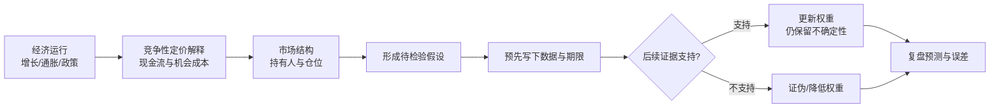

# 经济股市原理（严谨版）

**摘要：** 本文提供一套理解股市的学习框架：先看经济活动和信用如何影响现金流，再看现金流、折现率和风险如何影响资产价格，继而辨认市场持仓与拥挤，最后用情景、证据和证伪条件组织分析。周期、估值和交易指标都是带有假设的工具，不是准确预测未来或直接产生买卖指令的公式。

**适合读者：** 已了解股票、债券和基本财务术语，希望把宏观、估值与市场行为放进同一分析流程的自学者。

> **阅读原则与证据标准：** 先读正文建立概念，再按需查阅附录中的指标、流派和来源。全文统一遵循一条标准——观点必须有**日期、证据和失效条件**；个别阈值只是原材料中的示例，**不构成通用投资建议，不提供个股推荐**。此后正文不再逐处重复该声明，只在“这一条特别容易误用”处单独标注。

## 全文路线

**图1｜学习路线图。** 概念示意，不代表因果关系已由本图证明；本文结构由作者整理。宏观、数据与估值的延伸来源见文末出处索引。

## 1. 经济运行：先区分活动、融资与核算

**本节问题：** 支出、收入、货币、信用和 GDP 分别是什么？周期框架可以帮助回答什么，又不能回答什么？

**核心结论：** 支出是某段时间内发生的流量；货币余额与债务余额通常是时点存量；信用描述借贷关系及新增融资。达里奥把总支出写作“货币 + 信用”，其 money 指**已存在货币的周转使用（流量）**，而非 M2 存量；因此在流量口径下该式成立，但**不能把 M2 存量直接与新增信用相加**（存量与流量量纲不同）。

### 1.1 一笔交易如何进入经济活动

消费者购买商品时，买方发生支出，卖方取得销售收入；企业支付工资后，收入又流向家庭。交易链可以推动生产、就业和收入，但边际影响取决于生产能力、价格、进口、税收、储蓄和融资条件。新增借贷能够提前或扩大某些支出，同时也带来未来偿债义务；贷款发放不等于资金最终形成有效需求，更不等于盈利必然增长。

宏观核算中，GDP 可以从支出、生产或收入侧计量。支出法常用简式为 `GDP = C + I + G + (X − M)`，其中统计最终用途，避免把中间品重复计入；各核算方法力求描述同一时期的总产出，实际数据会因统计来源与误差而出现差异。GDP 不是资产价格，也不能单独说明支出流向、分配结果或企业现金流。美国 BEA 对 GDP 的口径说明见 [BEA GDP](https://www.bea.gov/data/gdp/gross-domestic-product)；中国数据应优先查国家统计局及人民银行口径。

**与达里奥原式的关系（口径对照）：** 达里奥《How the Economic Machine Works》把总支出写作 `支出 = 货币 + 信用`（money + credit）。这里的 money 指**已存在货币的周转使用（流量）**，近似 `MV`（货币量 × 流通速度），不是 M2 之类的**货币存量**；credit 指**新增信用/融资流量**。在此流量口径下该式成立。常见错误是把 money 误读为 M2 存量，再与新增信用相加——两者量纲不同（时点存量 vs 期间流量），相加无意义。故下图把“存量货币的周转”与“新增信用”并列画作支出的两类来源，**它们不能与 M2 存量相加**。来源对照见文末旧稿来源索引（达里奥原视频 / 桥水 PDF）。

**图2｜融资条件与支出、收入的关系。** 存量货币经周转形成交易支出，并与新增信用（融资流量）共同支持支出；箭头表示可能的传导关系。口径提示：达里奥“支出 = 货币 + 信用”中的货币是**周转流量**（近似 MV），误读为 M2 存量再加新增信用则量纲错。GDP 支出法统计最终用途，避免中间品重复计算；核算定义参见 BEA 与国家统计局口径。

> **常见误区：** 把货币存量与新增信用相加，直接当作某期总支出；或把 GDP 总量增长等同于上市公司利润增长。
>
> **自测：** 贷款余额是存量还是流量？它与贷款发放、企业投资和当期 GDP 各是什么关系？

### 1.2 周期模型是观察镜头，不是日历

不同周期理论关注不同变量。下表列出常见文献中的大致讨论范围，仅用于描述模型；不同作者口径并不一致，周期是否存在、长度和拐点预测能力都存在争论。

| 框架 | 常见讨论对象 | 常见文献范围（约） | 使用边界 |
|---|---|---:|---|
| 短期信贷/商业周期 | 信贷成本、需求与通胀 | 达里奥框架常用约4–10年（7±3） | 该作者的经验框架；不是固定周期或日期预测 |
| 长期债务周期 | 债务负担、偿付与政策响应 | 达里奥框架常用约50–100年（75±25） | 该作者的经验框架；应按债务主体、币种、期限和制度分析，周期长度争议大 |
| 基钦 | 库存与订单 | 约3–5年 | 频率和领先关系随国家、行业与样本期变化 |
| 朱格拉 | 设备投资与产能 | 约7–11年 | 投资周期并非跨行业同步 |
| 库兹涅茨 | 建筑、人口与基础设施 | 约15–25年 | 识别结果对定义、国家和样本很敏感 |
| 康波/长波 | 技术范式与长期增长 | 常见说法约40–60年 | 属争议性长期解释框架，不应用来定短线买卖点 |
| BIS金融周期 | 信贷、房价及抵押品 | 常见研究范围约8–30年 | 指标、国家和估计方法影响结论；不是危机倒计时 |
| 美林时钟 | 增长与通胀状态 | 不设固定周期长度 | 是资产配置分类框架，不保证经济按固定顺序轮转 |

美林时钟常用四象限是复苏（增长改善、通胀较低）、过热（增长较强、通胀上行）、滞胀（增长走弱、通胀偏高）和衰退（增长偏弱、通胀回落）；资产映射只是经验假设，须观察增长和通胀的方向及修订，不能把四象限当成自动轮转买卖表。BIS 信贷缺口也只是信用相对趋势的风险指标之一，不是危机倒计时或单独的仓位信号。

**图3｜周期框架的观察层次。** 各框架并非严格嵌套的因果链。时间范围是文献常见说法，不是具有统一定义的自然常数；来源索引见文末康波、库兹涅茨、朱格拉、基钦及 BIS 条目。

### 1.3 政策如何传到企业和资产

利率/价格渠道、银行信贷/数量渠道、汇率、财政支出和预期，在不同经济体中都可能重要。“美国偏价格、中国偏数量”至多是特定制度和时期下的观察侧重，不是两国各自只通过一种渠道传导。

**图4｜政策传导的多条路径。** “降息”是政策或价格变化，不等于企业已经借款、居民已经消费或利润已经兑现。中国社融、M1、地产数据及美国联储、国债/TIPS数据应各自按原始口径观察，系列目录见附录A。

### 1.4 去杠杆与危机分析

分析债务压力时，至少先问：谁欠债、用什么币种、债务期限如何、收入/税收能否覆盖偿付、是否存在流动性支持或制度性重组。削减支出、债务重组/减记、收入再分配以及货币化支持，可能以不同组合出现；每种选择都有分配、通胀、金融稳定和信用成本。

“和谐去杠杆”是对政策组合与经济结果的解释框架，不是只要名义增速高于利率就能断言成功。它成立需要**三条前提**：

1. **债务以本币计价**（央行能以本币印钞/购债，不被外币偿付约束）；
2. **央行对名义利率有实质控制权**（可压低名义利率、容忍温和通胀）；
3. **通胀预期基本被锚定**（印钞不引发失控通胀或资本外逃）。

名义增速 > 名义利率只是**结果**，不是充分条件；缺任一条，都会退化为通胀失控、违约重组或资本外逃。分析时还须检视实际偿债能力、金融机构资产质量、汇率约束和政策可信度；外币债务、主权货币制度不同的经济体不能简单类比。

### 1.5 政策传导：入世 / 三驾马车 / 国企 / 美国政策

政策意图不等于实际支出，传导必须逐环验证（李蓓教训：只看发布不看订单、结汇与信贷即误判）。四条常用链各记一句话，并各配“看哪个数、断在哪里算证伪”：

1. **入世链：** “关税下降 → 出口顺差 → 外汇占款投放 → 银行派生 → 地产基建承接”。**看：** 出口交货值 / 海关进出口 / 外需 PMI。**证伪：** 税率落地不及预期或转口消化即假设作废。（2006 年外贸依存度约 60%–67%，随分子是否含服务、分母现价/不变价而异；此后由 2008 年“4 万亿”财政刺激接力。）
2. **三驾马车链（内需）：** “投资看订单利用率、消费看社零与 M1、净出口看外需与出口交货值”，月度代理不等于支出法口径。**看：** 社零 + 服务零售 / M1。**证伪：** 社零不动且 M1 不回即刺激未兑现。
3. **土地财政 / 国企链：** “卖地 → 财政支出；城投收缩 → 化债占用额度；央企 capex 逆周期；分红 → 红利定价”，化债置换不自动变新支出。**看：** 土地出让金 / 城投净融资。**证伪：** 出让回升但开工不跟即托底非复苏。
4. **美国政策链：** “关税与产业补贴先改供应链与成本；财政赤字托底推迟衰退；联储加降息改全球折现率”，回流意图不等于订单回流。**看：** 美关税税率清单 / Fed Funds 与 TIPS。**证伪：** 加税被吸收进 CPI 或联储转向即重估。

> 各链的月度代理（固投/社零/进出口）≠ 支出法核算口径，季度/月度分析须注明替代误差（详见素材《政策_三驾马车》）。

**本节小结：** 先把支出流量、融资条件、债务存量和 GDP 核算分开；周期框架用来提出问题，不是给出日期；政策传导必须沿着融资、需求、订单、利润逐环验证。

## 2. 资产定价：现金流、折现率与风险

**本节问题：** 企业价值为何会因盈利预期或利率变化而变动？股票的折现率 r 由哪几条腿组成？债券和黄金应看哪些不同变量？

**核心结论：** 估值依赖现金流口径、发生时间、风险和折现率。简化公式只在假设成立时有用；不要把一个公式或一个宏观变量当成完整估值。

### 2.1 股票：完整 DCF 与永续增长简式

多期现金流折现的一般思想是：

`价值 = Σ(第 t 期预期现金流 / (1 + 折现率)^t) + 终值现值`

常见简式 `V₀ = FCF₁ / (r − g)` 只对应稳定增长的永续现金流假设，且要求 `r > g`；这里的 `FCF₁` 是下一期现金流，`r` 与 `g` 必须使用一致的币种、通胀和期间口径。若用每股股权现金流，结果才是每股价值的简化估计。口径必须一致：股权自由现金流（FCFE）通常以股权资本成本折现；企业自由现金流（FCFF）通常以 WACC 折现，求出企业价值后还需调整净债务等项目，才能推到股权价值。周期公司、金融企业、亏损成长企业、专利到期药企等情形，不能机械套用稳定永续模型。

**图5｜现金流折现的组成。** 终值对长期增长率和折现率十分敏感；`FCF₁/(r−g)` 是特定稳定增长情形，不是所有公司通用的估值快捷键。FCF 定义、增长与折现率均须匹配。

分析时可以把价格变化拆成两类假设：预期现金流/长期增速变化（分子）与无风险利率/风险溢价变化（折现率）。这有助于提问，不足以单独证明某次涨跌的真实原因。应同时看企业报告、资本开支、融资、利润质量和估值已隐含的预期。

### 2.2 股票折现率 r 的“四条腿”：把 r 与债券一样拆开

上一小节把价格变化拆成“分子（现金流/长期增速）”与“分母（折现率）”。本小节把分母的 `r` 拆开，与 §2.3 债券的收益率拆解同构——这是理解“利率杀估值”在**股票**语境里到底杀哪一段的关键。

股票折现率 `r` 常被近似拆成四条腿：

| 腿 | 含义 | 变化如何影响估值 |
|---|---|---|
| ① 实际无风险利率 | 剔通胀后的无风险回报 | 上行 → 分母变大 → 长久期资产杀得最狠 |
| ② 预期通胀 | 名义回报中的通胀补偿 | 上行 → 名义 r 上行 → 杀估值（若同步抬升名义现金流则部分对冲） |
| ③ 期限/流动性溢价 | 持有长久期的补偿 | 上行（如 QT、流动性收紧）→ 杀长久期 |
| ④ 股权风险溢价（ERP） | 要求的高于无风险利率的额外回报 | 扩张 → 杀估值；压缩 → 即使利率不动也能抬估值 |

**ERP 的定义：** `ERP ≈ 股票预期回报率 − 无风险利率`。可用“指数隐含 ERP”（由市场价格反推）或“历史实现 ERP”观察，两种口径结论常不同，须注明指数、时段与算法。

**“利率杀估值”杀的是哪条腿：** 通常先杀 ①（实际利率）与 ②（通胀），③（流动性/期限）是放大器；④ ERP 是**第三条腿**——ERP 压缩时即使无风险利率不变，估值也会扩张（2020–21 年可观察）；ERP 扩张时（恐慌、盈利不确定性上升）即使利率下行，估值仍可能被压。因此“利率降 → 估值必升”不成立，须同时看 ERP 方向。

**口径提示：** ERP 是预期概念，不是可直接观测的常数；本表的拆分是**近似框架**，具体数值须注明指数、时段与算法（示例观察值 ERP≈3.7% 见 P0 核验 D12，为特定时点的指数隐含口径，非判定线）。与债券不同，股票“票息”不确定，故 ④ 的波动往往比 ① 更大。

### 2.3 债券：收益率拆解是近似，不是精确恒等式

名义收益率常被近似理解为预期真实利率加预期通胀，再加期限、通胀风险、流动性、信用等溢价。不同债券的信用与期权特征会带来额外因素。TIPS 与名义国债的盈亏平衡通胀率也包含风险和流动性影响，不能当作纯粹无偏的通胀预报。

**图6｜名义收益率的近似构成。** 箭头表示分析拆分而非可直接观测的唯一加总。美国国债与 TIPS 数据可在 [FRED](https://fred.stlouisfed.org/) 查到 `DGS10`、`DFII10`、`T10Y2Y` 等系列；具体结论要注明观察日期。

倒挂期限利差常被用作增长风险指标，但不是衰退的精确计时器。久期描述现金流对利率变化的敏感度；期限更长不代表收益更高或风险更低。讨论“利率杀估值”时，应拆开政策利率、实际利率、期限溢价和信用风险；股票侧再叠加 ERP 这第三条腿（见 §2.2）。

### 2.4 黄金：分层观察，不把相关性写成定律

可将黄金驱动分成观察期限：实际利率、美元和仓位变化常用于分析较短期波动；官方部门购金、储备多元化、财政/地缘风险等可作为较长期需求假设。各因素可能同时变动，相关性不保证稳定，官方购金也不是金价的机械底线。

世界黄金协会《Gold Demand Trends: Full Year 2024》记载，央行在 2022–2024 连续三年净购金超过 1,000 吨；2024 年净购金为 1,044.6 吨（约 1,045 吨）。这是截至 2024-12-31 的历史统计，报告发布日期为 2025-02-05；WGC 口径包括已报告变动及对未报告购买的估算，可能随披露而修订；不等于未来购金速度或价格影响不变。见 [WGC 2024 年央行需求报告](https://www.gold.org/goldhub/research/gold-demand-trends/gold-demand-trends-full-year-2024/central-banks)。

**图7｜黄金的分期限假设。** 概念示意；不代表可由购金吨数直接推导金价，也不构成交易信号。数据来源为 WGC、FRED 与相应市场原始数据。

### 2.5 估值交叉检查

- **安全边际：** 对现金流、竞争格局、融资和自身判断分别留出余地；折扣和仓位不能代替理解业务，也没有对所有股票都适用的统一折扣率。
- **周期企业：** 使用跨周期或正常化利润假设，避免用景气顶点利润推算永久价值；资产负债表和再融资风险需单独核查。
- **成长企业：** 检查增速能否转化成利润与自由现金流，估值对终值的依赖有多大，资本开支由现金还是债务支持。
- **专利药：** 将专利有效期、临床/监管成功概率、竞争和支付方议价纳入分段情景；不能假设产品现金流永久持续。
- **相对估值：** PEG、股息率、PB 等是比较工具，不是独立的“高低估”证明；增速、利润口径、资本结构和行业风险需要可比。

**本节常见误区：** 用名义收益率的单次变动解释全部估值变化；把预测增长率当确定事实；将估值算出的点值误当精确目标价。

**自测：** 你使用的 FCF 属于 FCFE 还是 FCFF？折现率是否匹配？终值占总估值比例多大？如果增速低于假设，估值会如何变化？

## 3. 市场结构与风险：从观察到证伪

**本节问题：** 如何把持仓、期权、拥挤度和泡沫叙事转化为谨慎的观察，而不是单一信号交易？

**核心结论：** 市场结构数据可以提供参与者、保护需求和拥挤程度的线索，但大多有滞后、覆盖不全或解释歧义。观察、解释、行动必须分开。

### 3.1 先分三层

1. **观测值：** 原始持仓、期权未平仓量/隐含波动率/偏斜、成交与信用利差等，并注明市场、合约、时间和数据口径。
2. **解释：** 提出可能机制（对冲、方向性交易、再平衡或流动性变化），并列出替代解释。
3. **决策：** 等待独立证据、写下证伪条件、按个人风险承受能力评估。单个读数不等于买卖指令。

Form 13F 是美国特定机构对规则涵盖证券的季度持仓披露：通常须在季末后 45 天内提交；申报表不报告空头头寸，也不是完整组合或实时交易记录。因此它适合研究披露口径内的历史持仓，不能直接推断报告日之后的即时方向。制度说明见 [SEC Form 13F FAQ](https://www.sec.gov/divisions/investment/13ffaq.htm)。期权 ΔOI、IV 和 Skew 受期限、行权价、标的与做市对冲等影响，不能只凭“Call 增仓”判断看多。

**图8｜从指标到复盘。** 不包含收益阈值或回测结论。示例结构依据 SEC、CBOE/中金所等数据说明；数据源与交易假设须分别引用。

### 3.2 泡沫叙事和历史类比

“孕育—扩张—狂热—分裂—回归”可作为复盘词汇，不是普适、必经的五阶段模型。比较 1929、2000、2008 等时期，先比较估值、杠杆主体、融资期限、违约/传染机制、政策响应和制度背景；只挑相似价格走势容易形成事后类比。

即使某项资产被判断为昂贵，也不能据此预测泡沫何时破裂。反过来，出现政策救助也不能自动代表资产已经便宜或风险已经消失。历史案例用于列出机制和反例，不直接外推未来收益。

> 按驱动逻辑分类的历史案例（美债基差、GME 逼空、互联网泡沫、LTCM、瑞郎下限等）见 **[市场的多种逻辑](/posts/econ-logics)**；中国市场的对应案例见 **[中国市场案例包](/posts/econ-cn)**。

### 3.3 情景与证伪

使用多情景时，概率只是当前判断，不是客观频率；必须允许概率随证据变化。一个可审计的记录至少写：情景、关键驱动、领先/滞后观察、会推翻判断的事实、复核日期。仓位和止损取决于个人目标、组合结构和风险承受能力，本篇不规定统一的百分比。

**本节小结：** 先核对数据，再列多种解释；结构信号只提高或降低某个假设的权重；交易与否是另外一个需要风险预算的决定。

**常见误区/自测：** 13F 报告能否代表当前持仓？某个期权指标走强，是否还有对冲、到期与流动性等替代解释？写出至少一个能推翻你解释的观察。

## 4. 通用分析法：把观点写成可复核的流程

**本节问题：** 分析行业或企业时，怎样从一句话的观点走到可以更新、可以证伪的判断？

**核心结论：** 每一步都先区分事实与假设，下一步才是估值或行动。结论不应超出证据能支持的范围。

### 4.1 企业分析 0–7 步

| 步骤 | 要回答的问题 | 主要证据 | 证伪例子 |
|---|---|---|---|
| 0 一句话定锚 | 我的核心判断是什么？ | 业务、周期位置、估值假设 | 新证据使核心因果链不成立 |
| 1 行业结构 | 利润池在哪，竞争如何？ | 供应链、客户、替代品、竞争者 | 利润持续向另一环节迁移 |
| 2 周期位置 | 需求、库存与资本开支怎样？ | 订单、库存、利用率、融资 | 去库存却订单继续恶化 |
| 3 护城河 | 优势能否维持并兑现？ | 留存/复购、提价能力、成本或转换证据 | 对手复制、客户流失或监管改变 |
| 4 财务兑现 | 收入和利润是否成为现金？ | 现金流、资本开支、债务、稀释 | 利润增长却现金持续流出、债务上升 |
| 5 估值 | 市价隐含什么情景？ | 适用的 DCF/相对估值/资产价值 | 反向估值需要无法支持的假设 |
| 6 风险证伪 | 哪些事件会使判断失效？ | 明确指标、来源、复核频率 | 证伪条件触发或关键数据不可得 |
| 7 结论与风险预算 | 现在的信息支持什么行动？ | 多情景、机会成本、组合风险 | 风险超出承受能力或关键证据失效 |

“行业五力”帮助分析竞争结构，不直接等于企业拥有护城河；高 ROE/高市占也只是需要解释的观察结果，不能单独证明优势可持续。

**图9｜企业分析检查顺序。** 这是复核清单，不保证分析正确，也不构成买入流程。框架参考波特五力、现金流估值及风险复盘材料，具体来源见附录。

### 4.2 护城河与企业类型

波特五力可分别检查：现有竞争者竞争、潜在进入者、替代品、供应商议价能力、买方议价能力。它用于判断行业长期利润压力，不是只要行业吸引力高就能推出单家公司有护城河。

- **无形资产：** 品牌、牌照、专利等；需验证顾客支付意愿、续约和法律保护。专利具有期限，品牌也可能衰退。
- **转换成本：** 客户迁移带来的时间、风险和费用；检查留存、续约及价格敏感度。
- **网络效应：** 新增参与者是否提升既有用户价值；同时检查多归属、替代网络和监管约束。
- **成本优势：** 规模、流程、资源或区位能否持续带来单位成本优势；分析成本曲线与周期位置。

企业类型先于估值倍数：成熟现金流、周期资产、金融企业、早期成长和专利药需要不同的现金流/资产口径。任何单一比率都可能被会计处理、杠杆、周期位置和增长质量扭曲。

### 4.3 中性练习：半导体行业

以半导体为例，先把设备投资周期与库存变化作为两种不同假设；再区分设计、制造、设备和材料的订单与库存位置；检查利用率、资本开支、客户集中度和自由现金流；最后写明“库存改善但资本开支订单仍下降”等可证伪情形。这里不提供实时行业评级或仓位结论。白酒、医药可分别练习品牌/渠道与专利/研发兑现的不同分析口径。

**常见误区：** 把“护城河”当赞美词；从行业增长直接推导某家公司的现金流；没有证伪线的“长期看好”。

**自测：** 你写下的每项信息是原始事实、推论还是假设？如果只能选一条未来数据来推翻观点，选什么？

## 5. 案例：用黄金串起运行、定价与结构

**本节问题：** 如何让宏观判断经过估值和市场结构的检验，而不是从一个宏观变量跳到资产结论？

**核心结论：** 案例应展示一条当时可观察、可复核、可能被推翻的推理链；历史结果本身不能证明框架具有预测力。

### 5.1 黄金案例的分析模板

**范围说明：** 以下购金数据是历史事实；“官方购金可能改变黄金需求结构”是待持续检验的解释，不是当前行情判断。

1. **运行层：** 说明所处的增长、通胀、利率、财政和储备环境；避免只写政策意图，追踪实际融资与资金流向。
2. **定价层：** 同时列出实际利率、美元、风险溢价和需求变化等竞争性解释；说明这些变量相关但不必然稳定。
3. **结构层：** 检查官方部门/ETF/期货仓位等各自来源与时滞；不能混淆不同持有者、统计覆盖或净/毛流量。
4. **证伪层：** 如果官方购金减速、实际利率/美元关系重新占优，或风险偏好与持仓解释更有力，就下调“结构性新锚”的权重。
5. **复盘层：** 记录使用的发布日期、数据口径、预测期限和实际结果，不把事后故事当成预测能力证明。

**图10｜贯穿案例的分析链。** 概念示意，没有生成任何价格曲线或收益率数据。黄金官方需求参考 WGC 报告；利率和美元序列须各自注明来源与日期。

### 5.2 历史比较应比较机制

原材料涉及 1929、2000 和 2008：可分别检查杠杆主体、估值、融资结构、违约传染和政策救助。对这些时期的跌幅、复苏速度或“更像哪一年”的判断，必须标注指数、起止日期和来源。旧稿中“本轮更像 2000 而非 2008”的判断没有在本篇保留可靠评估日期，因此不作为当前结论；只保留比较方法。

### 5.3 投资风格是不同约束下的选择

价值、红利、成长、宏观、量化等风格赚取的风险暴露和承担的失效方式不同；指数被动、趋势、事件、债券信用也属于不同策略，不应为了“五流派”标签将它们混在一起。附录C保留简表；这不是排名或收益承诺。

### 5.4 原稿案例的正确用法

- **华盛顿邮报（1970年代）：** 常被用于说明市场价格可能显著偏离资产或经营价值。它是历史个案，不证明相同折价在今天仍存在，也不意味着资产估值容易复现；需回到当时的财务报表、公司结构和交易条件核对。
- **段永平的“打孔机”比喻：** 可用来提醒投资者限制自己理解范围、避免为分散而分散；它不是集中持仓必然更优的统计证据。
- **李蓓相关宏观案例：** 适合讨论“政策意图”与“实际支出/信用传导”之间的时间差。应评价当时的公开信息和预测记录，不以后来的市场涨跌单独判定分析方法对错。
- **1981、2022 年紧缩与市场反应：** 可用来比较通胀、真实利率、债务结构和政策时滞，不应因为两段时期都有加息便假设衰退时点或资产表现相同。
- **A股 2015 与 2024 年杠杆案例：** 旧稿以配资和杠杆产品讨论拥挤解除。比较时应核对当时的产品机制、监管与参与者，不能把某一年的个股或指数表现当作今天的仓位信号。
- **猪周期：** 传统周期长度会被生产效率、繁殖率、成本、规模化和融资改变。研究时看成本曲线、母猪/仔猪供给、现金流承压与产能退出，不把固定月份数当作反转日期。

以上案例的原始阅读线索保留在文末来源索引中；数字、评估时点或转述未经复核的，不作为本篇事实结论。

### 5.5 中国市场案例包（A股主场景补充）

前述案例以美股/西方市场为主，而本库的主应用场景是 A 股。中国市场的完整案例另立专篇 **[中国市场案例包](/posts/econ-cn)**，收 8 例（2015 配资去杠杆、2024 DMA/微盘、2018 去杠杆、2021 白酒抱团瓦解、2022 港股/中概、猪周期、地产链、红利拥挤），每例按“运行 / 定价 / 结构 / 证伪”四栏写，格式与美股案例一致，并逐例标注日期与口径。

八种驱动逻辑（现金流、折现率、流动性信用、微观结构、叙事反身性、趋势动量、相对价值、政策事件）的分案例讲解见 **[市场的多种逻辑](/posts/econ-logics)**；两篇与本节并行阅读。

**本节自测：** 把一个资产的判断拆成运行、定价、结构、证伪四栏后，哪些是数据，哪些仍是解释？

## 6. 结论与局限

1. **运行：** 把支出、收入、融资、债务和 GDP 核算分开；周期模型是观察框架，不是定时器。
2. **定价：** 现金流、风险、时间和折现率必须匹配；简式用于解释假设，不能替代完整分析。
3. **结构：** 持仓、期权和拥挤度有信息但存在滞后与歧义，不能单指标决定方向。
4. **执行：** 写明情景、证据、失效条件和复核时间；个人风险预算不能由通用教程替代。
5. **复盘：** 保留当时信息集和日期，区分预测成功、偶然结果和事后解释。

**局限：** 本文为低频学习框架，不覆盖高频交易、具体个股估值模型、实时行情数据流或组合适配。经济模型和实证关系会随制度、市场与时间变化。任何示例都不构成投资建议；实际数据以其发布机构当前口径为准。

## 7. 附录

### 附录A｜周期与数据观察表

| 问题 | 可观察数据示例 | 解释边界 |
|---|---|---|
| 美国利率与实际利率 | FRED `FEDFUNDS`、`SOFR30DAYAVG`、`DGS10`、`DFII10`、`T10Y2Y` | 依次为有效联邦基金利率、SOFR 30日均值、10年名义/实际国债收益率及10年-2年利差；记录频率、发布日期与修订 |
| 美国信贷/公共部门 | FRED `TOTALSL`（消费信贷）、`WALCL`（联储资产）、`GFDEGDQ188S`（联邦债务占GDP） | 指标对象不同，不可将联储资产负债表误当作政府债务或企业信贷 |
| 产能/库存 | FRED `TCU`、PMI 新订单、行业库存和资本开支 | 领先关系须在特定行业和样本中检验 |
| 中国信用与流动性 | 人民银行社融、M1/M2，统计局价格/产出数据 | 口径、基数和季节性会影响同比变化 |
| 地产与信用抵押品 | 房价、土地、开工、按揭和信用数据 | 社融回升并不保证地产需求或利润同步回升 |
| 黄金官方需求 | WGC [2024全年央行需求报告](https://www.gold.org/goldhub/research/gold-demand-trends/gold-demand-trends-full-year-2024/central-banks) | 报告发布日期2025-02-05，数据截至2024-12-31；区分季度/年度、净购金估算与实际持有变化 |
| 机构持仓 | SEC EDGAR Form 13F | 披露有时滞且并非所有头寸都可见 |
| 期权结构 | CFFEX、CBOE、OCC 等市场资料 | 交易所口径、期限、行权价和标的不可混为一谈 |

### 附录B｜估值与风险检查清单

- FCF 类型、币种、名义/实际口径与折现率是否一致？
- 明确现金流预测期、终值、再投资、资本结构及敏感性范围。
- 周期行业使用跨周期情景，不只外推单季度景气。
- 对每个经验阈值记录来源、市场、时段、定义、验证方式和失效条件。
- 未经回测的数字必须标为“演示规则/待验证假设”；精确小数只用于可内联注明口径者（见附录D格式规范），不用精确小数制造确定感。
- 概率与仓位取决于个人组合、流动性和损失承受力；本文不提供统一仓位/止损值。

### 附录C｜策略类型速查

| 类型 | 主要关注 | 常见风险/失效条件 |
|---|---|---|
| 价值 | 现金流、资产负债表、价格与内在价值假设 | 价值陷阱、商业模式恶化、估值假设错误 |
| 红利 | 分红来源、可持续性、相对收益与拥挤 | 分红削减、利率变化、行业集中与风格落后 |
| 成长 | 可持续增速、再投资回报、现金流转化 | 高估值、融资稀释、增长未兑现 |
| 宏观 | 利率、通胀、财政、信用与跨资产传导 | 数据修订、政策反应与时滞错误 |
| 量化多因子 | 可重复信号、风险暴露、交易成本与容量 | 过拟合、拥挤、制度变化、成本漏计 |
| 指数被动 | 分散化、费率、跟踪误差、再平衡 | 市场整体长期回撤、集中度上升 |
| 趋势/动量 | 趋势延续、波动和风险控制 | 震荡反复、跳空、拥挤反转 |
| 事件驱动 | 事件概率、价差、监管与时间表 | 事件失败、时间拖延、流动性不足 |
| 债券/信用 | 票息、久期、信用利差与偿付能力 | 久期错配、违约、流动性冲击 |

### 附录D｜原稿数字与规则的使用边界

下列数字在旧稿/P0 材料中出现过，来源线索保留在出处索引中；在本篇未被视为经过独立回测的普遍规则。若要用于研究，需重新核对原始定义、样本、时段、交易成本、幸存者偏差和样本外表现。

**格式规范（对正文生效）：** ① 精确小数只在能**内联注明口径**（指标/市场/时段/名义或实际/来源）时使用，例：`2024 年 WGC 央行净购金 1,044.6 吨（约 1,045；截至 2024-12-31，WGC 口径）`；② 不能注明口径的，降级为区间或“约”；③ 阈值/警戒线（如 3.25%、Top7 60%）一律标“演示规则/待验证”，**不得作为判据**，只作观察起点；④ 同一数字在不同来源冲突时，以原始发布机构口径为准并注明差异。

| 旧稿规则/数字 | 本版处理 |
|---|---|
| 期权 Call ΔOI/OI 约 0.5、PUT IV 变化约 10%、Skew 收敛及 2/3 分法 | 仅作为旧稿中的观察打分示例，不代表方向预测或稳定胜率；具体合约/期限需要单独检验 |
| Top7 集中度约 60%、保证金同比约 8%、信用利差约 3.25% | 不作为普遍预警线；需说明指数、数据定义、样本期和历史误报/漏报 |
| Call 增仓 50%、某类持仓迁移比例等 | 未独立核实原始数据与计算方法，不纳入正文推论 |
| PEG 0.5/1/2 等区间、PEGY 门槛 | 经验性比较惯例，增长口径和风险差异会令结论失效，不构成低估/高估判定 |
| 单票/组合止损、仓位百分比 | 删除通用建议；止损与仓位应由个人投资政策和组合风险决定 |
| 政策发布后 20–40 天兑现 | 未作为通用时间规律保留；需针对具体政策、市场、样本和事件窗验证 |
| “本轮类似 2000/1929/2008” | 本篇只保留机制对照，不保留没有明确评估日和证据集的当前判断 |

### 附录E｜阅读和复核来源

1. **官方数据：** [FRED](https://fred.stlouisfed.org/)、[WGC Goldhub](https://www.gold.org/goldhub)、[SEC EDGAR](https://www.sec.gov/edgar/search/)、[CBOE](https://www.cboe.com/us/options/market_statistics/daily/)、[CFFEX](http://www.cffex.com.cn)、美国 [BEA GDP](https://www.bea.gov/data/gdp/gross-domestic-product)。
2. **经济机器与债务周期：** 达里奥原视频 [How the Economic Machine Works](https://www.youtube.com/watch?v=PHe0bXAIuk0)、[Leveragings and Deleveragings PDF](https://economicprinciples.org/downloads/ray_dalio__how_the_economic_machine_works__leveragings_and_deleveragings.pdf)、[Big Debt Crises](https://www.principles.com/big-debt-crises)。
3. **原始图库：** 遵守相邻笔记 原始图库（素材索引，未发布） 的来源和版权规则。旧稿本地图片本版不嵌入；概念图为 Mermaid 文本图，图注指出模型和证据边界。
4. **扩展资料：** 文末旧稿来源索引保留周期理论、估值、护城河及行业案例阅读线索。表中旧图号和本地图片记录仅供追溯旧稿，不代表本版正文引用或嵌入；本版概念图以图注为准。二手资料用于寻找论点，不替代官方数据和原始研究。

> **使用数字的最低标准：** 记录数值定义、发布机构、样本/市场、数据时间、计算方法、发布日期和修订情况；无法复核时，明确标成引用观点或待验证假设。

## 旧稿来源索引（历史记录）

> 说明：下表保留旧稿的出处索引。旧稿中的图1/图2和本地图片记录仅作历史注记，不对应本版图号，也不表示本版正文嵌入了这些图片。本版图1–10均为概念示意，具体边界与来源以各图图注为准。

| 图               | 性质            | 依据                                                                                                                                                                                                                                                                                                                                                                                                                            |
| ---------------- | --------------- | ------------------------------------------------------------------------------------------------------------------------------------------------------------------------------------------------------------------------------------------------------------------------------------------------------------------------------------------------------------------------------------------------------------------------------- |
| 旧稿图1（旧编号） | 作者自制mermaid | 支出=货币+信用结构参考达里奥原视频 https://www.youtube.com/watch?v=PHe0bXAIuk0 与雪球中文图解 https://xueqiu.com/5304166513/318503737                                                                                                                                                                                                                                                                                           |
| 旧稿图2（旧编号） | 作者自制mermaid | 三情景写法综合正文01/02/11场景概率与证伪线，机制依据桥水《原则》免费PDF                                                                                                                                                                                                                                                                                                                                                         |
| 原图引用A1       | 原图引用        | 《How the Economic Machine Works》30分钟原视频 https://www.youtube.com/watch?v=PHe0bXAIuk0 ，免费公开，链时间点引用                                                                                                                                                                                                                                                                                                             |
| 原图引用A2       | 原图引用        | 《Leveragings and Deleveragings》免费PDF https://economicprinciples.org/downloads/ray_dalio__how_the_economic_machine_works__leveragings_and_deleveragings.pdf ，免费公开                                                                                                                                                                                                                                                       |
| 原图引用A3       | 原图引用        | 《Principles for Navigating Big Debt Crises》免费PDF https://www.bridgewater.com/big-debt-crises/principles-for-navigating-big-debt-crises-by-ray-dalio.pdf ，官网 https://www.principles.com/big-debt-crises ，免费公开                                                                                                                                                                                                        |
| 原图引用A4       | 原图引用        | 《How Countries Go Broke》免费PDF https://economicprinciples.org/downloads/How-Countries-Go-Broke.pdf ，免费公开                                                                                                                                                                                                                                                                                                                |
| 原图引用B        | 原文链接        | 雪球《一文了解达利欧长短债周期理论》 https://xueqiu.com/5304166513/318503737 ，图在原文内（xqimg站内WAF，只链原文不本地存）                                                                                                                                                                                                                                                                                                     |
| 本地复用B1       | 原文原图复用    | base `assets/xqimg-1940c05b21ec469e3fe75964.png`（交易构成，复用exercise已下载原图），原文同B，仅学习引用，版权归原作者，已嵌§2                                                                                                                                                                                                                                                                                                 |
| 本地复用B2       | 原文原图复用    | base `assets/xqimg-1940c039d8ec8f273fe3bddc.png`（三动力，复用exercise已下载原图），原文同B，已嵌§2                                                                                                                                                                                                                                                                                                                             |
| 本地D1           | 原视频封面索引  | base `assets/dalio-30min-thumb.jpg`（YouTube缩略图 https://i.ytimg.com/vi/PHe0bXAIuk0/hqdefault.jpg ，原视频 https://www.youtube.com/watch?v=PHe0bXAIuk0 ，本地存仅作封面索引，版权归原作者），已嵌§5                                                                                                                                                                                                                           |
| 黄金WGC          | 官网链接不盗图  | WGC Goldhub https://www.gold.org/goldhub （Central Bank Gold Reserves），已链§6.1                                                                                                                                                                                                                                                                                                                                               |
| 原图引用C        | 数据源          | FRED系列 DGS10/DFII10/T10Y2Y/FEDFUNDS/SOFR30DAYAVG/WALCL/TCU https://fred.stlouisfed.org ，WGC Goldhub https://www.gold.org/goldhub ，CBOE https://www.cboe.com/us/options/market_statistics/daily/ ，SEC EDGAR https://www.sec.gov/edgar/search/ ，各为官方数据，遵守站点使用条款                                                                                                                                              |
| 播客与研报       | 原文链接        | 厚雪长波播客总台 https://www.xiaoyuzhoufm.com/podcast/646d6bfa53a5e5ea14e69c7c ，段永平93分钟版 https://www.xiaoyuzhoufm.com/episode/691295ccfae48844090e9cbd ，桥水中国 https://www.bridgewater.cn/philosophy/a-two-part-look-at-1-principles-for-navigating-big-debt-crises-and-2-how-they-apply-to-what-s-happening-now/                                                                                                     |
| 出处C-康波       | 原文链接        | MBA智库康德拉季耶夫周期理论 https://wiki.mbalib.com/zh-tw/%E5%BA%B7%E5%BE%B7%E6%8B%89%E5%AD%A3%E8%80%B6%E5%A4%AB%E5%91%A8%E6%9C%9F%E7%90%86%E8%AE%BA ，宏观阿尔法康波理论篇 https://blog.leowang.net/kondratiev-wave/ ，维基康德拉季耶夫长波 https://zh.wikipedia.org/zh-hans/%E5%BA%B7%E5%BE%B7%E6%8B%89%E5%AD%A3%E8%80%B6%E5%A4%AB%E9%95%BF%E6%B3%A2                                                                          |
| 出处C-库兹涅茨   | 原文链接        | 维基库兹涅茨周期 https://zh.wikipedia.org/zh-hans/%E5%BA%93%E5%85%B9%E6%B6%85%E8%8C%A8%E5%91%A8%E6%9C%9F ，百度库兹涅茨周期理论 https://baike.baidu.com/item/%E5%BA%93%E5%85%B9%E6%B6%85%E5%85%B9%E5%91%A8%E6%9C%9F%E7%90%86%E8%AE%BA/1131618 ，雪球1955至今美国五轮地产周期 https://xueqiu.com/5992135535/337528580 ，郭磊库兹涅茨与朱格拉 https://wallstreetcn.com/articles/3460263                                           |
| 出处C-朱格拉     | 原文链接        | 百度朱格拉周期 https://baike.baidu.com/item/%E6%9C%B1%E6%A0%BC%E6%8B%89%E5%91%A8%E6%9C%9F/1067602 ，东方财富新一轮朱格拉周期开启信号 https://pdf.dfcfw.com/pdf/H3_AP202103241475533578_1.pdf ，国金策略朱格拉超额收益路径 https://finance.sina.com.cn/stock/roll/2024-07-14/doc-inceaspy5685528.shtml ，上财学报中国朱格拉与股价波动 https://qks.sufe.edu.cn/mv_html/j00003/201906/ba495b6f-a268-4c9e-bc3e-2d6012c1822e_WEB.htm |
| 出处C-基钦       | 原文链接        | 华福证券库存周期的历史经验 https://wallstreetcn.com/articles/3699274 ，同报告PDF https://pdf.dfcfw.com/pdf/H3_AP202309281600185292_1.pdf ，MacroMicro中国PPI vs产成品库存 https://www.macromicro.me/charts/14703/cn-industry-finished-goods-inventory-accumulated-ppi                                                                                                                                                           |
| 出处C-美林       | 原文链接        | 国信证券美林时钟的自我救赎 https://wallstreetcn.com/articles/3633773 ，虎嗅如何看懂美林时钟 https://pro.huxiu.com/article/654767.html ，Beacon美林时钟在中国被玩成电风扇 https://beaconsi.org/articles/632-2017-01-18-14-06-35.html ，东财经济再平衡温和再通胀 https://pdf.dfcfw.com/pdf/H3_AP202511191784392534_1.pdf                                                                                                          |
| 出处C-BIS        | 原文链接        | BIS年报国内国际债务与金融周期 https://www.bis.org/publ/arpdf/ar2014_ov_zh.pdf ，上交大高金彭文生2019重构周期 https://saif.sjtu.edu.cn/show-1138-40.html ，东财信用周期分析框架 https://pdf.dfcfw.com/pdf/H3_AP202304061585175959_1.pdf ，21财经王开本轮信用扩张到顶了吗 https://m.21jingji.com/article/20201224/herald/981bc6e2ef5fbacaf8f34be0ee8a0603.html ，财联社历次宽信用股市表现 https://m.cls.cn/detail/934166          |
| 出处D-安全边际   | 原文链接        | MungerModels安全边际 https://mungermodels.com/models/margin-of-safety ，新浪解读 https://finance.sina.cn/fund/jjgdxw/2020-04-07/detail-iimxxsth4002016.d.html ，《聪明的投资者》词条 https://baike.baidu.com/item/聪明的投资者/3632971                                                                                                                                                                                          |
| 出处D-PEG        | 原文链接        | 林奇分类与PEG主源 https://www.cnblogs.com/shao818/p/13098552.html ，六分类感悟 https://xueqiu.com/3819982580/229283848 ，分类科普 https://www.chnfund.com/article/AR20250316043555325                                                                                                                                                                                                                                           |
| 出处E-护城河     | 原文链接        | MBA智库巴菲特的护城河理论 https://wiki.mbalib.com/wiki/巴菲特的护城河理论 ，晨星解读 https://finance.sina.cn/fund/sm/2025-02-15/detail-inekqiwa5514859.d.html ，词条 https://baike.baidu.com/item/巴菲特的护城河/3694305                                                                                                                                                                                                        |
| 出处E-五力       | 原文链接        | MBA智库波特五力分析模型 https://wiki.mbalib.com/zh-tw/波特五力分析模型 ，21世纪夜读 https://m.21jingji.com/article/20150919/herald/137961b0f01458e279a66f6dc7fd74d0.html ，HBR繁中 https://www.hbrtaiwan.com/article/10616/the-five-competitive-forces-that-shape-strategy                                                                                                                                                      |
| 出处E-网络反垄断 | 原文链接        | 人民论坛李勇坚平台垄断 http://paper.people.com.cn/rmlt/html/2021-02/11/content_25878664.htm ，BBC反垄断简史 https://www.bbc.com/zhongwen/simp/business-55476378                                                                                                                                                                                                                                                                 |
| 出处E-品牌专利   | 原文链接        | 品牌专利主源 https://www.chinalifepe.com/1854.html ，专利悬崖百科 https://baike.baidu.com/item/专利悬崖/688344 ，雪球护城河对照 https://xueqiu.com/2442105821/128274188 ，2026到期盘点 https://www.pharnexcloud.com/zixun/sd_285739                                                                                                                                                                                             |
| 出处E-费雪       | 原文链接        | 费雪成长股梳理 https://xueqiu.com/3201878835/387074269 ，十五点原文帖 https://xueqiu.com/6022923094/96371929 ，富途行业视角 https://www.futunn.com/learn/detail-when-looking-for-growth-stocks-start-by-looking-at-the-industry-master-phillip-fisher-has-two-major-91405-240708015                                                                                                                                             |
| 出处F-半导体     | 原文链接        | 东海证券半导体框架 https://www.fxbaogao.com/detail/4562116 ，中金2023半导体新周期将至 https://wallstreetcn.com/articles/3678585 ，雪球半导体库存与capex讨论 https://xueqiu.com/6559975130/391935980 ，财联社AI capex与国产替代 https://www.cls.cn/detail/2436805 ，21财经万亿半导体超级周期 https://www.21jingji.com/article/20260604/herald/2e06e36627d1e27607db44159a29a167.html                                              |
| 出处F-猪周期     | 原文链接        | 虎嗅牧原只剩1元降本空间 https://www.huxiu.com/article/4887572.html ，虎嗅猪周期反转 https://www.huxiu.com/article/4877029.html ，界面牧原突围 https://m.jiemian.com/article/15029077.html ，钛媒体牧原没压准周期但压中自己 https://www.tmtpost.com/7940467.html ，见闻猪周期磨底 https://wallstreetcn.com/articles/3771020                                                                                                      |

*来源与版权说明：达里奥A1-A4为官方免费公开PDF/视频；雪球B仅保留原文链接，不在本版正文嵌入转载图；FRED/WGC/CBOE/SEC为原始数据源链接。本版图1–10为按文中概念整理的 Mermaid 示意图，不是实证数据图；引用依据见各图图注。*
