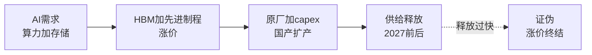

# 半导体：AI单极拉动与国产化

> **用途：** 行业分析第一篇，挂靠《股市笔记》§1（周期镜头）与《交易流派》趋势动量逻辑。行文只讲运行/定价/结构/证伪，不提供个股推荐，不构成投资建议。
> **证据标准：** 每个数字须有**日期 + 口径 + 来源**；凡标"**待核**"未经逐条回溯原文，引用前须复核；凡标"**转引**"为媒体转述研报，口径以原文为准。

## 运行层：AI单极拉动，消费成熟分化

- **总量：** 德勤《2026全球半导体行业趋势报告》（2026-03-26）预计2026年全球半导体销售额9750亿美元创新高，存储收入约2000亿美元、占25%；Semiconductor Intelligence（2026-04-02）预计2026年行业capex约2000亿美元（+20%），存储占45%。
- **单极形态：** AI数据中心环节（先进逻辑代工、HBM、企业级SSD、先进封装）紧张；消费/工业/汽车复苏慢，成熟制程利用率承压——与2019–2021全面缺货不同，本轮是"单极拉动"（semiconreport.org 2026-09-12 转述德勤框架）。
- **消费端：** 招商证券深度跟踪（2026-08-13，转引）：2026H1手机出货-5.4%、苹果逆势增，存储涨价致全年大盘预计-14%；PC Q2出货-4.7%（九连涨后首次下滑）；汽车H1销量-4%。
- **去库：** TI 26Q2库存46.05亿美元、DOI 212天（环比-6天）；英飞凌DOI 177→170天；ST DOI 137天；大陆手机链26Q1平均DOI约175天（招商2026-08-13，转引）。方向是去化延续，但绝对值仍高。
- **capex分化：** 台积电2026年capex上调至600–640亿美元（70%–80%先进制程）；三星DS部门26Q2资本开支15.4万亿韩元（平泽新厂+HBM4）；美光FY2026约270亿美元；SK海力士约40万亿韩元区间高位；中芯约80亿美元；特斯拉Terrafab（2nm，250亿美元分6年）2026年启动（Semiconductor Intelligence 2026-04-02，转引）。

## 定价层：谁在付溢价

- **存储：** AI需求主导晶圆与封装"零和博弈"（德勤2026-03-26）：DDR4/DDR5消费级供应紧，2025年9–11月价格约涨4倍，2026H1最高再涨50%（德勤，转引）；2027年DRAM（HBM挤占）或更紧、NAND或趋平衡（招商2026-08-13，转引）。
- **逻辑：** 先进逻辑向头部集中、定价权上移；成熟制程靠利用率定价，尚未修复。
- **国产链：** 长鑫2026H1营收预计1100–1200亿元、净利500–570亿元（科创板IPO招股书预告，新华网2026-07-09转引），DRAM份额约7.7%–8%（全球第四）；长江存储1600亿元估值冲刺IPO（胡润独角兽榜，新华网2026-07-09转引）。逻辑是周期红利与国产化共振，不对个股下结论。
- **风险定价：** 费城半导体7月以来调整（招商2026-08-13，转引）；AI标的享成长溢价、传统周期标的按利用率定价，分化或阶段性再平衡（semiconreport 2026-09-12）。

## 结构层：瓶颈与国产化

- **最紧环节：** 先进封装（CoWoS类）、HBM、高端载板——"后道约束"决定AI算力交付节奏（semiconreport 2026-09-12）；HBM基础裸片交由代工制造，存储与代工耦合加深。
- **国产化：** 长存/长鑫扩产 + ALD/刻蚀/TSV设备突破；先进逻辑（中芯/华虹/华力）保供扩产；设备零部件与材料从验证导入转向批量放量（招商/CLS 2026-01-01，转引）。HBM高端仍由海外三家垄断，人才与良率是短板（新华网2026-07-09）。
- **技术切换：** 逻辑进2nm（GAA）、存储HBM3E→HBM4、封装转向CoWoS/SoIC/FOPLP、CPO/LPO降功耗30%–50%（德勤2026-03-26，转引）；AI网络支出2024–2029复合增速约38%（德勤，转引）。

## 证伪层

- **涨价证伪：** 新增供给释放超预期（2027年DRAM/NAND分化走反）、成熟制程利用率回升吞掉分化、AI capex增速掉头（CSP合计约8300亿美元预期落空，招商2026-08-13转引）。
- **国产链证伪：** 海外巨头集中扩产打价格战、先进制程良率/客户导入不及预期、设备招标转订单不及预期。
- **跟踪项：** 存储合约价环比、原厂长协覆盖率、台积电/中芯利用率与capex执行率、HBM4量产节奏。

## 参考

- 德勤《2026全球半导体行业趋势报告》：https://www.deloitte.com/cn/zh/Industries/telecom-media-entertainment/perspectives/deloitte-2026-global-semiconductor-industry-outlook.html
- 招商证券半导体深度跟踪（2026-08-13）：http://m.microbell.com/wap_detail.aspx?id=8a05a9b8c01b9f182c3d31d053dd7230
- Semiconductor Intelligence 2026 capex前瞻：https://news.qq.com/rain/a/20260402A01GVR00
- 新华网存储双雄观察（2026-07-09）：http://www.xinhuanet.com/tech/20260709/18d93d2f14084b12b0b22f32012c3519/c.html
- CLS三关键词（2026-01-01）：https://www.cls.cn/detail/2245258
- semiconreport德勤解读（2026-09-12）：https://www.semiconreport.org/zh/articles/deloitte-2026-semiconductor-industry-outlook
