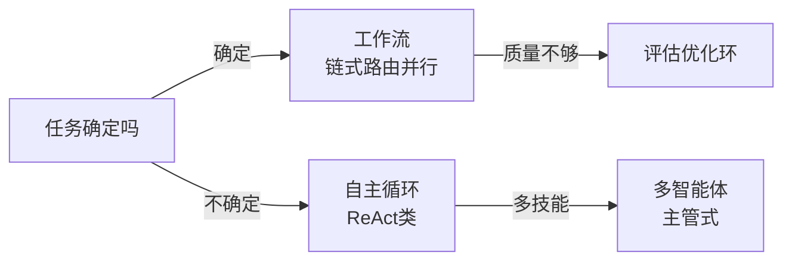

# 从GoF到Agent模式

**摘要：** 先过 GoF 23（确定性协作的答案），再看 Agent 多了什么（运行时决策的新失败），最后两张表收口：对标表讲"像在哪"，选型表讲"用哪个"。与《Agent手册》分工：手册讲系统由什么组成，本篇讲模式怎么演进。

**怎么读：** §1 GoF 速览（查表即可）→ §2 分层（先分层再对标）→ §3 总表 → §4–§6 三组（照抄/改造/全新）→ §7 选型 + 上线检查单。

> GoF 管确定性协作，Agent 模式管运行时决策。

做过后端的都熟：23 种 GoF + 微服务的熔断、管道、分流，解决的是"对象怎么写才稳"。Agent 把调用者换成了大模型——它会自己定下一步、自己调工具、自己改答案。于是多了三种传统代码里没有的失败：幻觉调不存在的工具、无限反思改个没完、token/钱烧穿。

本文用你已经会用的传统模式做锚，把 Agent 模式讲清：像在哪、不像在哪、怎么写才好。

## 1. GoF 23 速览（后端落点版）

**一句话：创建管 new，结构管包，行为管调——每个模式后面跟一句"在后端落在哪"，查表即可。**

### 创建型（5）：对象怎么 new

| 模式 | 一句话 | 后端落点 |
| --- | --- | --- |
| 单例 | 全局唯一实例 | 配置、连接池、Boot 默认单例 Bean（DCL/静态内部类/枚举，见《Java/Python笔记》§4） |
| 工厂方法 | 封装创建，解耦依赖 | BeanFactory、DriverManager |
| 抽象工厂 | 产品族成套创建 | 多 DB 方言、多云存储适配 |
| 建造者 | 分步骤构建复杂对象 | Request/Client 链式构建（OkHttp 即此） |
| 原型 | 复制代替 new | 配置模板、并发任务模板 |

### 结构型（7）：怎么包

| 模式 | 一句话 | 后端落点 |
| --- | --- | --- |
| 代理 | 控制访问 | AOP（JDK 动态代理/CGLIB）、Guardrails 拦截 |
| 装饰器 | 动态增强不改本体 | 评估环包生成器、IO 流包装 |
| 适配器 | 接口转换 | Tool 包装（外部 API 包成模型可调接口） |
| 桥接 | 抽象与实现分离 | 驱动层、跨平台通道 |
| 组合 | 树形结构统一处理 | 菜单、组织架构、文件树 |
| 外观 | 简化复杂子系统 | 网关门面、客户端 SDK |
| 享元 | 共享细粒度对象 | 常量池、连接池、线程池 worker |

### 行为型（11）：怎么调

| 模式 | 一句话 | 后端落点 |
| --- | --- | --- |
| 观察者 | 发布-订阅 | 事件机制、配置变更推送 |
| 策略 | 算法族可替换 | 路由、负载均衡、支付渠道 |
| 模板方法 | 骨架定死、细节子类填 | 数据管道、导入任务流程 |
| 责任链 | 请求沿链传递 | 拦截器链（OkHttp）、网关过滤器 |
| 命令 | 请求封装为对象 | 任务队列、重试单元 |
| 迭代器 | 遍历不暴露结构 | 游标分页、结果集遍历 |
| 状态 | 状态机驱动行为 | 订单、DAG 节点（见《系统设计笔记》§6.6） |
| 备忘录 | 存档与恢复 | 评估中间稿、草稿箱 |
| 中介者 | 中央协调代替网状调用 | Orchestrator 的祖先（见§5） |
| 访问者 | 结构上加新操作 | 编译器、报表遍历 |
| 解释器 | 解释执行小语言 | DSL、规则引擎、正则 |

- **OO 五原则一句话：** 单一职责、开闭、里氏替换、接口隔离、依赖倒置——原则是方向，模式是招式。

## 2. 分层：先分层再对标，不然会乱

**一句话：GoF 住在代码层，Agent 模式横跨五层——对标前先看模式住哪层，跨层对比必乱。**

| 层 | 解决什么 | 含哪些 Agent 模式 | 对标对象 |
| --- | --- | --- | --- |
| L0 代码实现层 | 单个类/函数怎么写 | Tool 对象创建、Memory 存取、事件分发内部实现 | GoF 23 原样用：Factory 建 Tool、Singleton 管 Session、Observer 推事件 |
| L1-L2 架构/集成层 | 系统怎么连、流程怎么走 | 提示链、路由、并行、Orchestrator、MCP/RAG、A2A、目标监控、异常恢复 | 对标 EIP/微服务：Pipes-Filters、Strategy、Fork-Join、Mediator、熔断、Saga，不对标 GoF |
| L3 思考认知层 | Agent 怎么想 | 推理（ReAct/CoT/ToT）、规划、反思/Evaluator、学习适应、探索发现、优先级排序 | **无传统等价物**，这是 Agent 增量 |
| L4-L5 协作治理层 | 多智能体 + 人 + 运维怎么管 | 多智能体协作、HITL、Guardrails、评估监控、资源优化 | 对标协作治理：Actor、Proxy、Observer、SRE，不对标 GoF 单个模式 |

- 多智能体放协作层不放 L3：单个 Agent 的想是 L3，多个 Agent 怎么商量（debate/vote/handoff）是协作问题；反思是单体自省，多智能体是群体商量，分开读者更清楚。

## 3. 总表：12+3，先看全景

| Agent 模式 | 一句话 | 传统锚 |
| --- | --- | --- |
| 提示链 | 上步输出即下步输入 | Pipes-Filters |
| 路由 | 先分类再进专用流程 | Strategy + Factory |
| 并行化 | 分治或投票再聚合 | Fork-Join / N-Version |
| Orchestrator | 中央 LLM 动态拆活 | Mediator |
| Evaluator/反思 | 生成 + 批判两角色 | Decorator + Memento |
| 工具使用/MCP | 给模型包外部能力 | Adapter + Facade |
| 规划/ReAct | 模型自己走 Thought-Act-Obs | 无等价 |
| 多智能体 | 多角色协作 | 微服务 + Mediator |
| 记忆/RAG | 跨轮状态 | Repository + Cache |
| 目标监控/异常/HITL/Guardrails/评估 | 生产三件套 | Proxy + 熔断 + Observer |

结论先行：约 1/3 直接复用，1/3 要改造，1/3 全新。全新的三块就是本文增量：ReAct、规划、多智能体通信。

## 4. 能直接抄的三组

**一句话：调用者从代码换成模型，但结构不变——照抄，多的只是一层"防模型犯错"的 gate。**

### 工具使用：就是 Adapter，但接口写给模型看

传统 Adapter 把外部 API 包成内部接口，Agent 一样，只是调用者从代码变成了 LLM（Anthropic 称之为 ACI，对标 HCI）。标准六步：定义工具 → 模型决策 → 生成 JSON → 框架执行 → 回 observation → 再推理。写好三条：描述写给实习生看（含边界 + 示例）；参数显式、幂等、超时、沙盒；模型内能算的别调。

### 提示链：就是管道，但每段都会幻觉

大 prompt 三病：context drift、指令忽略、错误传播。拆成大纲 → 正文 → 校对，每步只做一件事，就是管道过滤器 + 模板方法。多的一层是 gate：每步后用代码判格式/长度/关键词，不过就停或重试，不让错往下流，全链打 trace-id。

### 路由 + Guardrails：策略 + 代理，直接复用

路由即 Strategy：先分诊再进专用 prompt/工具/模型，难的走大模型、易的走小模型，留 default 兜底（分类器本身会分错）。Guardrails 即保护代理 + 熔断：input / tool-call / tool-response / output 四点拦截，只检输出是典型反模式。生产三板斧：最大步数/钱上限、HITL 低置信转人工、trajectory 回放做 eval。

## 5. 要改造的两组

**一句话：结构照抄，终止条件和任务形状变了——改造点全在"什么时候停"和"任务何时才定"。**

### 反思：装饰器 + 备忘录，但终止条件是自然语言

生成者写一版，批判者照标准改一版（HumanEval 80%→91% 就靠这多看一眼）。像装饰器包增强，像备忘录存中间稿。不像的是改到什么时候停代码说不清：必须硬 cap 2–3 轮，且标准可验证（单测过、名单命中、格式器过）；先跑外部校验再让 LLM 改，只存 diff 省 token；无标准答案的创意写作别用。

### 并行 + Orchestrator：分治 + 中介，但任务运行时才定

分治、投票聚合就是 Fork-Join 和 N-Version，差异最小。Orchestrator 是动态版：中央 LLM 看输入现拆活、分给 worker、再聚合，像 Mediator + Supervisor。写好：worker 输入输出定 schema，Supervisor 只分发不干活，并发加聚合超时，全轨迹 logging 否则挂了查不清。

## 6. 无对标三者：Agent 真正的增量

**一句话：ReAct 是运行时解释执行，规划是粗版 ReAct，多智能体是自然语言版微服务——三者都没有 GoF 祖先。**

### ReAct + 规划

| 模式 | 机制 | 适用 | 代价 |
| --- | --- | --- | --- |
| ReAct | 思考→行动→观察交错（Yao 2022） | 开放任务、工具多 | 步数多、易漂移 |
| Reflexion | 失败后自然语言复盘入记忆 | 可试错、有明确判分 | 需好评估器 |
| Plan-and-Execute | 先出计划再逐步执行、偏差重规划 | 长任务、步骤可列 | 规划错全错 |
| ReWOO | 一次性全规划 + 工具变量替换 | 工具调用可预见 | 灵活性低 |

- 生产配方：大计划粗分 + 每步内小 ReAct + 步步 grounding；流程固定的老实用提示链，别为智能而规划。
- 必须 Bounded：最大步/次/时三限，计划先打印给人看，失败回退上一步。状态机转移是写死的，ReAct 下一步是模型定的——这就是无祖先的原因。

### 多智能体：像微服务，但通信是自然语言

单 context 装不下多角色才拆：研究员 / coder / 评审各一 agent。拓扑三选一：Chain 顺序、Star 集中、Mesh 对等（Microsoft 称 Sequential / Concurrent / GroupChat / Handoff / Magentic）。像微服务分工，不像的是线上传自然语言，会 drift、会互甩锅。先单 agent 顶，顶不住再拆——Over-Agentification 是头号反模式。Handoff 协议写死，A2A/MCP 互通，Supervisor 别下场干活。

### 记忆与工具：三层 + 网关

记忆分三层：当轮上下文（快、贵）→ 检索库（经验/文档按需取）→ 权重（慢、稳），热数据上浮、冷数据下沉。Agentic RAG 把检索本身放进循环（改写查询 → 检索 → 自评 → 再检索）。工具走网关：鉴权、限流、审计、幂等收一处，MCP 即标准化后的网关协议。评估器与验证器是同一个东西——验证器质量是所有循环的天花板（见《RSI 笔记》§1）。

## 7. 选型与上线检查单

**一句话：按任务形状查表，默认从左往右试；按失败加模式，别按想象加。**

| 任务形状 | 首选 | 不够再加 |
| --- | --- | --- |
| 固定多步 | 链式 | 中间加校验门 |
| 先分类后处理 | 路由 | 错分加人工复核 |
| 独立子任务多 | 并行化 | 投票聚合 |
| 拆法事先不知 | 编排-工人 | 尾挂评估环 |
| 开放探索 | ReAct | 失败加 Reflexion |
| 长计划任务 | Plan-and-Execute | 偏差重规划 |
| 多技能协作 | 主管-工人 | 正确性不够上辩论 |

- 加料顺序：单调用 + 工具 → 验证挂了加反思 → 步骤不定加规划 → 角色装不下才上多智能体 → 全程挂 Bounded + Guardrail + Logging。
- **上线五问：** ACI 文档实习生能看懂吗？最大步数钱上限有吗？四点拦截做了吗？低置信转人工了吗？20 条黄金用例能回放吗？全 yes 即可发。

## 参考资料

- Anthropic《Building Effective Agents》（工作流五式与"简单优先"）：https://www.anthropic.com/engineering/building-effective-agents
- ReAct（`arXiv:2210.03629`）、Reflexion（`arXiv:2303.11366`）；四模式对照：https://theaiengineer.substack.com/p/the-4-single-agent-patterns
- HuggingFace《Design Patterns for Building Agentic Workflows》：https://huggingface.co/blog/dcarpintero/design-patterns-for-building-agentic-workflows
- Agentic Design Patterns 入门：https://aman.ai/primers/ai/agentic-design-patterns/
- Microsoft AI Agent Orchestration Patterns；谷歌《Agentic Design Patterns》（xindoo 中文版 21 章）；Augment 2026 Catalog。
