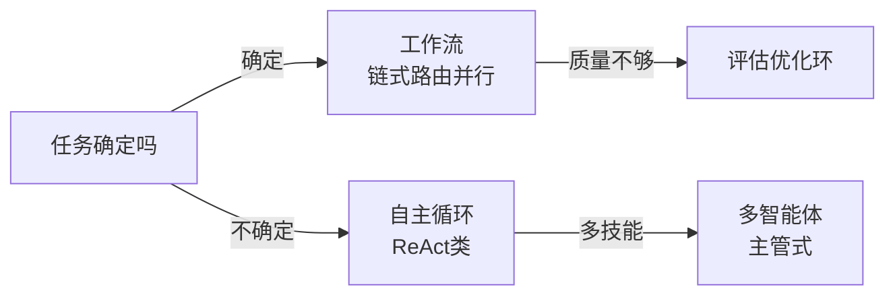

# 从GoF到Agent模式

**摘要：** 先一句话定位 GoF，再用 L0–L5 分层讲清 Agent 模式住在哪层、和传统做法像在哪不像在哪，最后用选型表和检查单收口。与《Agent手册》分工：手册讲系统由什么组成，本篇讲模式怎么演进。

**怎么读：** §1 一句话定位 GoF → §2 分层（核心）→ §3–§5 三组（照抄/改造/全新）→ §6 选型检查单。

> GoF 管确定性协作，Agent 模式管运行时决策。

做过后端的都熟：23 种 GoF + 微服务的熔断、管道、分流，解决的是"对象怎么写才稳"。Agent 把调用者换成了大模型——它会自己定下一步、自己调工具、自己改答案。于是多了三种传统代码里没有的失败：幻觉调不存在的工具、无限反思改个没完、token/钱烧穿。

本文不做一一对照，只讲清一件事：Agent 模式住在哪些层，每层和传统做法的逻辑关系是什么。

## 1. GoF 一句话定位

**一句话：GoF 23 = 创建管 new、结构管包、行为管调，解决"对象怎么写才稳"——后文只借它的逻辑，不再展开。**

- 后端最常用的七个（单例/工厂/代理/策略/观察者/模板方法/责任链）在《Java/Python笔记》§4 已有落点（Boot Bean、AOP、事件机制、拦截器链），不再重复。
- OO 五原则（单一职责、开闭、里氏替换、接口隔离、依赖倒置）是方向，模式是招式——这句话在两边通用。

## 2. 分层：先分层，逻辑自清

**一句话：GoF 住在代码层，Agent 模式横跨五层——看清模式住哪层，像不像自有分晓。**

| 层 | 解决什么 | 含哪些 Agent 模式 | 和传统的关系 |
| --- | --- | --- | --- |
| L0 代码实现层 | 单个类/函数怎么写 | Tool 对象创建、Memory 存取、事件分发内部实现 | 直接复用：Factory 建 Tool、Singleton 管 Session、Observer 推事件 |
| L1-L2 架构/集成层 | 系统怎么连、流程怎么走 | 提示链、路由、并行、Orchestrator、MCP/RAG、A2A、目标监控、异常恢复 | 逻辑相通：管道、策略、分治、中介、熔断、Saga，换的是调用者 |
| L3 思考认知层 | Agent 怎么想 | 推理（ReAct/CoT/ToT）、规划、反思/Evaluator、学习适应、探索发现、优先级排序 | **无传统等价物**，这是 Agent 增量 |
| L4-L5 协作治理层 | 多智能体 + 人 + 运维怎么管 | 多智能体协作、HITL、Guardrails、评估监控、资源优化 | 逻辑相通：Actor、Proxy、Observer、SRE，载荷换成自然语言 |

- 结论先行：约 1/3 直接复用，1/3 要改造，1/3 全新。全新的三块就是本文增量：ReAct、规划、多智能体通信。
- 多智能体放协作层不放 L3：单个 Agent 的想是 L3，多个 Agent 怎么商量（debate/vote/handoff）是协作问题；反思是单体自省，多智能体是群体商量，分开读者更清楚。

## 3. 能直接抄的三组

**一句话：调用者从代码换成模型，但结构不变——照抄，多的只是一层"防模型犯错"的 gate。**

### 工具使用：就是 Adapter，但接口写给模型看

传统 Adapter 把外部 API 包成内部接口，Agent 一样，只是调用者从代码变成了 LLM（Anthropic 称之为 ACI，对标 HCI）。标准六步：定义工具 → 模型决策 → 生成 JSON → 框架执行 → 回 observation → 再推理。写好三条：描述写给实习生看（含边界 + 示例）；参数显式、幂等、超时、沙盒；模型内能算的别调。

### 提示链：就是管道，但每段都会幻觉

大 prompt 三病：context drift、指令忽略、错误传播。拆成大纲 → 正文 → 校对，每步只做一件事，就是管道过滤器 + 模板方法。多的一层是 gate：每步后用代码判格式/长度/关键词，不过就停或重试，不让错往下流，全链打 trace-id。

### 路由 + Guardrails：策略 + 代理，直接复用

路由即 Strategy：先分诊再进专用 prompt/工具/模型，难的走大模型、易的走小模型，留 default 兜底（分类器本身会分错）。Guardrails 即保护代理 + 熔断：input / tool-call / tool-response / output 四点拦截，只检输出是典型反模式。生产三板斧：最大步数/钱上限、HITL 低置信转人工、trajectory 回放做 eval。

## 4. 要改造的两组

**一句话：结构照抄，终止条件和任务形状变了——改造点全在"什么时候停"和"任务何时才定"。**

### 反思：装饰器 + 备忘录，但终止条件是自然语言

生成者写一版，批判者照标准改一版（HumanEval 80%→91% 就靠这多看一眼）。像装饰器包增强，像备忘录存中间稿。不像的是改到什么时候停代码说不清：必须硬 cap 2–3 轮，且标准可验证（单测过、名单命中、格式器过）；先跑外部校验再让 LLM 改，只存 diff 省 token；无标准答案的创意写作别用。

### 并行 + Orchestrator：分治 + 中介，但任务运行时才定

分治、投票聚合就是 Fork-Join 和 N-Version，差异最小。Orchestrator 是动态版：中央 LLM 看输入现拆活、分给 worker、再聚合，像 Mediator + Supervisor。写好：worker 输入输出定 schema，Supervisor 只分发不干活，并发加聚合超时，全轨迹 logging 否则挂了查不清。

## 5. 无对标三者：Agent 真正的增量

**一句话：ReAct 是运行时解释执行，规划是粗版 ReAct，多智能体是自然语言版微服务——三者都没有传统祖先。**

### ReAct + 规划

| 模式 | 机制 | 适用 | 代价 |
| --- | --- | --- | --- |
| ReAct | 思考→行动→观察交错（Yao 2022） | 开放任务、工具多 | 步数多、易漂移 |
| Reflexion | 失败后自然语言复盘入记忆 | 可试错、有明确判分 | 需好评估器 |
| Plan-and-Execute | 先出计划再逐步执行、偏差重规划 | 长任务、步骤可列 | 规划错全错 |
| ReWOO | 一次性全规划 + 工具变量替换 | 工具调用可预见 | 灵活性低 |

- 生产配方：大计划粗分 + 每步内小 ReAct + 步步 grounding；流程固定的老实用提示链，别为智能而规划。
- 必须 Bounded：最大步/次/时三限，计划先打印给人看，失败回退上一步。状态机转移是写死的，ReAct 下一步是模型定的——这就是无祖先的原因。

### 多智能体：像微服务，但通信是自然语言

单 context 装不下多角色才拆：研究员 / coder / 评审各一 agent。拓扑三选一：Chain 顺序、Star 集中、Mesh 对等（Microsoft 称 Sequential / Concurrent / GroupChat / Handoff / Magentic）。像微服务分工，不像的是线上传自然语言，会 drift、会互甩锅。先单 agent 顶，顶不住再拆——Over-Agentification 是头号反模式。Handoff 协议写死，A2A/MCP 互通，Supervisor 别下场干活。

### 记忆与工具：三层 + 网关

记忆分三层：当轮上下文（快、贵）→ 检索库（经验/文档按需取）→ 权重（慢、稳），热数据上浮、冷数据下沉。Agentic RAG 把检索本身放进循环（改写查询 → 检索 → 自评 → 再检索）。工具走网关：鉴权、限流、审计、幂等收一处，MCP 即标准化后的网关协议。评估器与验证器是同一个东西——验证器质量是所有循环的天花板（见《RSI 笔记》§1）。

## 6. 选型与上线检查单

**一句话：按任务形状查表，默认从左往右试；按失败加模式，别按想象加。**

| 任务形状 | 首选 | 不够再加 |
| --- | --- | --- |
| 固定多步 | 链式 | 中间加校验门 |
| 先分类后处理 | 路由 | 错分加人工复核 |
| 独立子任务多 | 并行化 | 投票聚合 |
| 拆法事先不知 | 编排-工人 | 尾挂评估环 |
| 开放探索 | ReAct | 失败加 Reflexion |
| 长计划任务 | Plan-and-Execute | 偏差重规划 |
| 多技能协作 | 主管-工人 | 正确性不够上辩论 |

- 加料顺序：单调用 + 工具 → 验证挂了加反思 → 步骤不定加规划 → 角色装不下才上多智能体 → 全程挂 Bounded + Guardrail + Logging。
- **上线五问：** ACI 文档实习生能看懂吗？最大步数钱上限有吗？四点拦截做了吗？低置信转人工了吗？20 条黄金用例能回放吗？全 yes 即可发。

## 参考资料

- Anthropic《Building Effective Agents》（工作流五式与"简单优先"）：https://www.anthropic.com/engineering/building-effective-agents
- ReAct（`arXiv:2210.03629`）、Reflexion（`arXiv:2303.11366`）；四模式对照：https://theaiengineer.substack.com/p/the-4-single-agent-patterns
- HuggingFace《Design Patterns for Building Agentic Workflows》：https://huggingface.co/blog/dcarpintero/design-patterns-for-building-agentic-workflows
- Agentic Design Patterns 入门：https://aman.ai/primers/ai/agentic-design-patterns/
- Microsoft AI Agent Orchestration Patterns；谷歌《Agentic Design Patterns》（xindoo 中文版 21 章）；Augment 2026 Catalog。
