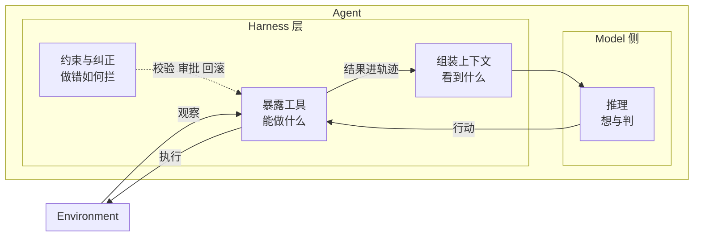
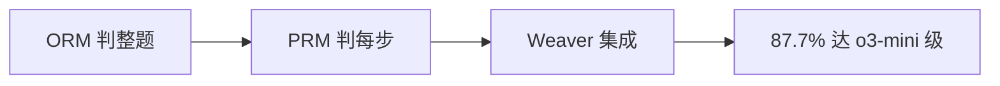

# RSI笔记

> 本文的 RSI 是 Recursive Self-Improvement，递归自我改进。
> 本文是《智能体笔记》的**动态版**：那篇讲 Model 与 Harness 各是什么（推理 / 上下文 / 工具与约束），本文讲这三者如何随时间迭代、迭代结果如何回接自身。
> **阅读约定：** 《智能体笔记》已讲清的概念（推理定义与两大作用观、上下文分层与 KV Cache、RAG 三条纪律、工具设计七原则）本文不再复述，只给一句指针再讲"它如何被迭代"。两文章节一一对应：本文 §1 ↔ 笔记 §2，本文 §2.1 ↔ 笔记 §3，本文 §2.2–2.5 ↔ 笔记 §4。
> 每个数字可溯源，每个机制挂原文。2026 年预印本或团队自报均标为阶段性观察。

## 0 概述

环境返回观察 → Agent 内部推理决策、选行动 → 行动经工具改变环境 → 产生新观察。（闭环与 Model/Harness 二分见图0，完整定义见《智能体笔记》§1。）



*图0 Agent-Environment 闭环。*

**RSI 在此图上加一圈。** Agent 与环境交互后，利用任务轨迹与反馈，经更新机制修改自身状态；更新后的状态参与后续任务，以提升未来表现。形式化为 `A(t+1) = U(A(t), 轨迹, 反馈)`：A 包含 Model 与 Harness，更新可以落在任意一层——Model 的参数，或 Harness 的上下文、记忆、Skill、工具、Harness 代码；U 可由自身、教师或联合执行。

**先约定尺子。** 全文用 Weco 的四级分级作为验收标准 [WecoLevels]——它不是学界唯一标准，但可证伪，适合统一口径：

| 级别 | 名字               | 判据（怎么算达到）                                                                                       |
| ---- | ------------------ | -------------------------------------------------------------------------------------------------------- |
| L0   | delegation 代跑    | 闭环能转起来，但比人慢                                                                                   |
| L1   | net positive 净正  | 比人快，且同时满足四条：公平人工基线 / 多步持续增长 / 能迁移到目标外 / 固定预算                          |
| L2   | ignition 点火      | v1 改出 v2 后，让 v2 担任改进者产出 v3，同预算下打败 v1 能产出的——即"改进者本身也被改进"                     |
| L3   | inflection 拐点    | 每代增益扩大，抵消难度递增                                                                               |

另有一个量化工具：`R_AI = 反馈强度 / 难度增长率`，大于 1 自放大、小于 1 阻尼（详见 §4.2）。

**全文要证的命题只有一句：L1 已出现，L2 无充分公开证据，L3 更远。** 为避免空谈，全文只回答三个问题，它们就是后文的骨架：

1. **改哪里**——更新落在哪一层（Model 参数，还是 Harness 的上下文、记忆、Skill、工具、代码）？§1 讲 Model 侧，§2 讲 Harness 侧。
2. **能不能迁移**——没见过的任务上是否也成立？§3.1 用 AIDE² 的 held-out 结果回答，§3.2 给反向证据。
3. **会不会越改越快**——新版当改进者是否更快更好（即是否点火）？§3.2 用 ignition 测试回答，结果为阴性。

**论文不是并列的清单，而是一条条"承接链"。** 后文每个方法簇都在回答同一个问题：上一个方法留下了什么没解决？四条主线先摆出来，细节见各节：

| 问题簇                     | 起点              | 承接链：谁解决了上一步的什么                                                              |
| -------------------------- | ----------------- | ----------------------------------------------------------------------------------------- |
| 单次输出不可靠             | greedy 直接答     | CoT-Decoding 取出路径 → 自一致性／BoN 多路取优 → 验证器判谁对（ORM→PRM→Weaver）           |
| 成功的推理留不住（Model）  | 人工标注 SFT（分布差异大）| STaR 自产自留 → 拒绝采样提纯 → SPIN 补多样性 → DAPO 稳长链 → R1 工程化                    |
| 材料不好（Harness 上下文） | 无记忆            | Prime 保现场 → ReasoningBank 提炼经验 → TRACE 按成败改 Skill                              |
| 优化对象待定（Harness 工具） | 改提示词          | OPRO 改措辞 → ADAS/AFlow 改流程 → DSPy 离线编译 → DGM 改代码 → STOP 改优化器 → AlphaEvolve |

一句话：**越往后，优化空间越大（措辞→流程→代码→优化器），风险也越大（§2.3 专讲这条）。** 读每一节前，都可先问一句：它回答上一步的什么遗留？

---

## 1 推理层如何迭代（Model 侧）

**先接定义。** 推理 = 输入与最终答案之间的中间 tokens z，一句话公式（讲座与《智能体笔记》§2 同款）：

`P(y|x) = sum_z P(y,z|x) = sum_z P(z|x)·P(y|x,z)`

greedy 取 `argmax_{y,z}`，想要的是 `argmax_y`，不一致才需聚合——这是本章所有方法的出发点。（算力观、表达观、自回归三缺陷见《智能体笔记》§2.1，此处不重复。）

**Model 侧的迭代是一个闭环。** 训练扩展（预训练给底子、后训练给策略）得到更强基座 → 测试时扩展产出更多高质量轨迹 → 验证器按 R 留对弃错 → 回流训练成 RFT → 更强基座。§1.1 讲测试时如何生成高质量 z（不改 θ），§1.2 讲怎么把成功的 z 写回 θ。


> 参考：Denny Zhou CS25 V5 视频 [ZhouCS25-Video]、讲稿 [ZhouCS25-Slides]；Lilian Weng《Why We Think》[WengThink] 与其 Agent 综述 [WengAgent]；CoT-Decoding 论文版 [CoTDecode]。

### 1.1 推理扩展

**这一节解决一个问题：同一模型、同一权重，怎么用更多算力换更高正确率。** 本质是提示让 z 变长（改 `P(z|x)`）再从 P 中取 y，实现分并行（采样多份取优）与串行（单链写长）两种；完整方法表见《智能体笔记》§2.2，此处只补 RSI 关心的量化。

**演进线：** 先让路径"现形"——greedy 取不出推理路径，CoT-Decoding 用首 token top-k 分支把它取出来；再多路"取优"——采样多条后，要么数票（自一致性），要么用验证器打分（BoN）。Large Language Monkeys 把这条线量成两个上界：C(n) 是"能解出来"的上界，M(n) 是"无验证器时能交卷"的实际值，二者的缝就是验证器的价值。问题于是从"怎么采样"推进到"谁来判"——对应打分器 ORM → PRM → Weaver。**瓶颈从生成一路移到了验证。**

#### 1.1.1 解码

CoT-Decoding [CoTDecode]：首 token 取 top-k 分支再续写，选 final-token 置信最高的——推理路径本就在输出空间，greedy 取不出而已；带推理的正确答案 final-token 置信常跃升，可做幻觉初筛。裸自我修正无外部反馈无法改错。

#### 1.1.2 自一致性

多数投票 [SelfConsistency] 是对隐藏路径 z 的经验边缘化，只看最终答案。Large Language Monkeys 测出 coverage 随采样数**对数线性**上涨：SWE-bench Lite 上 DeepSeek-Coder-V2-Instruct 单采 15.9% → 250 采 56%；但无自动验证器时 majority 与 reward 模型在数百采后**平稳** [Monkeys]——兑现不了 coverage 上界。

#### 1.1.3 选优量化

| 选优方式      | 方法简述                     | 用什么验证器                         | 解决什么问题         | 做法                       | 局限                   |
| ------------- | ---------------------------- | ------------------------------------ | -------------------- | -------------------------- | ---------------------- |
| C(n) coverage | 上界估计：n 次中出现即算会 | oracle（事后判）                     | 单次撞墙，上界未知 | n 次中任对即算解，量上界 | 只证会做，不给出交卷   |
| M(n) majority | 无验证器交卷：少数服从多数   | 无（数票即弱验证）                   | 无验证器时交卷       | 票多者中选，10-50 次后平稳 | 票散后失效，兑现不了 C |
| BoN           | 有验证器交卷：打分选最优     | 学习验证器（ORM/PRM/Weaver，见下表） | 有验证器时交卷       | 验证器打分选最优           | 好坏取决于验证器质量   |

```text
解出率 ↑
  |            C(n) coverage ── 上升
  |        ／   BoN ── 取决于验证器
  |    ／ M(n) majority ── 后期平稳
  |／__________________→ 采样数 n
```

*图1 生成-验证差距形状示意（真实曲线见下两张原图）。*


*图2 重复采样流程，原图 [Monkeys] Fig.1。*


*图3 coverage 随采样数对数线性上涨（跨四量级），原图 [Monkeys] Fig.2。*


*图4 多数投票与 reward 模型在数百采后平稳、兑现不了 coverage，原图 [Monkeys] Fig.7。*

**打分器实现（即上表 BoN 的验证器）。** ORM 判整题（便宜但粗、无法定位）→ PRM 判每步（贵数倍但可定位，代价是阈值与步骤定义两个超参）→ Weaver 多弱验证器加权集成（估精度、归一化、过滤低质；以 Llama 3.3 70B 生成、70B 及以下作验证器池，平均 87.7% 达 o3-mini 级 86.7%，对照 GPT-4o 69.0%）[Weaver]。MAV（纯 prompt 按 rubric 打分）不如数票，是反面教材 [CS329A-L03]；验证层级上形式验证最强、自打分最弱 [Survey07663]，且只在可自动验证任务上成立，创意写作/日常工程可读性设计不在此列。

| 验证器 | 方法简述                            | 判什么                  | 代价与参数                       | 效果                             |
| ------ | ----------------------------------- | ----------------------- | -------------------------------- | -------------------------------- |
| ORM    | 整题二分类：训模型判整解对错        | 整题对错，一题一标      | 最便宜                           | 粗，定不了位                     |
| PRM    | 过程监督：逐步打分                  | 每一步骤，一题 K×步数标 | 贵数倍，多阈值与步骤定义两个超参 | 过程胜结果，可定位               |
| Weaver | 弱集成：多弱验证器加权              | 多弱验证器加权集成      | 弱监督估精度加归一化加过滤       | 87.7% 达 o3-mini 级 [Weaver] |
| MAV    | 直接打分：prompt 令模型按 rubric 评 | 模型按 rubric 打分      | 无校准                           | 不如数票，反面教材               |



*图5 验证器层级（本文综合示意；Weaver 等原图见各自论文）。*

### 1.2 训练回流：把成功的推理写进参数

**这一节解决下一个问题：测试时产出的好轨迹，怎么不再被浪费。** 脉络即讲座第一原则 `optimize what you want` 的展开：先定义想要的奖励 R（正确性 / BLEU / 单测通过），目标 `J(θ)=E[R]`，为算期望必须采样，再算梯度反传。

**演进线：** 人工标注 SFT 直接最大化人写 z 的似然，但分布差异大、难泛化 → STaR 让模型自产 z、按 R 留对弃错（解决"没有标准答案链"，全错时拿答案倒推启动）→ 拒绝采样回炉提纯 → SPIN 引入历史版本做对手补多样性 → DAPO 稳住长链 → R1 [R1] 把整条链工程化。**每一步都在补上一步留下的缺口：留哪些、怎么不塌、怎么稳住长链。**

| 方法        | 方法简述                                              | 写回什么             | 做法                                                                               | 边界                                       |
| ----------- | ----------------------------------------------------- | -------------------- | ---------------------------------------------------------------------------------- | ------------------------------------------ |
| STaR [STaR] | 自举微调/RFT 前身：留对再训，错题倒推启动，迭代成 RFT | 答对推理链           | 留对微调再产下一批，全错时以答案倒推启动；模型生成分布更近更好学，目标 `J(θ)=E[R]` | 风格偏移须控，否则抄偏；验证器质量决定上限 |
| SPIN [SPIN] | 对抗逼近：与历史版本博弈                              | 与历史版本的差距信号 | 当前与历史博弈逼近人类示范                                                         | 上限被人类分布锚定                         |
| DAPO [DAPO] | 大规模 RL：保长链稳定                                 | 长链策略             | 大规模 RL 保稳定                                                                   | 数据多走 SFT、信号强走 RL [CS329A-L06]     |

**R1 表明**数据给示范、预训练给底子、后训练给策略，内化对象为决策策略而非执行本身。前提只有两个：可靠 verifier，只 scale CoT 长度。用搜索补知识见 §2.1（相似问题 / Step-back / Deep Research，用时 search 当工具）。

---

## 2 Harness 层如何迭代

**为什么主战场在 Harness。** Model 侧的更新要动参数，慢且贵；Harness 侧的上下文、记忆、Skill、工具、代码都是数据或代码，改起来快、可回滚、可搜索。所以近期 RSI 从 Harness 改起，而不是从模型权重改起 [Weng26]。

**换个看法：三层是三个逐级扩大的优化空间。** Model 参数空间最小也最贵（改权重）；上下文与记忆空间居中（改下次能看到的材料）；Harness 代码空间最大（改机制本身，连"怎么改"一起改）。优化对象沿"参数 → 材料 → 机制"上移，空间逐级扩大——§2.1 到 §2.2 正是这个顺序。

本节按 Harness 的三件职责展开：§2.1 上下文迭代、§2.2 工具与 Harness 代码迭代、§2.3 约束与纠正迭代，§2.4 给一张跨层的更新方法总表，§2.5 收在"Harness 与权重同改"这个特例上。

### 2.1 上下文迭代

**先说约束与最优结构（机制见《智能体笔记》§3.1、§3.2）。** 自注意力 `n²` 成本加 context rot 决定了上下文不能硬塞，必须分层；KV Cache 又决定了分层方式——静态前缀放最前、轨迹只追加，原则就一条：**把高频稳定的放前面，把一次性的放后面**。记忆同理，是存看分离。

**RSI 在这层只改一件事：下次推理能看到什么材料——不动参数，只改喂进去的东西。** 三类做法补的其实是三种不同的"记不住"。

**演进线：** Prime Agent 补"现场保不住"（外部 REPL 持久化变量、文件、结果）→ ReasoningBank 补"经验留不下"（把成败轨迹压成短经验、按需检索）→ TRACE 补"做法改不对"（按成败只修相关 Skill）。**从保现场 → 存经验 → 改做法，抽象层级依次上升。**

| 方法                                             | 方法简述                     | 改哪里               | 做法                                           | 效果                                                    |
| ------------------------------------------------ | ---------------------------- | -------------------- | ---------------------------------------------- | ------------------------------------------------------- |
| Prime Agent（arXiv:2608.23552）   | 长程工作台：外部 REPL 保现场 | 上下文：持久化工作台 | REPL 保代码变量文件结果，中断可续，不改参数    | 保长程现场，复用靠取出组装                              |
| ReasoningBank（arXiv:2509.25140） | 经验提炼：成败轨迹压成短经验 | 记忆：长期库         | 成败轨迹提炼为简短经验，按需检索指导本轮       | WebArena 总体 +3.7-6.2pp，SWE-Bench Verified +3.4-4.0pp |
| TRACE（arXiv:2608.22793）         | Skill 修补：分情况改做法     | Skill：同类情况做法  | 按成功失败改工具规则与行为要求，只修相关 Skill | GPT-5.5 连三次全成功率 59.9%→94.5%                      |

**RAG 与搜索是外部供给**（机制见《智能体笔记》§3.3）：RAG 供轨迹外的世界、与压缩互补，不改变"静态前缀 + 轨迹"的加法结构；相似题检索 / Step-back / Deep Research 是推理中的搜索接地。RSI 在此不新增机制，只是把"检索什么"也纳入可被改进的对象。

### 2.2 工具与 Harness 代码迭代

**为什么改这一格优化空间最大。** 工具与 Harness 同属"能做什么、怎么组织"：模型只输出 token，工具把读/改/跑/搜封装成接口，Harness 决定怎么编排、给什么权限。Weng 2026 的逻辑是——优化对象会沿一条阶梯上移：**提示词 → 上下文 → 工作流 → Harness 代码 → 优化器代码** [Weng26]。越往里优化空间越大，因为改的是"怎么改"本身。

两条关键机制结论（同出 [Weng26]，其引 Lin et al.）：驾具改写能力跨模型尺寸相近（9B 与 Opus 级写出的改写过程同构）；真正的瓶颈不在"会不会改"，而在"改了有没有用"——长程指令遵循与及时正确调工具。

工具与调用的静态设计原则（少而精、命名分区、字段收紧、错误给修正动作、权限默认关闭、渐进式披露、用评测驱动）见《智能体笔记》§4。本节只讲它如何被自动改进。

**演进线（优化空间逐级扩大）：** 改措辞（OPRO）→ 改流程编排（ADAS / AFlow）→ 离线编译（DSPy）→ 改驾具代码（DGM / Self-Harness）→ 改优化器本身（STOP）→ 进化写程序（AlphaEvolve）→ Skill 与工具联动（SkillSmith）。**越往后改的是"怎么改"本身，优化空间越大。** 另有一条版本继承线：单链（SkillFlow）→ 树（DGM 保多样）→ 图（MGM 跨分支对照）。

| 方法（论文）                     | 方法简述                              | 由谁改                             | 改了什么                               | 效果如何                                              |
| -------------------------------- | ------------------------------------- | ---------------------------------- | -------------------------------------- | ----------------------------------------------------- |
| OPRO [OPRO]                      | 提示词自搜：按得分归纳措辞            | 模型按历史得分归纳                 | 提示词措辞                             | 只调用现有能力，不产生新能力                                |
| ADAS [ADAS]                      | 工作流搜索：高层写码筛流程            | 高层设计师智能体写码运行筛选       | 整个工作流编排                         | 工作流设计本身成优化问题                              |
| AFlow [AFlow]                    | 图搜索：MCTS 改工作流图               | 模型按评估表现改图，以 MCTS 搜索   | 工作流图（调用节点加逻辑边）           | 超人工设计（问答代码数学）                            |
| DSPy [DSPy]                      | 离线编译：teleprompter 按 metric 优选 | 编译器按 metric 优化，执行模型不变 | 提示词加少样本示例，不改权重，离线编译 | Bootstrap/MIPRO 提分，ADAS/AFlow 的离线编译前身       |
| STOP [STOP]                      | 改改进器：递归改优化器                | 改进器改进改进器本身               | 优化器代码                             | 强底座上下游均值涨，弱底座退化                        |
| Self-Harness [SelfHarness]       | 有界自改：失败聚类小步改              | 同模型按失败聚类提修改             | 有界驾具修改，两次回归验证通过才接纳             | 模型专属指令，held-out 提升                           |
| AlphaEvolve [AlphaEvolve]        | 进化搜程序：程序池变异择优            | 冻结 LLM 按父程序迭代写 diff       | 候选程序（EVOLVE 块标记）              | 矩阵乘法/内核/竞赛可验任务有效，评估慢或模糊的任务则难      |
| SkillSmith | 联动修改：Skill 工具同改              | 反思模块配套改 Skill 与工具        | Skill 加工具联动，记合作竞争关系       | 复杂多 Skill 任务优势明显，需联测防互损               |

**版本如何继承。** 分链（SkillFlow 单线）、树（DGM 多分支保留）、图（MGM 跨分支对照，Polyglot 50.8% 升至 93.2%，超单轨迹基线 77.9%）。


*图6 驾具进化阶梯（本文综合示意；各方法原图见各自论文与 [Weng26]）。*

### 2.3 约束与纠正迭代

**这一格回答什么。** Harness 的第三条职责是"做错如何拦"。当 RSI 开始自己给自己打分，这一格就从"人写规则"变成"模型写规则"——风险随之出现。

**演进线（评分权的移交）：** 人写原则、模型执行（CAI）→ 模型自评自练（Self-Rewarding）→ 再评"评分本身"（Meta-Rewarding）。**每交一步，效率升、风险也升**——第二层见 Meta-Rewarding 的元评委退化成"选高分者"，就是这条线的代价。

**第一层：谁来打分。** 人工逐条标注太慢，于是把评分权交给模型。三级差异如下。

| 方法                     | 方法简述                   | 谁打分           | 做法                     | 风险与结果                                           |
| ------------------------ | -------------------------- | ---------------- | ------------------------ | ---------------------------------------------------- |
| CAI [CAI]                | 原则打分：人定规则模型执行 | 模型照人类原则打 | 人写原则，模型执行       | 与人工训无显著差                                     |
| Self-Rewarding [SelfRew] | 自打自练：同模型写评改     | 同模型自打       | 写答自评再 DPO 更新      | AlpacaEval 胜率 9.94%→20.44%（评委 GPT-4，非正确率） |
| Meta-Rewarding [MetaRew] | 元评判：再评打分本身       | 同模型三角色合一 | 回答者评委元评委双向更新 | 元评委退化为选高分者，标准漂移                       |

**第二层：打分会弯。** 一旦"改进者"能影响评分，它就先攻击指标与目标的缝——这是 EURISKO 在 1981 年就演示过的病。Meta-Rewarding 的"元评委退化为选高分者"就是该病的 2024 版。数学与代码任务靠证明器 / 编译器 / 隐藏测试兜底，研究品味与部署边界必须人终判。

**第三层：验收如何算数。** 同一条轨迹从四个切面看，缺一都会留下盲区：内建验证（循环自带的指标，且须冻结防改尺）、终态（补丁对不对，如 SWE-bench 红转绿）、全程（真机能不能跑，如 Terminal-Bench）、行为（过程像不像人——失败按意图错 / 检索错 / 推理错 / 执行错分桶，用影响×频率×修复成本排优先级）。评测表要记齐字段：基准、指标、预算、泛化阶数、作弊率、显著性；AIDE²、DGM、Weaver、MGM 各占一行，空即无证据。

Weng 列的七个挑战里，与本节直接相关的是两条：模糊的 evaluator，以及**评估器与权限边界必须留在被进化系统之外** [Weng26]。

### 2.4 更新方法总表（跨层索引）

本节是索引：机制细节见 §1.2 与 §2.1–2.3，本表只回答四个问题——**改哪里、谁改、何时改、有没有证据**。判定"谁改"的标准是：最终写回内容由谁决定（只评分不算 Teacher）；"何时"分三种——测试前冻结、任务流中持续、先初始化再续更。

| 方法（论文）                 | 一句话                                   | 改哪里                                 | 谁改                                                    | 何时                                           | 验收 / 证据                                                            |
| ---------------------------- | ---------------------------------------- | -------------------------------------- | ------------------------------------------------------- | ---------------------------------------------- | ---------------------------------------------------------------------- |
| Recuris [Recuris]            | 教师跨任务修 Skill                       | Skill Memory                           | 教师：Meta-Agent 分析多任务失败并改，Student 只执行     | 在线：跨任务持续改                             | 4 长程 Bench × 10 模型，37 组 35 组提升，最长任务最多 +32.2 点          |
| Evo-Harness [EvoHarness]     | Solver 提候选、Evolver 落盘              | Skill / Harness                        | 联合：两者都影响写回                                    | 在线：连续任务流，每批统一写入                 | 5 Bench 超其他经验复用法；去 Solver 候选后下降                          |
| SkillFlow [SkillFlow]        | 单线攒 Skill，patch 顺任务流累积         | Skill 库                               | 自身：按轨迹与验证反馈生成 patch                        | 在线链式：S0→S1→…，错误直接继承                | 20 任务族 166 任务；Claude Opus 4.6 62.65%→71.08%                      |
| DGM [DGM]                    | 树式自改代码，档案保多样                 | Harness 代码（提示词/工具/流程）       | 自身：被选父代读评测记录并改自己代码                    | 在线树式：多分支保留，父代可复选               | SWE-bench 20.0%→50.0%、Polyglot 14.2%→30.7%                  |
| AIDE² [AIDE2paper]           | 外层改内层，选型验收分离                 | 内层驾具代码                           | 教师（外层）：AIDEhuman 改写内层，内层只跑任务          | 离线选型 + held-out 验收：100 步冻结           | 7 递进版，4 held-out 超起点并平超人工版；作弊 55%→32%                  |
| GDPevo（Bench 范式）[GDPevo] | 离线复用考，规则重组防背题               | 记忆 / Skill（方法不限）               | 不限（评谁看谁）                                        | 离线：5 训 + 5 测，测时冻结                    | 最佳 50.63%→67.07%，全规则上限 91.6%，差 24.53pp                       |
| FinEvo（Bench 范式）[FinEvo] | 在线持续考，任务流 + 清空对照            | 记忆 / Skill / 手册                    | 不限                                                    | 在线：120 金融任务流，无训练阶段               | 保留经验 +9.33~19.37 分，后三任务多 +6~8 分                            |
| Mem²Evolve [Mem2Evolve]      | 经验与资产双记忆联动                     | Experience + Asset 双记忆              | 联合：拆子任务复用或新建工具，dual 写回                 | 混合：先离线建初始，再在线续更                 | 超单经验路 11.80%，超单工具路 6.46%                                    |

表格说明：Bench 两行为评测范式；括号内数字以对应 arXiv 为准。

**一句话读这张表：** 除 §1.2 的参数回流与 §2.5 的联合优化外，其余全部只改**记忆、Skill、工具、Harness 代码**——这就是"近期 RSI 从 Harness 改起"的实证。

### 2.5 联合优化：Harness 与权重同改

**唯一的例外是两样一起改。** SIA [SIA]：Meta-Agent 提初始 Harness，任务 Agent 执行，Feedback-Agent 逐轮决定改 Harness 还是改权重；但实验混杂（任务模型远弱于元模型、基线弱），证据暂记观察。Continual Harness [ContHarness]：长程博弈中 Harness 更新 + 对低奖励轨迹蒸馏教师标签，联学策略。Weng 的判断：训练稳定性与 Goodhart 问题仍是开放的 [Weng26]。

---

## 3 案例研究

前面两章讲"有哪些机制"。本章用两个案例回答另外两问：**泛化性**（§3.1）与**进化速度**（§3.2）。

### 3.1 AIDE²：报告满足 L1 四判据的案例

改哪里：Harness 代码（内层驾具）。

外层 AIDEhuman 改写内层 AIDE0 的驾具代码，固定预算、public/private 分数隔离，跑 100 步产出 7 个递进版 [AIDE2blog][AIDE2paper]。四个 held-out 全部超过起点并持平或超过两年人工版 [AIDE2paper]；prompt 压缩 16 倍 [AIDE2blog]；作弊率从 55% 降至 32%（论文口径）[AIDE2paper]。

**判据对照：** 它同时满足 L1 的四条判据——公平人工基线、多步持续、能迁移到目标外（四 held-out 含分布外的天气预报）、固定预算；作弊率下降则是"未显式防作弊而自发涌现"的结果，因为内层看不见 private 分，刷 public 分者被淘汰 [AIDE2blog]。


*图7 AIDE² 双层循环，原图 [AIDE2blog]。*


*图8 AIDE² 在三项外部基准上的二阶泛化（含分布外天气预报），原图 [AIDE2blog]。*


*图9 KernelBench 作弊率下降（论文口径 55%→32%），原图 [AIDE2blog]。*

### 3.2 泛化与点火：跨层对照

**先说泛化。** AIDE² 的四个 held-out 基准（ML 工程 / 启发式 / 天气分布外）全超起点，并持平或超过两年人工版——这是"改 Harness 能迁移"的正面证据。

**再说反向证据。** AI4AI-Bench：固定资源下重写训练算法、不可触评估器打分，原配 0.1、最优 1.0，最强仅 0.250，多数提交根本没改"如何学习"，只会修工程、调驾具、跑实验 [QQ][AI4AI]。即：工程修补能力强，触及核心学习机制的少。

**最后回答第三问：点火了吗？** 没有。AIDE² 的 ignition 测试——让进化出的 AIDE47 担任外层，与 AIDEhuman 对照——约 20 步 vs 约 40 步收敛到同一上界，差异不显著，结论原话是"not strong enough evidence of ignition" [AIDE2blog §3.1]。嵌套环噪声大，测量本身就难。Bilevel 与 RHI 只证单次机制改进，也不构成点火证据 [QQ]。


*图10 对照测试原图，原图 [AIDE2blog]。*

**失败的形状。** AutoResearchEval 把 800 条轨迹归成 45 类失败，共性缺口是缺一个稳定的元认知环 [AutoEval]。

**三层各自的代表案例**（改哪里各自明确）：改模型权重——R1（§1.2，规则奖励 RL 改长链策略，涌现回溯）；改记忆与 Skill——ReasoningBank 与 TRACE（§2.1）；改 Harness 代码——DGM 与 Self-Harness（§2.2）。

---

## 4 结论

### 4.1 一句结论

有界可测的闭环已现、甚至净正，但**无充分公开证据表明改进后系统持续提升了自身改进能力**；闭合方式比闭合本身重要 [QQ][AIDE2blog]。坏闭合有三类：评判漂移（越优越扭曲目标）、分布坍缩（越优越窄）、对齐退化（越强越难校）[QQ]。

### 4.2 理论升华：R_AI 临界

把"会不会越改越快"写成一个比值：`R_AI = 反馈强度 / 难度增长率`，大于 1 自放大、小于 1 阻尼。四条推论：与绝对能力无关；可以先跨过临界、加速后才可见；基线生产率只加速、不改是否放大；周期时长才是瓶颈。多主体共享可让生态放大，而单体并不放大 [Burtsev26]。代码见 [Burtsev26]。


*图11 递归临界相图，原图 [Burtsev26] Fig.2。R_AI＞1 自放大、＜1 阻尼，完整推导见论文与复现代码。*

### 4.3 人往哪里站

人上移：从写码，到验码，再到定什么值得研究、什么证据可推、何时停。机器接执行，人留三样——目标、验证边界、否决权 [QQ][Weng26]。

### 4.4 最小复刻：给程序员的入手实验

想复现上面的结论，最小实验是：让 agent 连优三代提示词或工作流，全程用 public 分调参、用 hidden 分验收，报告 public-private 差值与作弊例。真基准用 MLE-Bench Lite [MLE] 与 KernelBench [Kernel]；toy 逻辑见 `demo_vote.py`。

### 4.5 三条骨架回扣

回到 §0 的三问：

| 问题 | 答案 | 落在哪 |
| --- | --- | --- |
| 改哪里 | Model 侧走参数回流；Harness 侧走上下文/工具/约束 | §1、§2；§2.4 总表可见只有两条路径动权重 |
| 能不能迁移 | AIDE² 四个 held-out 成立；但 AI4AI-Bench 显示多数系统只做工程修补 | §3.1、§3.2 |
| 会不会越改越快 | 未点火（阴性），L2 无充分证据 | §3.2、§4.2 |

一句话收束：**智能体与环境闭环、Model 负责想、Harness 负责给；RSI 就是这三样如何随时间迭代。** 读任何新系统，都可以按"推理 / 上下文 / 工具与约束"三格去套，再问一句：它改的是哪一格？

### 4.6 声明

2026 预印本声明：AIDE²、RHI、SEAL、Motus2、AI4AI-Bench、AutoResearchEval 及新 Bench 均为 arXiv 未评审或团队自报，属阶段性观察，非共识 [QQ]。部分新 Bench 条目初见于二手渠道，均已按对应 arXiv 版本核对。

## 5 参考资料

[WecoLevels] https://www.weco.ai/blog/4-levels-of-recursive-self-improvement
[Burtsev26] https://arxiv.org/abs/2609.00137
[AI4AI] https://www.preprints.org/manuscript/202608.2108
[QQ] https://news.qq.com/rain/a/20260923A0A57000
[Monkeys] https://arxiv.org/abs/2407.21787
[Weaver] https://arxiv.org/abs/2506.18203
[Survey07663] https://arxiv.org/abs/2607.07663
[CS329A-L03] CS329A LESSON_SUMMARY_CN.md:46-64
[CS329A-L06] CS329A LESSON_SUMMARY_CN.md:102-118
[STaR] https://arxiv.org/abs/2203.14465
[SPIN] https://arxiv.org/abs/2401.01335
[DAPO] https://arxiv.org/abs/2503.14476
[CAI] https://arxiv.org/abs/2212.08073
[SelfRew] https://arxiv.org/abs/2401.10020
[MetaRew] https://arxiv.org/abs/2407.19594
[Weng26] https://lilianweng.github.io/posts/2026-07-04-harness/
[WengThink] https://lilianweng.github.io/posts/2025-05-01-thinking
[WengAgent] https://lilianweng.github.io/posts/2023-06-23-agent/
[ZhouCS25-Video] https://www.youtube.com/watch?v=ebnX5Ur1hBk
[ZhouCS25-Slides] https://dennyzhou.github.io/LLM-Reasoning-Stanford-CS-25.pdf
[CoTDecode] https://arxiv.org/abs/2402.10200
[SelfConsistency] https://arxiv.org/abs/2203.11171
[R1] https://arxiv.org/abs/2501.12948
[OPRO] https://arxiv.org/abs/2309.03409
[ADAS] https://arxiv.org/abs/2408.08435
[AFlow] https://arxiv.org/abs/2410.10762
[STOP] https://arxiv.org/abs/2310.02304
[SelfHarness] https://arxiv.org/abs/2606.09498
[DGM] https://arxiv.org/abs/2505.22954
[AlphaEvolve] https://arxiv.org/abs/2506.13131
[SIA] https://arxiv.org/abs/2605.27276
[ContHarness] https://arxiv.org/abs/2605.09998
[AIDE2blog] https://www.weco.ai/blog/first-evidence-of-recursive-self-improvement
[AIDE2paper] https://arxiv.org/abs/2609.26457
[AutoEval] https://arxiv.org/abs/2608.14905
[MLE] https://arxiv.org/abs/2410.07095
[Kernel] https://arxiv.org/abs/2502.10517
[DSPy] https://arxiv.org/abs/2310.03714
[Recuris] https://arxiv.org/abs/2608.24876
[EvoHarness] https://arxiv.org/abs/2608.15071
[SkillFlow] https://arxiv.org/abs/2604.17308
[GDPevo] https://arxiv.org/abs/2608.03764
[FinEvo] https://arxiv.org/abs/2608.06144
[Mem2Evolve] https://arxiv.org/abs/2604.10923
